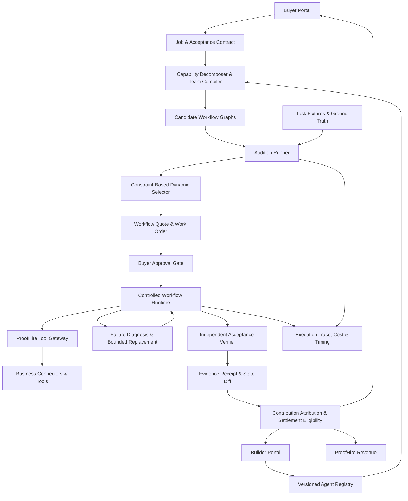

# PROOFHIRE
## Final Product & Hackathon Solution Blueprint

**Product name:** ProofHire  
**Product category:** Outcome-driven marketplace and execution layer for independently built AI capabilities  
**Product architecture:** Marketplace + Team Compiler + Verification & Execution  
**Initial market wedge:** Receiving and inventory reconciliation  
**Hackathon:** hackCBS 9.0 · 24-hour build  
**Document status:** Canonical product definition and prototype plan  
**Version:** 2.0 · 30 October 2026

---

# 1. Executive Summary

ProofHire is a marketplace where independent AI-agent developers monetize specialized capabilities and businesses purchase completed business outcomes.

A business posts a job describing the outcome it needs, the available inputs, acceptance conditions, budget, deadline and permitted actions. ProofHire converts that request into a structured contract, decomposes it into required capabilities, discovers compatible agents from independent developers, assembles candidate workflows and auditions those complete workflows against buyer-relevant tests.

The **Team Compiler** chooses the simplest, most cost-effective workflow that satisfies the buyer's quality, reliability, budget and risk constraints. That workflow may use one agent, several agents from different builders, deterministic software, a human checkpoint, or a combination of them.

After the buyer approves the proposed workflow and price, ProofHire coordinates execution. It detects invalid outputs and failed stages, attempts bounded retries or compatible replacements, and escalates to a human when safe recovery is not possible. An independent verification layer checks the final result against the agreed acceptance contract. Only after acceptance can the job be marked complete and the agreed builder payouts and platform fee become eligible for settlement.

Every execution produces a version-specific evidence receipt recording the workflow, contributing agents, checks, relevant state changes, costs, failures, recovery actions and final outcome. Successful work also contributes to the performance history of the agent versions that participated.

**The business is the marketplace. The Team Compiler is its intelligence. Verification and recovery are the trust infrastructure that make the marketplace commercially usable.**

## One-sentence pitch

> **ProofHire is a performance-driven marketplace where businesses buy verified outcomes from teams of independently built AI agents, while the Team Compiler discovers, auditions, assembles and repairs the most suitable workflow and attributes earnings to the builders who deliver it.**

## The core promise

Businesses should not have to discover, evaluate, integrate and debug every specialist themselves. Independent developers should be able to earn from a focused capability without having to build and sell an entire end-to-end product. ProofHire connects the two sides and makes the transaction measurable.

## What ProofHire is not

- It is not simply a directory of agents or an open bidding board.
- It is not just an agent orchestration framework.
- It is not an evaluator that sells scores but does not connect them to paid work.
- It does not assume multiple agents are always better.
- It does not promise that every workflow can be automated.
- It does not treat an agent's statement that a task is complete as proof of completion.
- It does not claim that a synthetic benchmark proves customer demand or production security.
- It does not execute consequential actions without the required permissions and human approvals.

---

# 2. The Problem

Businesses can increasingly access AI models, individual agents, workflow frameworks and integrations. However, completing a real business outcome often requires several different capabilities, tools, data sources and decisions.

A business may need to:

- Find the right specialists for a workflow.
- Determine whether one agent is enough or multiple capabilities are necessary.
- Evaluate whether an agent can handle the actual task rather than merely describe its capabilities.
- Connect agents built by different developers.
- Resolve incompatible input/output formats and incomplete handoffs.
- Control permissions and data access.
- Handle agent timeouts, invalid outputs, contradictory results and partial execution.
- Verify that the business system reached the correct final state.
- Decide how to compensate each contributor fairly.

The buyer currently has to perform much of this work through internal engineering, consultants, packaged products or manual agent orchestration.

The agent developer faces a different problem. A specialist may have a valuable document-extraction, reconciliation, research, coding or compliance capability but lack distribution, customer access and the resources to sell a complete solution.

ProofHire connects these problems.

## The failure ProofHire targets

A collection of individually capable agents may fail as a team because:

- Their schemas or assumptions are incompatible.
- A stage produces incomplete or misleading data.
- A downstream stage acts on an invalid result.
- A component fails halfway through execution.
- A replacement cannot satisfy the original stage contract.
- The workflow reports success even though the business state is wrong.
- The cost of coordination, retries and human intervention exceeds the value delivered.

A conversational response saying “Done” is not sufficient. The agreed business outcome must pass its acceptance checks.

---

# 3. The Three Interconnected Engines

ProofHire has three product engines. They are not separate products; each is necessary for the full marketplace.

## 3.1 Marketplace — the economic engine

Connects buyers with independent developers and specialist providers.

It manages:

- Buyer job posting and budgets.
- Builder registration and agent submissions.
- Capability listings and agent versions.
- Matching and availability.
- Commercial terms and work orders.
- Contribution attribution.
- Builder earnings and platform fees.
- Settlement eligibility and dispute records.
- Version-specific reputation and performance history.

The marketplace creates the economic incentive for developers to supply useful capabilities and for businesses to purchase them.

## 3.2 Team Compiler — the intelligence engine

Determines how a buyer's job should be completed.

It manages:

- Outcome and acceptance-contract interpretation.
- Capability decomposition.
- Agent discovery and matching.
- Candidate workflow generation.
- Interface and dependency compatibility.
- Team-level auditions.
- Quality, cost, latency and risk comparison.
- Selection of the cheapest qualifying workflow.
- Capability-gap detection.
- Compatible fallback selection and bounded replacement.

The compiler must be able to select one agent, several agents, deterministic code or a human checkpoint. It must not force multi-agent execution.

## 3.3 Verification & Execution — the trust engine

Makes the work inspectable, controlled and eligible for payment.

It manages:

- Scoped tool access and permissions.
- Controlled workflow execution.
- Stage-level validation and error handling.
- Retry limits, idempotency and side-effect controls.
- Human approval and escalation.
- Independent deterministic acceptance checks.
- Before/after state diffs.
- Execution traces and cost records.
- Evidence receipts.
- Settlement eligibility and dispute evidence.

**The marketplace creates the economic value. The compiler creates the selection advantage. Verification creates the trust needed for transactions.**

---

## 3.4 Core Architectural Concepts

To maintain conceptual integrity across the marketplace, compiler, and verification engine, ProofHire strictly separates six distinct concepts:

### A. Capability
A declared unit of functionality that can be required by a business workflow.
- **Examples:** Invoice extraction, purchase order interpretation, quantity reconciliation, exception reporting, repository analysis, code generation, test generation, test execution.
- **Provider neutrality:** A capability can be provided by one agent, multiple cooperating agents, a deterministic platform function, an existing business system connector, or a human checkpoint.
- **Rule:** *Do not treat every capability as an agent.* Capabilities represent *what* needs to be accomplished; agents are one way to implement them.

### B. Agent Package
The reusable, distributable software unit published by an independent developer. ProofHire treats an agent as a versioned, executable software package that provides one or more capabilities. A package contains:
- Agent identity and developer ownership metadata.
- Versioned executable implementation (the code that actually executes the task).
- Manifest declaring capabilities, dependencies, and author claims.
- Input and output schemas (strict JSON schemas validated at runtime).
- Configuration schema and default parameters.
- Required permissions, tools, and environmental access scopes.
- Runtime requirements (environment variables, container constraints).
- Evaluation suite and synthetic test cases.
- Version and dependency metadata.
- Pricing model (e.g. fixed paise per stage invocation, compute-adjusted).
- **Rule:** *The manifest alone is not the agent implementation.* An agent is not merely a prompt or manifest; its executable implementation performs the work.

### C. Agent Version
An immutable, uniquely identifiable release of an agent package (e.g., `1.0.0`, `1.1.0`).
- Performance, audit, and evaluation evidence belongs strictly to a specific version.
- Executions must record the exact version used so evaluation, recovery, provenance, and contribution attribution remain reproducible.

### D. Agent Instance
A configured, contextualized instance of a specific agent version bound to a particular business job or workflow step. It combines the reusable package implementation with:
- Business-specific configuration parameters.
- Allowed tools and connectors mediated by the ProofHire Tool Gateway.
- Approved permission scopes (read-only vs. read-write).
- Relevant business context (e.g. warehouse SKU taxonomy, invoice rules).
- Runtime constraints (timeouts, cost limits, concurrency bounds).

### E. Compiled Workflow
A versioned, acyclic execution graph composed of:
- Configured agent instances.
- Deterministic platform functions (e.g., math calculations, rule assertions).
- Business connector operations.
- Conditional branches, failure handling, and recovery steps.
- Human approval checkpoints for consequential side effects.
- **Rule:** *A workflow is not an agent package.* The Team Compiler assembles workflows; agents do not automatically construct the final workflow themselves.

### F. Execution
An actual execution run of a compiled workflow against authorized business input data.
- The runtime persists the exact workflow version, agent versions, instance configuration, tool permissions, stage execution traces, retries, verification results, and tamper-evident evidence receipts.

---

## 3.5 Two Agent Categories: Execution Agents and Creation Agents

ProofHire distinguishes between two fundamental categories of agent packages:

### Type 1: Execution Agent
An agent with an existing executable implementation that performs a declared operational task directly on input data.
- **Pattern:** Document/Data In $\rightarrow$ Existing Code Execution $\rightarrow$ Structured Output Out.
- **Example:** An Invoice Reader receives an invoice PDF or JSON, executes its extraction algorithm/model prompt, validates the output against its declared schema, and returns structured line items.
- **Property:** It delivers its capability without generating new application source code.
- **Role in MVP:** All worker agents in the Northstar receiving demonstration (`Evidence Reader`, `Reconciliation Specialist`, `Exception Reporter`) are Execution Agents.

### Type 2: Creation Agent
An agent capable of analyzing, producing, or modifying software artifacts to deliver requested functionality.
- **Pattern:** Requirements & Repository In $\rightarrow$ Workspace Analysis & Code Modification $\rightarrow$ Test Verification $\rightarrow$ Reviewed Code Artifact Out.
- **Examples:** Repository Analysis Agent, Software Engineering Agent, Test Generation Agent, Debugging/Repair Agent.
- **Workflow:**
  1. Connects to an authorized repository via restricted sandbox.
  2. Inspects architecture, existing tests, and dependencies.
  3. Generates or modifies code in a controlled workspace.
  4. Generates or updates automated tests.
  5. Executes test suites and static analysis tools.
  6. Reports failures and attempts bounded repair.
  7. Produces a reviewed code-change artifact or pull request for human sign-off.
- **Crucial Boundary:** *Generated business code is an output artifact; it does not automatically become a new marketplace agent package.* Publishing generated functionality as a reusable marketplace agent requires a separate, explicit packaging, schema validation, synthetic evaluation, and publishing process.
- **Product Roadmap:** Creation agents are part of ProofHire's longer-term engineering roadmap; they are intentionally excluded from the 24-hour Northstar receiving MVP.

---

---

# 4. Who Benefits and Why They Participate

## 4.1 Business buyers

**Job to be done:** “Complete this business workflow without requiring me to find, integrate, supervise and debug every specialist.”

Potential benefits:

- Access to capabilities from multiple independent providers.
- Less time spent evaluating and integrating agents.
- A workflow chosen against the buyer's own requirements.
- Transparent trade-offs between quality, cost, latency and human effort.
- Recovery when a specialist fails, within defined limits.
- Verifiable deliverables and a record of what actually happened.
- A payment condition tied to the agreed acceptance process.

What must be proven:

- Lower total cost per accepted outcome, better reliability, less human work, or another buyer-valued improvement.
- A meaningful advantage over the buyer's existing process or a strong single-agent alternative.
- Willingness to provide real workflow data and pay for a pilot or completed job.

## 4.2 Independent agent developers and specialist providers

**Job to be done:** “Let my agent compete for relevant paid work based on demonstrated capability, without requiring me to build the entire end-to-end product and sales channel.”

Potential benefits:

- Access to qualified business demand.
- Ability to sell a focused capability rather than a complete application.
- Standardized integration contracts.
- Transparent, comparable evaluation.
- Paid work attributed to actual contribution.
- Version-specific performance evidence and reputation.
- Feedback about failure patterns and opportunities to improve.
- Retention of ownership of their agent and source code under agreed licensing terms.

What must be proven:

- Developers can integrate their agents without excessive effort.
- Evaluation is transparent, reproducible and reasonably fair.
- The available jobs and payout justify participation costs.
- Builders receive paid opportunities and return for future work.

## 4.3 ProofHire

Potential revenue:

- A transaction fee or commission on completed jobs.
- Buyer subscriptions for team selection, evaluation, governance and monitoring.
- Evaluation or certification fees, provided the criteria are transparent and not misleading.
- A hybrid of buyer subscription/usage fees and marketplace transaction fees.

What must be proven:

- Positive contribution margin after all variable costs.
- Buyers repeat.
- Enough suitable builders participate.
- Buyer and builder acquisition costs are sustainable.
- Evaluation, support, recovery and dispute costs do not consume the platform's revenue.

## 4.4 Human specialists and operators

Some jobs require physical observation, authorization, judgment or exception handling. ProofHire can include a human checkpoint or specialist as a workflow participant.

Human compensation, waiting time, travel and intervention must be included in the true cost of the workflow. A human fallback is not a free or invisible resource.

---

# 5. The ProofHire Economic Flywheel

The intended marketplace loop is:

1. A business posts a structured job with requirements and a budget.
2. ProofHire identifies the capabilities required.
3. Independent developers supply eligible agents for those capabilities.
4. The compiler auditions candidate agents and complete workflow combinations.
5. The buyer approves a qualifying workflow and its commercial terms.
6. ProofHire coordinates execution and handles permitted recovery.
7. The verifier checks whether the agreed outcome was achieved.
8. Builder contributions and platform fees are calculated.
9. Payouts become eligible for settlement under the job's terms.
10. Builders receive version-specific performance evidence and reputation.
11. A successful buyer can return with more jobs.

The flywheel hypothesis:

**More buyer demand → more paid opportunities → more builders → broader and more competitive capabilities → better candidate selection → more buyer value → repeat demand.**

This flywheel is a hypothesis, not an automatic network effect. It only works if there is real buyer demand, sufficient supply quality and attractive transaction economics.

## Why ProofHire should not start with unrestricted bidding

An open board can attract irrelevant proposals, automated spam and low-quality submissions. It can also make buyers responsible for evaluating the very providers they came to the platform to discover.

The initial model should be a **curated, capability-based marketplace**:

- Builders register declared capabilities and agent versions.
- The compiler filters candidates against the job's requirements.
- Eligible agents are auditioned through comparable tests.
- Buyers see qualified workflows and the evidence behind them.
- Developers compete through demonstrated performance, price and availability—not proposal volume alone.

This does not eliminate competition. It makes competition more useful to the buyer.

---

# 6. Complete Product Lifecycle

## Stage 0 — Builder onboarding and agent registration

A developer creates a builder profile and submits an agent or specialist capability.

A registration contains:

- Builder identity and contact.
- Agent name and version.
- Declared capabilities and supported task categories.
- Input and output schemas.
- Required tools and permissions.
- Runtime and integration requirements.
- Pricing model or cost estimate.
- Expected latency and availability.
- Known limitations.
- License and usage terms.
- Endpoint or adapter configuration.
- Evaluation history for that version.

The developer retains ownership of their implementation. ProofHire receives only the execution and evaluation rights explicitly agreed in the listing and contract.

A version change creates a new version record. Performance evidence for one version must not silently transfer to a materially different version.

**Hackathon scope:** Use a small curated registry of seeded independent-builder profiles and actual callable candidate implementations. Clearly label seeded profiles as demo participants.

## Stage 1 — Buyer creates a job

The buyer specifies:

- Desired business outcome.
- Input documents, data or system references.
- Required deliverables.
- Acceptance conditions.
- Budget and deadline.
- Risk level.
- Permitted tools and data scopes.
- Actions that require human approval.
- Any builder, provider or licensing restrictions.

The job should describe an outcome, not prescribe a multi-agent architecture. ProofHire determines whether one agent, multiple agents, deterministic software or human work is appropriate.

## Stage 2 — Acceptance Contract Compiler

ProofHire converts the request into a structured, inspectable contract.

The contract contains:

- Objective and expected outputs.
- Required capabilities.
- Stage-level input/output schemas.
- Dependencies.
- Deterministic acceptance checks.
- Failure conditions.
- Budget and latency limits.
- Allowed tools, permissions and side effects.
- Human approval rules.
- Evidence required for completion.

Ambiguity must be surfaced. The system should ask the buyer to approve unclear business rules rather than inventing them.

For example, if a buyer says “reconcile the shipment,” the system must clarify which source is authoritative when the purchase order, invoice and receiving count disagree.

## Stage 3 — Capability decomposition

The compiler maps the job to the smallest useful set of capabilities.

For the receiving example:

- Document extraction.
- Physical receiving evidence capture.
- Identifier and quantity reconciliation.
- Policy validation.
- Exception reporting.
- Human approval if a consequential inventory correction is required.

A capability can be supplied by an independent agent, deterministic function, existing integration or human operator.

## Stage 4 — Agent discovery and matching

ProofHire searches the versioned agent registry.

It checks:

- Capability coverage.
- Declared and previously observed task compatibility.
- Input/output schema compatibility.
- Required tool and permission fit.
- Availability.
- Price and estimated execution cost.
- Expected latency.
- Known failure patterns.
- Contract and licensing restrictions.

A candidate that cannot safely or technically satisfy a required stage is excluded or marked as a capability gap.

## Stage 5 — Candidate workflow generation

The compiler creates a bounded set of valid workflow candidates.

Examples:

- One strong agent handles the complete job.
- An extraction agent feeds a deterministic reconciliation function.
- Three independent specialists handle extraction, reconciliation and reporting.
- An agent performs analysis while a human approves a consequential action.

Each candidate must satisfy dependency and interface rules before it is auditioned.

## Stage 6 — Team audition and dynamic selection

The Team Compiler tests candidate workflows against comparable buyer-relevant synthetic test cases.

### The 9-Step Compiler Pipeline
The business submits an outcome request and constraints. The compiler:
1. **Decomposes** the requested business outcome into required capabilities.
2. **Queries** the versioned Agent/Capability Registry for candidate implementations.
3. **Identifies** suitable agent packages, deterministic platform functions, and business connectors.
4. **Generates** candidate workflow graphs (single-agent, hybrid, or multi-agent; multi-agent is not mandatory).
5. **Configures** candidate agent instances with job-specific parameters and tool permission scopes.
6. **Checks** schemas, dependencies, permissions, compatibility, budget, and execution limits.
7. **Auditions** candidates on comparable synthetic fixtures (`wh204-suite-v1`).
8. **Rejects** candidates that fail critical acceptance constraints (e.g. quantity mismatch, schema corruption).
9. **Selects** a qualifying workflow dynamically based on observed accuracy, cost, latency, recovery, and human intervention.

### Evaluation Differences by Agent Category
Evaluation criteria must reflect the agent package category:
- **Execution Agents:** Capability correctness, input/output schema compliance, data extraction accuracy, operational reliability, compute cost, latency, and tool permission compliance.
- **Creation Agents:** Generated code correctness, automated test pass rate, preservation of existing application behavior (no regressions), static analysis and security vulnerability checks, authorized scope compliance, and clean, reviewable output artifacts (diffs / pull requests).
- **Workflow-Level Evaluations:** End-to-end integration across nodes, bounded failure recovery, final acceptance contract verification, and side-effect safety (e.g. inventory ledger non-mutation).
- **Synthetic Test Boundaries:** Synthetic audition tests provide empirical evidence against defined test cases; they do not guarantee perfection across all real-world edge cases.

Audition cases should include:
- Normal inputs.
- Missing and malformed data.
- Duplicate records.
- Contradictory evidence.
- Schema violations.
- Agent timeouts.
- Invalid tool results.
- Selected malicious or misleading inputs.
- Policy-boundary cases.

The evaluator uses deterministic assertions wherever possible. LLM-based qualitative assessment can supplement checks but should not be the sole source of truth for critical acceptance conditions.

**Selection rule:**
1. Reject any candidate that fails a critical safety or quality requirement.
2. Reject candidates that violate permissions, interface contracts, budget or deadline constraints.
3. Compare the remaining candidates on observed quality, total cost, latency, recovery behavior and human intervention.
4. Dynamically select the least costly qualifying workflow that meets the buyer's required thresholds and risk constraints (Candidate A, B, or C can qualify based on audition measurements).
5. If none qualifies, report the capability gap and offer alternatives.

A higher composite score must never compensate for a critical safety violation.

Audition evidence must be versioned with the test suite, agent versions, configuration and execution conditions. A score is evidence under those conditions, not a guarantee of future production success.

## Stage 7 — Buyer approval and commercial work order

Before execution, the buyer sees:

- Proposed workflow graph.
- Participating builders and agent versions.
- Expected deliverables.
- Audition evidence and limitations.
- Price and cost breakdown.
- Proposed builder payout allocation.
- ProofHire fee.
- Execution and recovery limits.
- Required human checkpoints.
- Acceptance and dispute terms.

The buyer approves the work order. No consequential production side effect occurs merely because an agent was selected.

## Stage 8 — Controlled execution

The runtime executes the approved workflow.

Every stage has:

- A stage contract.
- A specific agent version or deterministic function.
- Scoped inputs and permissions.
- A timeout and retry policy.
- An execution status.
- Input/output references.
- Cost and latency measurement.
- Trace and error records.

Untrusted agents should not receive broad production access. The platform should enforce permissions at the tool/API boundary rather than trusting natural-language instructions.

## Stage 9 — Failure detection and bounded recovery

When a stage fails:

1. Detect and classify the failure.
2. Preserve the relevant input, output and error evidence.
3. Determine whether retry, repair, replacement or human escalation is permitted.
4. Select a replacement that satisfies the same required contract and permission constraints.
5. Rerun the failed stage and only the necessary downstream stages.
6. Enforce retry, time, cost and replacement limits.
7. Prevent duplicate side effects through idempotency and state tracking.
8. Re-run the final acceptance checks.

A replacement must not inherit permissions it does not need.

If no compatible replacement exists, ProofHire should stop safely and report the gap. It must not pretend the job succeeded.

## Stage 10 — Independent verification and outcome receipt

The verifier checks the delivered result against the approved contract.

The receipt records:

- Job and contract version.
- Buyer and participating builder references.
- Agent identities and versions.
- Selected workflow graph.
- Test and execution conditions.
- Stage statuses and relevant traces.
- Acceptance checks passed and failed.
- Before/after state diff.
- Cost, latency, retries and human intervention.
- Recovery and replacement events.
- Final outcome and approval status.
- Integrity hash or signature where implemented.

A hash or signature can make subsequent changes detectable. It does not prove that the original data, observations or checks were truthful.

## Stage 11 — Contribution attribution and settlement eligibility

The platform calculates the allocation defined in the approved work order.

Attribution should be based on transparent, agreed rules such as:

- Which contracted stage a builder supplied.
- Whether that stage passed its required checks.
- Whether the output was used in the accepted result.
- Agreed fixed or variable stage pricing.
- Any defined failure, cancellation or dispute rules.

Do not use an arbitrary AI-generated percentage to divide money. Buyers and builders should see the allocation rules before execution.

After acceptance and any required dispute/approval window, the transaction becomes eligible for settlement through an appropriate payment provider. Real escrow or automatic payouts are not part of the hackathon prototype unless genuinely integrated.

Successful work updates the participating agent versions' performance histories.

---

# 7. The Signature Differentiator

## Buyer-specific team auditions + cost-aware compilation + bounded recovery + paid contribution attribution

A conventional marketplace helps buyers discover providers. A workflow framework helps developers connect components. An evaluator measures performance.

ProofHire's hypothesis is that businesses need these capabilities connected in one commercial process:

1. Discover independent specialist capabilities.
2. Test the complete candidate workflow for a particular job.
3. Select the least costly workflow that satisfies hard quality and risk requirements.
4. Execute under a buyer-approved work order.
5. Recover from compatible component failures.
6. Verify the final outcome independently.
7. Attribute work and compensation to the contributors.
8. Build version-specific reputation from evidence.

The differentiation is the integrated buyer-to-builder transaction, not any single feature in isolation.

## What makes the audition meaningful

Testing an agent alone is insufficient when the buyer is purchasing a team outcome. A candidate combination can fail because its handoffs, schemas, dependencies or permissions are incompatible.

ProofHire therefore evaluates both:

- **Individual capability fitness:** can this agent complete its declared stage?
- **Composition fitness:** can the complete workflow exchange valid information and produce the buyer's required result?

Private held-out tests should be used where practical to reduce simple benchmark memorization. Evaluation criteria should be disclosed enough to be fair, while not publishing every private test input.

## Capability-gap resolution

If no suitable agent exists for a required stage, ProofHire should offer one of four honest outcomes:

1. **Alternative composition:** use a different combination of existing capabilities.
2. **Developer opportunity:** publish a capability request or bounty with clear requirements and acceptance tests.
3. **Human specialist:** assign an approved human operator or reviewer.
4. **Infeasible status:** explain what is missing and what would be needed.

The platform must not claim that it can automatically create any missing capability.

---

# 8. Initial Market Wedge: Receiving and Inventory Reconciliation

## Why this is the hackathon demonstration

Receiving and reconciliation creates a concrete, inspectable business outcome. It connects documents, physical evidence and a business-system state. The correctness conditions are simple enough to verify independently, while the workflow can still involve multiple specialist capabilities.

It also creates an impressive physical demonstration without requiring a robot or custom hardware.

## The scenario

A warehouse receives a shipment.

| Evidence source | Quantity |
|---|---:|
| Purchase order | 12 units |
| Supplier invoice | 12 units |
| Physical receiving scan | 10 units |
| Correct recorded physical quantity | **10 units** |
| Unresolved discrepancy | **2 units** |

The system must not mark 12 units as physically received merely because the invoice says 12.

## Physical demo setup

Prepare:

- Twelve small objects, cards or packages representing expected units.
- A purchase order fixture stating 12.
- An invoice fixture stating 12.
- Ten physical objects with QR/barcode labels, or a pre-recorded receiving scan showing ten.
- A receiving interface that records the ten scanned units.
- A simulated inventory ledger with a visible before/after state.

The audience should be able to see the mismatch, not merely hear about it.

If camera scanning is unreliable under venue lighting or time pressure, use a prepared scan manifest and manually scan or enter a few labels live. Clearly describe the input as a controlled physical-receiving fixture.

## Candidate specialist agents

Use real callable implementations or adapters, not decorative profile cards.

| Candidate | Builder profile | Capability |
|---|---|---|
| Evidence Reader | Builder A | Extracts PO, invoice and scan data |
| Reconciliation Specialist | Builder B | Matches SKUs, quantities and identifiers |
| Policy Checker | Builder C | Checks whether the proposed update is justified |
| Exception Reporter | Builder D | Generates a discrepancy report with evidence |
| Fallback Reconciler | Builder E | Compatible replacement for a selected stage |

The initial registry may be seeded for the demo. Label it as a curated demonstration pool; do not claim these are real third-party marketplace customers unless they are.

## Workflow

1. Read the purchase order.
2. Read the invoice.
3. ingest the physical receiving scan.
4. Normalize identifiers and quantities.
5. Reconcile expected, invoiced and physically received quantities.
6. Apply policy checks.
7. Generate a discrepancy report.
8. Prepare a proposed inventory-state change.
9. Verify the proposal.
10. Require human approval for any consequential inventory commit.

## Acceptance contract

The job passes only when:

- The recorded received quantity matches the physical scan evidence.
- The mismatch is identified.
- The discrepancy amount is correct.
- No unsupported quantity is marked as received.
- The report identifies the evidence supporting the discrepancy.
- The before/after diff is visible.
- Every required assertion passes.
- Any approval-required action remains pending until approved.

Expected outcome:

- Expected: 12
- Invoiced: 12
- Physically received: 10
- Discrepancy: 2
- Result: `EXCEPTION — HUMAN REVIEW REQUIRED`
- Inventory commit: blocked until approval

This is not merely an agent producing a correct sentence. The final state must reflect the correct quantity and approval boundary.

---

# 9. The Impressive Hackathon Demo

## Demo thesis

**“Watch ProofHire turn a business job into paid specialist work, recover when a specialist fails, and prove that the outcome is correct before settlement.”**

The demo must show all three engines:

- Marketplace: independent builders and their earning opportunity.
- Team Compiler: selection and replacement of agents.
- Trust engine: independent verification and settlement eligibility.

## 9.1 Three-minute judge presentation

### 0:00–0:25 — The physical problem

Show the 12 expected objects, the invoice for 12 and the 10 received/scan-confirmed objects.

Pitch:

> “The invoice says 12. The warehouse physically received 10. A normal automation can confidently update the system incorrectly. A business doesn't need another agent saying ‘Done’. It needs the right capability, verified against what actually happened.”

### 0:25–0:50 — Post a paid business job

Open the buyer interface.

Show:

- Job: reconcile incoming shipment.
- Budget: a clearly labelled demo budget.
- Deadline.
- Inputs.
- Acceptance criteria.
- Human approval requirement.

The platform compiles the request into a structured contract and identifies the required capabilities.

### 0:50–1:15 — Show the independent builder economy

Open the specialist registry.

Show independent builder profiles, capabilities, agent versions, indicative prices and previous demo evaluation evidence.

The buyer is not choosing from random text bids. ProofHire is matching declared capabilities to the job.

Show candidate agents and their commercial contribution terms.

### 1:15–1:40 — Audition and compile the workflow

Show three approaches side by side:

- **A — Single-agent baseline:** one capable agent attempts the entire job.
- **B — Fixed team:** a manually configured specialist workflow.
- **C — ProofHire:** compiler generates and auditions candidate workflows, then selects the least costly candidate that passes the required checks.

Show the actual audition outcomes and why the selected configuration qualified.

Do not invent benchmark scores. Use measured results from the running implementation.

### 1:40–2:15 — The failure and replacement moment

Inject a controlled failure into the selected reconciliation specialist.

For example, make its first version return a malformed quantity schema or a controlled timeout.

Show:

1. The stage turns to `FAILED`.
2. ProofHire captures the failure.
3. The workflow identifies the failed contract.
4. The registry finds an eligible replacement.
5. The replacement passes the required compatibility check.
6. ProofHire reruns the failed stage and required downstream stages.

Make the replacement visible in the workflow graph. Show that the original evidence is preserved.

If no compatible replacement passes, the system must show a safe failure/escalation instead.

### 2:15–2:40 — Independent verification

Show the actual final state:

- PO: 12
- Invoice: 12
- Receiving: 10
- Discrepancy: 2
- Status: human review required
- Unsupported inventory update: blocked

Run deterministic assertions and show their results.

Display the evidence receipt, stage trace, costs, retries and before/after diff.

### 2:40–3:00 — The economic loop

Show the transaction breakdown:

- Buyer budget/payment amount.
- Builder A's contracted contribution.
- Builder B's contracted contribution.
- Builder C's contracted contribution.
- ProofHire fee.
- Execution/recovery costs.
- Settlement eligibility.

Show agent-version reputation being updated only from recorded execution evidence.

Pitch:

> “The business gets a verified outcome. Independent developers earn from the capabilities they contribute. ProofHire earns by matching, evaluating and coordinating the work. Verification connects the economic transaction to the actual result.”

## 9.2 The signature “wow” sequence

The strongest moment is not an animated workflow or a high agent score.

It is this sequence:

**Business job posted → independent specialists matched → full workflow auditioned → selected specialist fails → compatible builder's agent replaces it → final state independently verified → contributor earnings calculated.**

This demonstrates the marketplace, compiler, recovery and trust layers in one story.

## 9.3 Demo authenticity rules

Every visible result must be classified correctly:

| Element | Demo status |
|---|---|
| Buyer job | Real interaction in prototype |
| Builder profiles | Seeded demo profiles unless actual builders participate |
| Candidate agents | Actual callable implementations/adapters |
| Audition results | Actual recorded executions |
| Injected failure | Controlled and explicitly labelled |
| Replacement | Actual fallback execution |
| Acceptance checks | Real deterministic code |
| Inventory system | Simulated ledger; no real warehouse system mutation |
| Payout split | Calculated from demo contract |
| Payment settlement | Simulated unless a real provider is integrated |
| Reputation | Updated from demo execution records; not a validated public rating |

Do not represent seeded profiles, simulated money or controlled benchmark conditions as real market adoption or production transactions.

---

# 10. Scope Boundaries: Hackathon MVP vs. Future Platform Capabilities

To prevent scope creep and maintain strict development focus, ProofHire explicitly separates its 24-hour hackathon MVP from its near-term evolution and long-term platform capabilities.

## 10.1 Hackathon MVP Scope (24-Hour Deliverable)

### Must build
1. **Buyer job form:** outcome, inputs, budget, deadline, acceptance criteria and allowed actions.
2. **Acceptance contract preview:** structured checks and ambiguity warnings.
3. **Builder/agent registry:** versioned Execution Agent packages with capabilities, schemas, permissions and pricing.
4. **Capability matcher:** match required stages to eligible candidate agents, deterministic functions, and human checkpoints.
5. **Workflow candidate generator:** create a bounded set of valid single-agent, hybrid, and multi-agent workflows.
6. **Audition runner:** execute 10 synthetic fixtures (`wh204-suite-v1`) against each candidate.
7. **Workflow selector:** reject candidates failing hard constraints and dynamically select the qualifying workflow.
8. **Execution engine:** run the selected workflow via QStash durable step webhooks and record stage state.
9. **Failure/replacement path:** inject one controlled failure (`AGENT_SCHEMA_INVALID`) and substitute a compatible agent (`v1.1.0`).
10. **Independent verifier:** deterministic acceptance checks against final output/state, independently checking the 42→42 inventory invariant.
11. **Contribution and economics ledger:** calculate builder allocations (₹5,500), platform fees (₹2,500), and reserves (₹1,200/₹800).
12. **Evidence receipt:** tamper-evident SHA-256 hash over selected agents, versions, checks, state diff, costs, errors and outcome.
13. **Polished end-to-end demo:** receiving and inventory reconciliation (Northstar Warehouse WH-204).

### Should build if time permits
- Buyer and builder dashboard views.
- Agent version comparison timeline.
- Capability-gap request form.
- Human-review queue interface.
- Receipt JSON/Markdown export.
- Adversarial negative test suite (`N-01` through `N-10`).
- Visual compiler candidate graph.

### Simulate honestly (with clear badges)
- Public developer onboarding at scale (use seeded Jordan Lee / Demo Agent Studio).
- Real payment settlement and escrow (`ELIGIBLE_SIMULATED`, `provider: null`).
- Real production warehouse inventory update (42 → 42 simulated ledger invariant; commit blocked).
- External model API dependency (hybrid adapter with deterministic fallback on timeout).

## 10.2 Future Product Capabilities (Near-Term & Long-Term Roadmap)

The following capabilities are central to ProofHire's commercial vision but are **strictly deferred** beyond the 24-hour MVP:

### Near-term product evolution
- **Public developer onboarding & validation:** Self-serve developer portal with automated static analysis and dynamic security scanning of submitted packages.
- **Agent package upload & sandboxed runtime:** Uploading arbitrary packages running inside isolated microVM / gVisor sandboxes with strict memory/CPU limits and egress firewalls.
- **Builder-hosted agent endpoints:** Protocol for developers to host their own secure webhook endpoints conforming to the ProofHire Agent Protocol.
- **Production business connectors:** Read/write connectors for major ERP, CRM, and WMS platforms (NetSuite, SAP, Salesforce) mediated by the ProofHire Tool Gateway.
- **Credential vault & rotation:** Secure KMS-backed enterprise credential storage with per-execution scoped tokens and automatic secret rotation.

### Long-term platform capabilities
- **Customer-hosted agent packages:** Allowing enterprise customers to execute agents entirely within their private cloud VPC or on-premises infrastructure.
- **Creation Agents (Software Engineering Workflows):** Agents that inspect authorized codebases, generate/modify application code, generate unit/integration tests, and open verified pull requests in GitHub/GitLab.
- **Decentralized receipt anchoring:** Anchoring tamper-evident receipt hashes to public timestamping authorities or distributed ledgers for external cryptographic non-repudiation.
- **Dynamic cross-version reputation & insurance:** Actuarial reliability underwriting based on long-term execution histories.

---

# 11. Technical Architecture

## 11.1 Logical architecture



## 11.2 Core services

- **Buyer/job service:** job lifecycle, budgets, deadlines and risk.
- **Contract service:** acceptance criteria, schemas, permissions and approvals.
- **Builder service:** builder profiles, terms, payout destination metadata and ownership.
- **Agent registry:** capability manifests, package versions, adapters and evaluation history.
- **Compiler:** capability decomposition, candidate composition and compatibility.
- **Audition service:** test fixtures, candidate execution and deterministic grading.
- **Selector:** hard-constraint filtering and cost/quality/risk dynamic ranking.
- **Marketplace/work-order service:** quotes, buyer approvals, contract and commercial terms.
- **Workflow runtime:** scheduling, stage state, timeouts, retries and idempotency.
- **Tool Gateway:** operation-level authorization, credential protection, and audit logging.
- **Recovery service:** diagnosis, compatible replacement and human escalation.
- **Verifier:** final checks, policy gates and acceptance decision.
- **Economics service:** contribution attribution, platform fee and settlement eligibility.
- **Evidence service:** execution traces, state diffs, costs, versions and receipt export.

## 11.3 Agreed Serverless Stack

The ProofHire architecture utilizes a modern, serverless stack designed for high reliability and zero local filesystem dependencies:

- **Frontend & App Framework:** Next.js 15 App Router, React 19, strict TypeScript.
- **Database & ORM:** Neon PostgreSQL with Prisma 7, utilizing `@prisma/adapter-neon` and `@neondatabase/serverless`. Configured with pooled connection string (`DATABASE_URL`, with `?sslmode=require`) for runtime queries and direct connection (`DIRECT_URL`) for migrations.
- **Background Orchestration:** Upstash QStash (`@upstash/qstash`) for durable asynchronous execution step progression, dispatching signed webhook events to `/api/webhooks/qstash/execution-step`.
- **Validation:** Zod for runtime schema validation across API envelopes, agent manifests, contracts, and stage I/O.
- **Hosting & Compute:** Vercel serverless deployment.
- **Integrity & Trust:** In-process SHA-256 canonical receipt hashing (`RECEIPT_BODY_V1`).
- **Agent Adapters:** Typed TypeScript interfaces wrapping callable hybrid model-backed capabilities (Gemini/OpenAI) with deterministic local fallback logic.

## 11.4 Where Executable Agent Code Resides

The product architecture supports three distinct deployment models for executable agent code:

1. **Platform-Hosted Packages:** ProofHire hosts and operates the execution runtime.
2. **Builder-Hosted Packages:** Developers maintain their own hosted agent endpoints, invoked by ProofHire over authenticated webhooks.
3. **Customer-Hosted Packages:** Agents execute within a business-controlled private cloud (VPC) or on-premises environment.

**Hackathon MVP Implementation:**
The 24-hour MVP exclusively uses **curated, platform-hosted callable adapters**. Implementation code resides directly within the ProofHire codebase (`src/server/agents/**`). The registry stores package metadata, capability declarations, and references to these executable implementations.

> [!IMPORTANT]
> The hackathon MVP does **not** allow developers to upload and execute arbitrary third-party code. Supporting arbitrary public executable uploads is a major future capability requiring isolated container/microVM runtimes (e.g. gVisor, Firecracker), strict CPU/memory limits, egress network firewalls, secret isolation, and automated package lifecycle management.

## 11.5 Business-System Integration Architecture

ProofHire strictly separates two integration scenarios:

### Scenario A: Use Existing Business Data and Systems (Operational Workflows)
When an Execution Agent requires access to business records (e.g., invoices, purchase orders, inventory counts, customer records):

$$\text{Business System} \longrightarrow \text{Business Connector} \longrightarrow \mathbf{ProofHire\ Tool\ Gateway} \longrightarrow \text{Workflow Runtime} \longrightarrow \text{Agent Instance}$$

The **ProofHire Tool Gateway** mediates all external access:
- **Business-authorized integrations:** Connections are explicitly authorized by the business buyer.
- **Narrow tool scopes:** Agents receive least-privilege tool definitions rather than broad API keys.
- **Credential protection:** Agents *never* receive raw database credentials, production connection strings, or unrestricted API tokens.
- **Input/output validation:** The Tool Gateway enforces strict schema validation on all inputs to and outputs from business tools.
- **Operation-level authorization:** Every individual call is checked against the work order's approved permission scope.
- **Read vs. write separation:** Read actions execute within approved limits; write operations (especially consequential state changes like inventory commitments or payment releases) require explicit human approval checkpoints.
- **Audit logging:** Every invocation, payload hash, and latency measurement is appended to the execution trace.

### Scenario B: Modify an Existing Business Codebase (Creation Agent Workflows)
When a future Creation Agent is contracted to modify or add functionality to an existing business application:

$$\text{Authorized Repository} \longrightarrow \text{Restricted Workspace} \longrightarrow \text{Repo Analysis} \longrightarrow \text{Code Gen} \longrightarrow \text{Test Execution} \longrightarrow \text{Verification} \longrightarrow \text{Pull Request} \longrightarrow \text{Human Review}$$

- **Restricted Workspace Sandbox:** The agent clones the authorized branch into an ephemeral, isolated workspace with no access to production infrastructure or secrets.
- **Repository Analysis:** Understands existing architecture, conventions, and test harnesses.
- **Code & Test Generation:** Generates proposed modifications and accompanying test suites.
- **Automated Verification:** Executes existing and new tests, static analysis, and security scanners.
- **Controlled Deliverable:** The workflow produces a clean **Pull Request / Code-Change Artifact** for human review. It *never* directly mutates production or deploys code without human authorization.
- **Distinction:** This is entirely different from a data-processing workflow and is **not** part of the Northstar receiving demo.

## 11.6 Example Agent Package, Version, and Adapter Contract

```ts
import { z } from "zod";

// Capability Key Enum
export type CapabilityKey =
  | "document_evidence_extraction"
  | "quantity_reconciliation"
  | "policy_validation"
  | "exception_reporting"
  | "inventory_proposal"
  | "human_approval"
  | "repository_analysis"
  | "code_generation"
  | "test_generation"
  | "test_execution";

// Reusable Agent Package metadata
export interface AgentPackage {
  packageId: string;
  builderId: string;
  name: string;
  description: string;
  category: "EXECUTION" | "CREATION";
  deploymentModel: "PLATFORM_HOSTED" | "BUILDER_HOSTED" | "CUSTOMER_HOSTED";
  capabilities: CapabilityKey[];
  isSeeded: boolean;
  createdAt: string;
}

// Immutable Agent Version
export interface AgentVersion {
  versionId: string;
  packageId: string;
  version: string; // e.g. "1.0.0"
  status: "DRAFT" | "ACTIVE" | "DEPRECATED";
  inputSchemaId: string;
  outputSchemaId: string;
  configSchemaJson?: Record<string, unknown>;
  requiredPermissions: string[];
  pricePaise: number;
  estimatedLatencyMs: number;
  fallbackVersionIds: string[];
  runtimeAdapter: string;
  runtimeMode: "HYBRID" | "DETERMINISTIC_RULES" | "FALLBACK";
}

// Contextualized Agent Instance Configuration
export interface AgentInstanceConfig {
  instanceId: string;
  jobId: string;
  versionId: string;
  stageKey: CapabilityKey;
  businessConfig: Record<string, unknown>;
  allowedTools: string[];
  permissionScope: "READ_ONLY" | "READ_WRITE_STAGED";
  timeoutMs: number;
  maxCostPaise: number;
}

// Execution Result Contract
export interface AgentExecutionResult<T> {
  status: "SUCCESS" | "FAILED";
  output?: T;
  rawOutput?: unknown;
  errorCode?: string;
  errorMessage?: string;
  costPaise: number;
  latencyMs: number;
  traceRef: string;
}

// Typed Agent Adapter Interface
export interface AgentAdapter<TInput, TOutput> {
  package: AgentPackage;
  version: AgentVersion;

  execute(
    input: TInput,
    instanceConfig: AgentInstanceConfig
  ): Promise<AgentExecutionResult<TOutput>>;

  validateInput(input: unknown): input is TInput;
  validateOutput(output: unknown): output is TOutput;
  healthCheck(): Promise<{ ok: boolean; message?: string }>;
}
```

## 11.7 Important Conceptual Data Entities vs. Hackathon Persistence

To prevent over-engineering while establishing clean domain abstractions, ProofHire separates conceptual entities from concrete hackathon tables:

| Entity | Conceptual Role | Hackathon MVP Persistence | Future Scope |
|---|---|---|---|
| `AgentPackage` | Reusable software package | Folded into `Agent` table | Full package publishing & artifact storage |
| `AgentVersion` | Immutable version release | Persisted in `AgentVersion` table | Multi-region binary distribution |
| `Capability` | Declared functional requirement | Persisted in `Capability` table | Dynamic semantic capability ontology |
| `AgentInstance` | Configured version for a job | Materialized in `CandidateStage` & `StageRun` | Dynamic container instance lifecycle |
| `CompiledWorkflow` | Acyclic execution plan | Persisted as `WorkflowCandidate` | Cross-organization workflow templates |
| `ToolPermission` | Operation-level security scope | Enforced via Tool Gateway in runtime code | Granular RBAC / OAuth2 token vault |
| `BusinessIntegration`| External system connection | Simulated local fixtures (`scan`, `po`, `inv`) | Production ERP/WMS OAuth connectors |
| `Execution` | Commercial job execution | Persisted in `ExecutionRun` table | Distributed multi-tenant execution queue |
| `EvidenceReceipt` | Tamper-evident verified record | Persisted in `EvidenceReceipt` table | Decentralized public anchor |
| `ContributionRecord`| Builder stage compensation | Persisted in `ContributionRecord` table | Real bank / Stripe escrow transfer |

---

# 12. Workflow Selection and Fair Evaluation

## 12.1 Hard constraints first

Reject a candidate workflow if it:

- Fails a critical acceptance check.
- Violates required permissions or policy.
- Has incompatible stage schemas.
- Cannot cover every required capability.
- Exceeds a hard budget or deadline.
- Cannot provide required evidence.
- Has no safe recovery or escalation path for a critical stage.

## 12.2 Rank eligible candidates

Compare:

- Observed task acceptance rate.
- Critical error and policy-violation rate.
- Total cost, including auditions and retries where applicable.
- End-to-end latency.
- Human intervention time.
- Recovery success under defined failure cases.
- Builder commercial terms.
- Operational constraints.

Do not let a high average score compensate for a critical safety violation.

## 12.3 Fair comparison principles

- Give all approaches equivalent task information and permission boundaries.
- Use the same ground truth and test variants.
- Use comparable model/compute budgets, or disclose differences.
- Include a strong single-agent baseline.
- Include a fixed-team baseline.
- Include deterministic code where it is a reasonable alternative.
- Separate tuning tests from held-out verification cases.
- Record exact versions, prompts/configuration, test fixtures and trial count.
- Report failures and uncertainty, not only the best run.

---

# 13. Trust, Security and Reliability

ProofHire coordinates independent agents. Their output, code, tools and external content must be treated as untrusted.

## 13.1 Security controls

- Least-privilege access for every stage.
- Tenant isolation at the data and API layers.
- No unnecessary sharing of secrets between agents.
- Short-lived, scoped credentials where supported.
- Tool/API permission enforcement outside the agent's natural-language instructions.
- Treat documents, web pages, emails and agent outputs as untrusted input.
- Separate audition environments from production systems.
- Restrict network and filesystem access for untrusted code.
- Human approval for consequential, irreversible, financial or physical actions.
- Minimize retention of sensitive data.
- Record sensitive actions and access decisions.
- Do not allow a replacement agent to inherit excessive permissions.

## 13.2 Reliability controls

- Schema-validate every inter-agent handoff.
- Use timeouts and bounded retries.
- Track stage state durably.
- Use idempotency keys before retrying side effects.
- Track partial completion and commit state.
- Detect duplicate events.
- Enforce maximum execution cost and replacement count.
- Preserve the original failure evidence.
- Verify final state independently.
- Stop safely when no compatible recovery exists.

## 13.3 Hackathon test matrix

| Test | Injected condition | Expected behavior |
|---|---|---|
| Invalid output | Malformed JSON/schema | Reject stage output |
| Timeout | Candidate does not respond | Time out and apply recovery policy |
| Contradiction | Two agents disagree | Flag conflict; do not guess |
| Duplicate event | Same event delivered twice | Avoid duplicate side effect |
| Missing evidence | Required scan record absent | Request evidence or escalate |
| Prompt injection | Malicious instruction in document | Treat content as untrusted |
| Permission violation | Agent requests forbidden action | Block at tool boundary |
| Replacement mismatch | Fallback has incompatible schema | Reject fallback |
| Partial execution | Runtime interrupted after a stage | Resume safely or escalate |
| False completion | Agent says done but state is wrong | Final acceptance must fail |

Passing this prototype test matrix does not establish enterprise-grade security or prove that all production threats are covered.

---

# 14. Marketplace Economics

## 14.1 Transaction model

A buyer agrees to a total price. The work order defines:

- Builder/stage compensation.
- ProofHire fee.
- Execution and recovery budget.
- Human specialist costs if applicable.
- Acceptance conditions.
- Cancellation and dispute rules.
- Settlement timing and payment provider.

Payout allocation should be agreed before execution.

### Illustrative example only

Suppose the buyer's approved job value is ₹10,000.

| Allocation | Amount |
|---|---:|
| Evidence-processing builder | ₹2,000 |
| Reconciliation builder | ₹2,500 |
| Policy/verification builder | ₹1,500 |
| Exception-reporting builder | ₹1,000 |
| ProofHire platform fee | ₹2,000 |
| Execution/recovery reserve | ₹1,000 |
| **Total** | **₹10,000** |

These amounts are illustrative. They do not imply validated prices, a market-standard commission or real payment settlement.

The platform should calculate payouts from the contracted contributions and recorded acceptance status—not invent shares after the job is complete.

## 14.2 Platform unit economics

For each job:

```text
Platform contribution =
    platform revenue
  - agent / builder execution costs paid by platform
  - model and infrastructure costs
  - audition and sandbox costs
  - retries and recovery
  - human support
  - payment fees
  - dispute and remediation costs
```

Track separately:

- Revenue per completed job.
- Builder payouts.
- Gross and contribution margin.
- Audition cost per selected workflow.
- Execution cost per accepted outcome.
- Recovery cost.
- Support/dispute cost.
- Buyer acquisition cost.
- Builder acquisition and onboarding cost.
- Repeat buyer rate.
- Builder repeat participation.
- Time to find a qualifying workflow.

A marketplace commission can fail on low-value jobs if the costs of auditioning and supporting providers exceed the fee. A buyer subscription or managed-workflow model may be easier to validate first.

## 14.3 Pricing models to test

1. **Marketplace commission:** fee on accepted jobs.
2. **Buyer subscription:** access to matching, auditions, governance and analytics.
3. **Evaluation fee:** transparent charge for version evaluation.
4. **Hybrid:** subscription/usage fee plus a transaction fee.

Do not choose a fee rate just because another marketplace charges it. Test buyer value, builder incentives and costs.

---

# 15. Validation: How We Prove This Deserves to Exist

## Experiment A — Technical advantage

Compare:

- A: a strong single-agent baseline.
- B: a manually assembled fixed multi-agent workflow.
- C: ProofHire-selected workflow with auditions and bounded recovery.

Use the same tasks, ground truth, data access, permissions and comparable budgets.

Measure:

- Correctly accepted jobs / total jobs.
- Cost per accepted job.
- End-to-end latency.
- Critical errors.
- Policy violations.
- Human intervention minutes.
- Recovery success and cost.

For the hackathon, start with 8–12 controlled test cases and a small number of repetitions. Clearly report the test count and limitations. Do not claim statistically conclusive superiority from a tiny demo set.

**Technical success:** repeatable advantage on a buyer-valued metric without unacceptable decline in correctness or safety.

## Experiment B — Buyer demand

Interview 10–15 people who operate or own the target workflow.

Ask about:

- The last real discrepancy or workflow failure.
- Current process and tools.
- Time and money spent.
- Error consequences and rework.
- Who owns the budget.
- What evidence would justify using an external workflow.
- Whether they will provide representative data or schedule a pilot.

Evidence strength:

| Signal | Strength |
|---|---|
| Says the idea is interesting | Weak |
| Describes a recurring costly problem | Moderate |
| Provides sample data | Strong |
| Introduces budget owner | Very strong |
| Agrees to a pilot with success criteria | Very strong |
| Pays for a pilot | Strongest |

## Experiment C — Builder participation

Invite a small set of independent developers to register specialist agents.

Measure:

- Time and effort to integrate.
- Evaluation acceptance and fairness perceptions.
- Pass/fail feedback usefulness.
- Qualified job opportunities.
- Builder net earnings.
- Willingness to participate again.

A mock builder profile or simulated payout is not evidence of real builder demand.

## Experiment D — Platform viability

For each real or pilot workflow, measure actual revenue and every variable cost. Test buyer willingness to pay, repeat use, builder payouts and platform contribution.

## Kill, narrow or pivot conditions

- If a strong single agent produces comparable quality at materially lower cost, choose the single agent.
- If team selection improves reliability only on certain workflow types, narrow to those workflows.
- If buyers value verification but do not care about an external agent marketplace, test a managed workflow product before expanding the marketplace.
- If builders will not submit agents or trust the evaluation, revise the supply model.
- If buyers will not provide data or commit to a pilot, revisit the target problem.
- If safe replacement cannot be demonstrated, escalate to a human rather than claiming autonomous recovery.
- If variable costs erase the platform's revenue, change pricing, scope or delivery model.

---

# 16. Competitive Positioning

ProofHire competes with more than agent marketplaces.

| Alternative | What it provides | What ProofHire must prove |
|---|---|---|
| Build internally | Control and customization | Less engineering, selection and maintenance effort |
| Agent framework | Workflow orchestration and execution patterns | Buyer-specific matching and team selection with evidence |
| Single-agent vendor | A packaged capability and simpler deployment | Better result or economics across independent providers |
| Agent marketplace | Discovery and purchasing | Complete-workflow auditions and verified delivery |
| Evaluation platform | Testing and comparison | Connect evaluation to execution, commercial work and builder payouts |
| Consultant/agency | Human judgment and custom integration | Competitive cost and faster delivery on suitable repeated workflows |

Relevant products and ecosystems to monitor include Microsoft Agent Framework, Amazon Bedrock AgentCore, Salesforce AgentExchange, Google Cloud Marketplace, Zapier AutomationBench, other agent marketplaces and workflow frameworks.

These alternatives already cover portions of the problem. ProofHire must not claim that a competitor lacks a capability merely because a public page does not mention it.

## Responsible differentiation claim

> ProofHire is designed to connect independent agent supply to buyer-specific workflow selection, execution, verification and contribution-based compensation in one transaction lifecycle.

Whether this combination is meaningfully differentiated and defensible must be established through current competitor diligence and customer experiments.

---

# 17. One-Day Hackathon Execution Plan

The hackathon prototype should demonstrate the complete concept through one reliable vertical slice. It should not attempt to build the entire long-term platform.

## Build priorities

### Priority 1 — Demonstrable marketplace

- Buyer job creation.
- Seeded independent builder profiles.
- Versioned specialist agents.
- Capability registry.
- Indicative prices and payout terms.

### Priority 2 — Compiler

- Parse the job into a structured contract.
- Identify required capabilities.
- Match registry candidates.
- Generate one single-agent and one or more multi-agent candidate workflows.
- Audition candidates.
- Select the cheapest candidate that meets hard checks.

### Priority 3 — Trust

- Execute the selected workflow.
- Inject one controlled failure.
- Replace the failed specialist with a compatible fallback.
- Run deterministic acceptance checks.
- Show before/after state and evidence receipt.

### Priority 4 — Economics

- Show the approved demo budget.
- Attribute the contracted contribution to each builder.
- Calculate the platform fee and execution reserve.
- Mark payouts as simulated/eligible, not settled.

## Suggested team split

| Workstream | Main responsibility |
|---|---|
| Backend / runtime | Agent registry, adapter contract, stage execution, failure injection, recovery, audit records |
| Compiler / evaluation | Contract parsing, capability matching, candidate generation, auditions, selection, deterministic verifier |
| Frontend / demo integration | Buyer flow, builder registry, workflow graph, comparison dashboard, evidence receipt, economic ledger |

All members should agree on schemas and API contracts immediately so that the demo is integrated rather than three separate screens.

## Time-boxed plan

| Sprint | Deliverable |
|---|---|
| First 1–2 hours | Lock scenario, schemas, interfaces, fixtures and acceptance truth |
| Next 3–5 hours | Registry, job/contract flow and callable agents |
| Next 3–5 hours | Candidate workflows, auditions and selection |
| Next 3–5 hours | Runtime, failure injection, replacement and verifier |
| Next 3–4 hours | Buyer/builder UI, evidence dashboard and payout ledger |
| Final hours | End-to-end integration, repeated demo runs, bug fixes and pitch rehearsal |

Do not spend the final hours building extra features. Spend them making the full demo repeatable.

---

# 18. The Judge-Facing Story

## Opening

“Businesses don't need another agent claiming it completed a task. They need the right capabilities assembled around a business outcome—and proof that the outcome actually happened.”

## Problem

“A warehouse expected 12 units. The invoice says 12. The receiving team physically scanned 10. A workflow that trusts the invoice can silently corrupt the inventory record.”

## Solution

“ProofHire turns the business request into an acceptance contract, discovers independent specialist agents, auditions complete workflows and selects the least costly configuration that meets the required checks.”

## Demonstration

“Watch a specialist fail. ProofHire catches the failure, replaces the component under the same contract and permission constraints, and independently verifies the final result.”

## Economic model

“Independent builders earn from the capabilities they contribute. Buyers purchase a verified outcome instead of sourcing and integrating every specialist. ProofHire earns by matching, auditioning, coordinating and verifying the transaction.”

## Close

“ProofHire is building the economic and trust layer for independent AI capabilities—not another directory of agents.”

---

# 19. Judge Questions and Strong Answers

**Q: Why not just use one powerful AI agent?**

A: Sometimes we should. ProofHire includes a strong single-agent baseline and can select one agent when it is the simplest qualifying option. The product is not designed to maximize agent count. It is designed to select the most suitable workflow for the buyer's constraints.

**Q: Why not use LangGraph, CrewAI or an existing orchestration framework?**

A: Those frameworks help engineers build and run workflows. ProofHire's proposed product connects independent agent providers to buyer jobs, evaluates complete candidate compositions, handles commercial attribution and verifies completed outcomes. We must still prove that this integrated layer offers enough additional value to justify another platform.

**Q: Why would independent developers participate?**

A: They can monetize a focused capability, access qualified demand, receive transparent evaluation feedback and build version-specific performance evidence without selling a full end-to-end product. We still need real builder participation and paid pilot evidence to validate this assumption.

**Q: How do you prevent bad agents from receiving jobs?**

A: Capability declarations are not trusted alone. Candidate versions are auditioned against relevant tests, runtime outputs are schema-validated, permissions are enforced and final work is independently checked. Evaluations reduce risk; they do not guarantee future behavior.

**Q: What happens when an agent fails?**

A: ProofHire checks the stage contract, preserves the failure evidence, retries or replaces only within defined limits, reruns necessary downstream stages and verifies the final state. If no compatible fallback exists, it escalates or stops safely.

**Q: How do builders get paid?**

A: The buyer approves a work order with transparent stage-level compensation and acceptance terms. The platform attributes contributions from recorded execution evidence. Payout eligibility follows acceptance and the agreed dispute process. Our hackathon ledger simulates this unless a real payment provider is integrated.

**Q: How is this secure?**

A: The prototype uses controlled agents, limited permissions, synthetic data and a simulated business ledger. The production roadmap requires tenant isolation, scoped credentials, sandboxing, tool-boundary authorization, approval gates, idempotency and auditability. We do not claim enterprise-grade security from a prototype.

**Q: What if the marketplace has no builders?**

A: Start with a curated supply pool and a managed workflow pilot. Expand public builder onboarding when there is repeat buyer demand and evidence that builders can earn enough to participate.

**Q: What if businesses do not care which agents are used?**

A: That is a valid possible outcome. Buyers may care only about verified workflow delivery. We would then test a managed-workflow product while preserving the ability to source specialist agents behind the scenes.

---

# 20. Roadmap

## Phase 0 — Hackathon prototype

- One workflow vertical.
- Small curated builder and agent registry.
- Job and acceptance contract.
- Capability matching and bounded candidate generation.
- Single-agent vs fixed-team vs ProofHire comparison.
- Team-level audition.
- One controlled failure and replacement path.
- Deterministic verification and evidence receipt.
- Contribution attribution and simulated payout ledger.

## Phase 1 — Design-partner validation

- Interview workflow owners and independent builders.
- Obtain approved sample data.
- Run representative comparisons.
- Improve contract and evaluation templates.
- Validate builder integration and willingness to participate.
- Secure one or two low-risk pilots.
- Measure real costs, time, reliability and willingness to pay.

## Phase 2 — Reliable workflow product

- More execution adapters and selected protocols.
- Better compatibility and failure diagnosis.
- Production-grade identity and tenant boundaries.
- Credential scoping and approval policies.
- Durable workflow state, retries and rollback.
- Versioned evaluation and reproducible receipts.
- Customer dashboards and evidence export.

## Phase 3 — Marketplace expansion

- Public builder onboarding.
- Agent submission and version management.
- Commercial contracts and appropriate payment-provider integrations.
- Dispute and appeal processes.
- Carefully defined reputation and ranking.
- More workflow categories.
- Repeat-purchase and marketplace liquidity measurement.

## Long-term possibility

The platform may develop an evidence base connecting business requirements, agent versions, workflow compositions, costs, failure patterns and verified outcomes. This could become an advantage if the data is high quality, lawfully collected, reusable with permission and demonstrably useful for better selection.

Storing more evaluations alone does not create defensibility.

---

# 21. Critical Risks and Mitigations

| Risk | Why it matters | Mitigation |
|---|---|---|
| Marketplace cold start | Buyers and builders need each other | Start curated and managed; recruit supply around a specific buyer workflow |
| Agent spam | Low-cost submissions can overwhelm buyers | Capability filters, rate limits, audition gates and builder verification |
| Weak buyer demand | Technical interest may not convert to paid work | Interviews, sample-data requests, paid-pilot tests |
| Poor audition predictiveness | Test scores may not transfer to production | Held-out tests, version tracking, live pilot measurement |
| Multi-agent overhead | Coordination can lower quality and raise costs | Strong single-agent and deterministic baselines |
| Replacement incompatibility | A replacement may break downstream stages | Typed contracts and compatibility auditions |
| Unsafe side effects | Errors can damage business systems | Least privilege, staging, idempotency and approval gates |
| Evaluation gaming | Builders may overfit public tests | Private test variants, reproducible evaluation and appeals |
| Disputed contributions | Builders may disagree about payout | Transparent stage terms and pre-agreed dispute rules |
| Unprofitable small jobs | Audition/recovery costs may exceed the fee | Minimum job values, batching, cached version evidence and buyer subscription tests |
| Data/IP concerns | Buyers and builders may expose sensitive information | Explicit licensing, scoped data access and retention rules |
| Platform dependence | Providers or model APIs may change | Adapter abstraction and versioned compatibility tests |

---

# 22. Final Product Definition and Decision

## What we are building

**ProofHire is an outcome-driven marketplace for independent AI capabilities.** Businesses post jobs and constraints. Independent developers supply specialized agents. The Team Compiler decomposes jobs, matches capabilities, auditions complete workflow combinations and chooses the least costly qualifying solution. The execution and verification layer runs the approved work, performs bounded recovery, checks the outcome and records evidence. The marketplace attributes builder earnings and platform fees under the agreed commercial terms.

## What makes the product coherent

- The marketplace gives developers a route to monetize specialist capabilities.
- The compiler makes those capabilities discoverable and composable for real jobs.
- Auditioning gives buyers evidence before choosing a workflow.
- Execution and recovery handle operational failures.
- Verification connects payment eligibility to accepted outcomes.
- Performance history gives buyers and builders evidence for future transactions.

## What the hackathon prototype must prove

1. A business job can be converted into a meaningful acceptance contract.
2. Independent specialist capabilities can be matched to the job.
3. The system can compare a single agent, a fixed team and a compiler-selected workflow.
4. The selected workflow can execute the task.
5. A failed specialist can be replaced safely—or the system can escalate.
6. Deterministic checks can verify the final result.
7. Builder contribution and platform economics can be transparently calculated.

## What remains unproven

- That businesses will pay for this marketplace rather than use existing vendors or internal tools.
- That independent builders will submit and maintain agents.
- That complete-team auditions predict production outcomes.
- That dynamic selection and recovery outperform strong alternatives on buyer-valued metrics.
- That transaction margins remain positive after all operational and acquisition costs.
- That the platform can meet production security and compliance requirements.

## Final strategic position

**Keep the freelancer/agent-builder economic loop. Narrow the initial marketplace to curated independent specialists. Make the Team Compiler and deterministic verification the reason buyers trust the marketplace.**

Do not turn ProofHire into an evaluator-only SaaS product unless real buyer validation shows that the marketplace is unnecessary.

The first concrete build is the end-to-end receiving reconciliation transaction:

**Business posts job → ProofHire matches independent specialists → auditions candidate workflows → selects a team → executes → replaces a failed specialist → verifies 10 received against 12 expected → calculates builder contributions and platform fee → marks the simulated payouts eligible.**

That single demonstration communicates the complete idea: marketplace, intelligence, trust and economics.

---

# Appendix A — Example Agent Manifest

```json
{
  "agentId": "agent-reconciliation-01",
  "builderId": "builder-b",
  "name": "Inventory Reconciliation Specialist",
  "version": "1.2.0",
  "capabilities": [
    "sku_matching",
    "quantity_reconciliation",
    "discrepancy_detection"
  ],
  "inputSchema": "reconciliation-input-v1",
  "outputSchema": "reconciliation-output-v1",
  "permissions": [
    "read:purchase_orders",
    "read:invoices",
    "read:receiving_scans"
  ],
  "pricing": {
    "model": "per_accepted_stage",
    "amount": 250
  },
  "runtime": {
    "adapter": "proofhire-agent-adapter",
    "estimatedLatencyMs": 3000
  }
}
```

The values are illustrative. A production manifest must also define authentication, endpoint ownership, licensing, data handling and exact execution constraints.

# Appendix B — Example Acceptance Contract

```json
{
  "jobId": "warehouse-reconciliation-demo",
  "objective": "Reconcile purchase order, supplier invoice and physical receiving evidence",
  "inputs": {
    "purchaseOrder": {
      "sku": "BOX-001",
      "quantity": 12
    },
    "invoice": {
      "sku": "BOX-001",
      "quantity": 12
    },
    "receivingScan": {
      "sku": "BOX-001",
      "quantity": 10
    }
  },
  "expectedOutcome": {
    "receivedQuantity": 10,
    "discrepancyQuantity": 2,
    "status": "EXCEPTION_REQUIRES_REVIEW"
  },
  "acceptanceChecks": [
    "received_quantity_equals_physical_scan",
    "invoice_po_mismatch_is_reported_against_receiving",
    "discrepancy_quantity_is_correct",
    "unsupported_inventory_commit_is_blocked",
    "evidence_references_are_present"
  ],
  "approvalRules": {
    "inventoryCommitRequiresHumanApproval": true
  },
  "limits": {
    "maxRetriesPerStage": 1,
    "maxReplacementAttempts": 1
  }
}
```

# Appendix C — Evidence Receipt Example

```json
{
  "receiptId": "receipt-demo-001",
  "jobId": "warehouse-reconciliation-demo",
  "status": "VERIFIED_PENDING_HUMAN_APPROVAL",
  "workflowVersion": "demo-workflow-v1",
  "agents": [
    {
      "agentId": "agent-evidence-01",
      "version": "1.0.0",
      "stageStatus": "PASSED"
    },
    {
      "agentId": "agent-reconciliation-fallback",
      "version": "1.1.0",
      "stageStatus": "PASSED",
      "replacedAgent": "agent-reconciliation-01"
    }
  ],
  "result": {
    "expected": 12,
    "invoiced": 12,
    "physicallyReceived": 10,
    "discrepancy": 2
  },
  "checks": {
    "physicalQuantityMatchesScan": true,
    "discrepancyDetected": true,
    "unsupportedCommitBlocked": true,
    "evidenceAttached": true
  },
  "economics": {
    "builderAllocations": "SIMULATED",
    "platformFee": "SIMULATED",
    "settlementStatus": "NOT_SETTLED"
  }
}
```

This is a schema example, not a real execution result.

# Appendix D — Reference Landscape

These references provide starting points for competitive and technical diligence. They do not establish that ProofHire's proposed combination is unique or that buyers will pay.

1. Microsoft Agent Framework: https://learn.microsoft.com/en-us/agent-framework/
2. Microsoft Agent Framework workflow orchestration: https://learn.microsoft.com/en-us/agent-framework/workflows/orchestrations/
3. Zapier AutomationBench: https://zapier.com/benchmarks
4. Zapier AutomationBench repository: https://github.com/zapier/AutomationBench
5. Salesforce AgentExchange: https://www.salesforce.com/agentforce/agentexchange/
6. Google Cloud Marketplace: https://cloud.google.com/marketplace
7. Nature Machine Intelligence — “Capable language models can outgrow the benefits of collaboration”: https://www.nature.com/articles/s42256-026-01268-y

---

*Document principle: distinguish implemented capability, controlled simulation, research evidence, business hypothesis and future roadmap. Never present one as another.*
