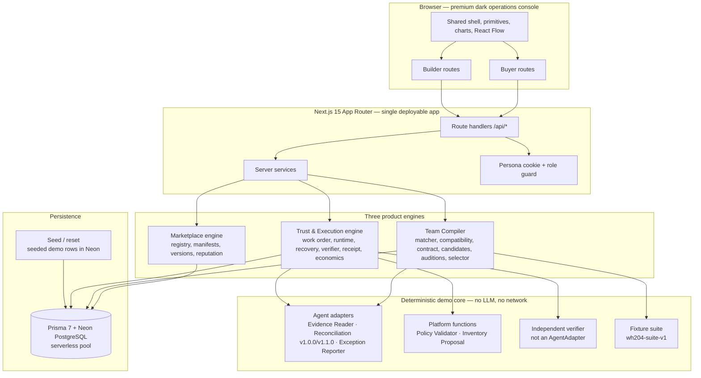

# 02 — Implementation Master Plan

**Status:** `COMPLETED — PRODUCTION MVP DELIVERED & VERIFIED (PRs #6-#10 LANDED)`  
**Owner:** Joint A/B/C lead (architecture), with Team B as build custodian  
**Product source:** [`BLUEPRINT.md`](../../BLUEPRINT.md)  
**Execution source:** [`TASK_TRACKER.md`](TASK_TRACKER.md)  
**Window:** 24 elapsed hours, P0 at H0 to P8 at H24 (All phases landed)  
**Team size:** Three developers, three permanent workstreams, no Team D

---

## 1. Purpose

This plan turns the Forgent blueprint into a build that three people can finish and demonstrate in 24 hours without weakening the product's core claim:

> A buyer posts a real business outcome. Forgent compiles a team of independently built agents, auditions competing workflows, exposes failure, recovers within bounds, verifies the result independently, and attributes payment only to accepted work.

The plan is deliberately narrower than the long-term product and deliberately wider than a compiler demo. The marketplace, the compiler and the trust/execution engine must all be visible in one continuous journey. A compiler-only or evaluator-only demo fails the plan even if it is technically impressive.

### Non-negotiable product properties

1. **The economic loop stays intact.** Jordan Lee is a seeded independent builder with four marketplace versions. Work is attributed per stage. A replaced version earns ₹0; the accepted fallback earns ₹2,500.
2. **Verification is independent.** The verifier recomputes the truth. It does not trust an agent's `SUCCESS` status, and it is not a marketplace agent.
3. **Failure is shown, not hidden.** Reconciliation v1.0.0 fails with a schema-invalid output. v1.1.0 recovers the stage. Downstream work reruns.
4. **Consequential action is blocked.** Inventory remains 42 committed, 10 pending and 2 variance. The commit stays `BLOCKED_PENDING_APPROVAL`.
5. **Everything simulated is labelled.** Payments are simulated eligibility, not settlement. Inventory is a local ledger, not a warehouse integration. Demo profiles are seeded.
6. **The UI is a product, not a wireframe.** Premium dark B2B operations console with no dead routes and no fake deferred actions.

### 1.3 Canonical Agent Architecture Principles

To ensure structural consistency across all three engines, Forgent strictly defines the following architectural abstractions:

1. **Capability:** A declared unit of business functionality (e.g. `document_evidence_extraction`, `quantity_reconciliation`, `repository_analysis`). Capabilities define *what* is needed; they can be supplied by single agents, cooperating agents, deterministic platform functions, business connectors, or human checkpoints. *Not every capability is an agent.*
2. **Agent Package:** The reusable, versioned software package authored and published by an independent developer. Conceptually contains developer identity, versioned executable implementation, capability manifest, schemas, permissions, synthetic evaluation suites, and pricing. *The manifest alone is not the implementation.*
3. **Agent Version:** An immutable, uniquely identified release of an agent package (e.g., `1.0.0`, `1.1.0`), ensuring that execution history, evaluations, recovery events, and contribution attribution remain reproducible.
4. **Agent Instance:** A configured instance of an agent version bound to a specific job step, combining the reusable package code with business context, configuration, runtime limits, and allowed tools mediated by the Forgent Tool Gateway.
5. **Compiled Workflow:** A versioned, acyclic execution graph composed of configured agent instances, deterministic functions, business connectors, failure recovery paths, and human approval checkpoints. The Team Compiler assembles workflows; agents do not assemble the final workflow themselves.
6. **Execution:** An auditable run of the compiled workflow against authorized business inputs, persisting exact versions, configurations, tool permissions, stage traces, and tamper-evident evidence receipts.

**Two Distinct Agent Categories:**
- **Execution Agents (Type 1):** Possess an existing executable implementation that performs an operational task directly on input data (e.g. extracting invoice fields, reconciling quantities). They deliver their capability without writing new application code. All worker agents in the Northstar hackathon MVP are Execution Agents.
- **Creation Agents (Type 2):** Capable of inspecting authorized repositories, generating/modifying code in an isolated workspace, generating tests, running static checks, and producing a reviewed Pull Request. *Generated business code is an output artifact, not automatically a new marketplace package.* Creation agents belong to Forgent's long-term product roadmap and are excluded from the current MVP.

**Deployment Models:**
- **Platform-Hosted (MVP):** Forgent operates the execution runtime via curated, platform-hosted callable adapters (`src/server/agents/**`).
- **Builder-Hosted (Future):** Developers maintain external webhook endpoints conforming to Forgent's agent protocol.
- **Customer-Hosted (Future):** Agents execute within customer VPC / on-premises environments.
- *Arbitrary untrusted public code execution is strictly prohibited in the hackathon MVP.*

---

## 2. Scope

### In scope for the 24-hour build

| Area | Included |
|---|---|
| Authentication | Constrained demo authentication: seeded Northstar Buyer (`buyer@northstar.demo`) and Jordan Lee (`jordan@demoagent.studio`), `/login` screen with 1-click persona quick-select, server-managed `forgent_session` cookies, server-side role authorization (`BUYER` vs `BUILDER`), protected route guards, dashboard redirects, demo badge. No public signup or OAuth. |
| Marketplace & Packages | Buyer catalog, agent detail, version timeline, builder profile, constrained package submission pipeline (ZIP archive upload, 5MB limit, anti-path-traversal validation, SHA-256 digest, persistent storage abstraction, immutable `PENDING_APPROVAL` version records), My Agents manager, and versioned reputation. |
| Execution Safety | Runtime execution safety boundary: only pre-approved platform-hosted adapters (`src/server/agents/**`) can be bound into workflow execution graphs. Uploaded packages remain safely stored and validated (`PENDING_APPROVAL`) without runtime execution. Zero dynamic `eval` or dynamic imports. |
| Job creation | Three-step wizard, structured evidence inputs, budget/deadline, acceptance contract compile |
| Team Compiler | Capability matching, compatibility checks, three candidates, ten-fixture audition, hard-constraint selection, capability gaps |
| Commercial | Work order, ₹10,000 allocation, buyer approval, simulated settlement eligibility |
| Execution | Six-stage runtime, fail-closed safety limits & 42->42 inventory lock enforced before execution, persisted events, injected failure, bounded replacement, downstream rerun, safe stop |
| Trust | Independent ten-check verifier, state diff, tamper-evident receipt with SHA-256 hash, human review, blocked inventory commit (42 → 42 invariant) |
| Economics | Stage attribution, v1.0.0 ₹0, v1.1.0 ₹2,500, builder ₹5,500, platform ₹2,500, reserves |
| Operations | Deterministic seed/reset, health endpoint, demo runbook, backup, rehearsals |

### Explicitly out of scope

- Public sign-up, OAuth providers, password reset, enterprise multi-tenant IAM, real payment gateways, real escrow, KYC, billing or bank payout rails (MVP uses constrained demo session authentication with seeded accounts and simulated economic settlement).
- Real warehouse or ERP integration; the ledger is simulated.
- Public builder self-service onboarding, third-party acquisition or unrestricted bidding.
- Arbitrary untrusted dynamic code execution, public container sandboxing, queues or websockets. Uploaded packages are stored and validated in pending-approval status without runtime execution; live workflows execute only approved platform adapters.
- PDF receipt export, cross-job audit browser, disputes centre, crypto settlement.
- A real capability-bounty submission flow.
- Production multi-tenancy, horizontal scale, SLA or compliance claims.

Deferred items are recorded in [15 — Risk and Scope Register](15_RISK_AND_SCOPE_REGISTER.md) and the tracker's optional/deferred register. They must not appear as dead UI.

---

## 3. Product story in one screen

```text
Northstar Warehouse has a receiving exception.
  Expected PO: 12 / Invoiced: 12 / Scanned Receiving: 10.
  Inventory must not be changed without human approval (42 → 42 invariant).

Northstar posts WH-204 with an illustrative ₹10,000 budget.

Forgent compiles three candidate workflows:
  A  single-agent baseline          (evaluation only; not for hire)
  B  fixed specialist team          (no recovery path)
  C  compiler-selected team         (with v1.1.0 fallback)

All three audition dynamically on the same ten fixtures and fixed seed.
The selector evaluates hard constraints and audition metrics from persisted runs;
any candidate can qualify, and Candidate C ranks highest in the baseline run.

Jordan Lee's agents are hired by the stage:
  Evidence Reader (Hybrid) ₹2,000  → model-backed with deterministic fallback
  Reconciliation v1.0.0   ₹2,500  → fails schema validation (earns ₹0)
  Reconciliation v1.1.0   ₹2,500  → replaces it; v1.0.0 receives ₹0 payout
  Exception Reporter      ₹1,000
  Policy + inventory proposal are Forgent-owned deterministic functions.

The independent verifier passes 10 checks against 10 received / 2 discrepancy.
The inventory proposal is blocked pending human approval (42 → 42 preserved).
The tamper-evident receipt hashes the canonical body with SHA-256.
Jordan's simulated eligible earnings are ₹5,500.
Forgent's platform fee is ₹2,500. Reserves are ₹1,200 and ₹800.
No money moves. The marketplace and attribution logic are real.
```

---

## 4. Architecture

### 4.1 Logical architecture



### 4.2 Runtime shape

- **Serverless web & API.** Next.js App Router deployed on Vercel Serverless. Stateless route handlers.
- **Durable asynchronous execution.** Upstash QStash (`@upstash/qstash`) orchestrates durable step execution, retries and webhook dispatch (`/api/webhooks/qstash/...`), eliminating background process / local daemon dependencies.
- **Resume from persistence.** Stage state is written to Neon PostgreSQL before and after every transition. A page refresh or reconnect continues cleanly from database state.
- **Deterministic adapters.** Hybrid architecture: Evidence Reader calls multimodal models with instant fallback to `evidencePacket_WH204` fixture; Reconciliation and Verifier are deterministic.
- **Neon connection pooling.** Database operations run through `@neondatabase/serverless` connection pool via `DATABASE_URL`, with `DIRECT_URL` for Prisma migrations.
- **Forgent Tool Gateway.** Mediates all interactions between agent instances and business systems. Enforces least-privilege tool scopes, operation-level authorization, input/output validation, audit logging, and strict read versus write separation (with human approval required for consequential operations like inventory commit). Agents never receive raw database credentials.
- **The 9-Step Compiler Pipeline.** 1) Decompose outcome into capabilities $\rightarrow$ 2) Query registry $\rightarrow$ 3) Identify packages, platform code & connectors $\rightarrow$ 4) Generate candidate graphs $\rightarrow$ 5) Configure candidate instances $\rightarrow$ 6) Check schemas, dependencies & budgets $\rightarrow$ 7) Audition on synthetic suite $\rightarrow$ 8) Reject hard constraint failures $\rightarrow$ 9) Dynamically select the qualifying workflow. Multi-agent execution is never mandatory.
- **Business Integration Models:**
  - *Scenario A (Operational Data — MVP):* Business System $\rightarrow$ Business Connector $\rightarrow$ Tool Gateway $\rightarrow$ Workflow Runtime $\rightarrow$ Agent Instance (read-only PO, Invoice, Scan; inventory commit blocked).
  - *Scenario B (Codebase Modification — Future Roadmap):* Authorized Repo $\rightarrow$ Restricted Workspace Sandbox $\rightarrow$ Repo Analysis $\rightarrow$ Code Generation $\rightarrow$ Test Verification $\rightarrow$ Pull Request $\rightarrow$ Business Review (not part of Northstar demo).

### 4.3 Repository shape (to be created at P0)

```text
app-or-src/
  app/
    (buyer)/buyer/...              buyer routes
    (builder)/builder/...          builder routes
    api/...                        route handlers
  components/
    ui/                            primitives
    shell/                         sidebar, topbar, banner
    workflow/                      React Flow graph
    compiler/                      candidates, comparison
    execution/                     timeline, events, recovery
    verification/                  checks, state diff
    receipt/                       receipt document
    economics/                     allocations, contributions
  lib/
    contracts/                     frozen types, Zod schemas, constants
    api/                           typed client + mocks
    navigation.ts
  server/
    db.ts
    agents/                        adapter, registry, manifests, adapters/*
    compiler/                      matcher, compatibility, candidates, auditions, selector
    runtime/                       orchestrator, recovery, limits, failure injection
    verification/                  verifier, state diff, approval gate
    evidence/                      receipt
    economics/                     attribution, contributions, settlement, reputation
    fixtures/                      WH-204 + audition fixtures
prisma/
  schema.prisma
  seed.ts
  migrations/
scripts/
  reset-demo.ts
  verify-seed.ts
docs/hackathon/                    this package
```

**File ownership** is defined in [04 — Workstream Ownership](04_WORKSTREAM_OWNERSHIP.md). Frozen contracts live in `src/lib/contracts/` and are owned by Team C after P0 sign-off.

---

## 5. The three engines and their boundaries

### 5.1 Marketplace — the economic engine

**Owns:** buyer and builder identities, agent identity, versioned manifests, capabilities, pricing, latency, limitations, fallback links, visibility, version statistics.

**Must prove:** an independent builder can list a versioned capability, a buyer can discover it, and accepted work produces an attributable earning. The marketplace is not a decorative catalog; it is where Jordan's participation becomes economically real (simulated).

**Never:** show the hidden baseline as a listing; show the verifier as an agent; invent ratings; claim a real payout.

### 5.2 Team Compiler — the intelligence engine

**Owns:** capability decomposition, hard matching, schema/permission compatibility, acceptance-contract compilation, candidate generation, auditions, assertions, selection.

**Must prove:** three workflows are compared on the same evidence and the same suite; the selection is explained by hard constraints, not vibes; the compiled team includes a bound fallback.

**Never:** use an LLM on the critical path; claim a benchmark that was not measured; let a high score override a critical failure; hide the held-out fixtures' values.

### 5.3 Verification & Execution — the trust engine

**Owns:** work order, approved allocations, execution, stage events, failure injection, recovery, independent verification, state diff, receipt, review gate, attribution and settlement eligibility.

**Must prove:** an agent saying "done" is not proof; failure is visible and bounded; a replacement can complete the work; consequential inventory action stays blocked; payment follows accepted evidence.

**Never:** let an agent commit inventory; let a failed version earn; let the verifier be registry-selectable; call simulated eligibility "paid".

---

## 6. End-to-end data flow

```mermaid
sequenceDiagram
    participant Buyer
    participant UI
    participant API
    participant Compiler
    participant Runtime
    participant Verifier
    participant Ledger

    Buyer->>UI: Open seeded WH-204
    UI->>API: GET /api/jobs/job-wh-204
    API-->>UI: CONTRACT_READY + contract v1
    Buyer->>UI: Run compiler
    UI->>API: POST /compile (idempotency key)
    API->>Compiler: match capabilities + generate A/B/C
    Compiler-->>API: three candidates persisted
    Buyer->>UI: Run auditions
    UI->>API: POST /auditions
    API->>Compiler: run wh204-suite-v1 on A/B/C
    Compiler-->>API: measured results + assertions
    API->>Compiler: hard-constraint dynamic selection
    Compiler-->>API: winning candidate selected; rejection reasons persisted
    Buyer->>UI: Approve ₹10,000 work order
    UI->>API: POST /work-orders/:id/approve
    API->>Ledger: snapshot allocations
    Buyer->>UI: Start execution
    UI->>API: POST /executions
    API->>Runtime: execute six stages
    Runtime-->>API: v1.0.0 fails AGENT_SCHEMA_INVALID
    Runtime->>Runtime: compatibility check + v1.1.0 replacement
    Runtime-->>API: downstream stages rerun and complete
    API->>Verifier: recompute truth independently
    Verifier-->>API: 10/2 + ten checks + blocked commit
    API->>Ledger: receipt hash + contributions + eligibility
    UI-->>Buyer: verified receipt, economics, blocked inventory
```

**Polling contract:** the execution endpoint returns ordered events and stage state. The UI stops polling at `AWAITING_APPROVAL`, `COMPLETED`, `FAILED_SAFE` or `VERIFICATION_FAILED`. A reload resumes from persisted state.

---

## 7. The 24-hour schedule

H0 is the first implementation minute. Calendar time is irrelevant; elapsed hours are the only clock. The windows below sum to exactly 1,440 minutes.

| Phase | Elapsed | Window | Theme | Gate outcome |
|---|---|---:|---|---|
| **P0** | H0–H1 | 60m | Architecture freeze and running foundation | App boots, contracts compile, `/api/health` 200, `p0-foundation` tag |
| **P1** | H1–H4 | 180m | Premium shell, personas, schema and seeded overviews | Both personas see seeded overviews with labelled data |
| **P2** | H4–H7 | 180m | Marketplace, builder profile, registry, job creation | Northstar browses versions and opens WH-204 with a compiled contract |
| **P3** | H7–H10 | 180m | Compiler and auditions | Auditions complete across 10 fixtures for Candidates A, B, and C; results persisted; comparison matrix displays audition scores and breakdown (selection in P4) |
| **P4** | H10–H13 | 180m | Dynamic selection, work order, execution and recovery | Dynamic ranking computed; winning candidate persisted (A, B, or C eligible); work order approved; fail-closed limits & 42->42 invariant locked; v1.0.0 fails; v1.1.0 replaces it; downstream completes |
| **P5** | H13–H16 | 180m | Independent verification, receipt, review and demo reset | Ten checks pass; tamper-evident receipt hash exists; inventory commit remains blocked 42 → 42 independently verified; demo reset verified in Neon |
| **P6** | H16–H18 | 120m | Contributions, economics and reputation | v1.1.0 ₹2,500, v1.0.0 ₹0, builder ₹5,500, platform fee ₹2,500, reserves ₹2,000, simulated eligibility |
| **P7** | H18–H21 | 180m | Premium UX completion, negative regression and live integration | Whole journey runs live with no frontend/API mocks (NEXT_PUBLIC_USE_MOCKS=false); negative regression suite passes |
| **P8** | H21–H23 | 120m | Hardening, rehearsal and release lock | Three clean rehearsals; `v1.0-demo`; signed runbook; offline fallback verified |
| **P9** | H23–H24 | 60m | Unallocated contingency and demo freeze | Presentation deck aligned, AV setup verified, unallocated contingency reserve (0 scheduled tasks) |

### Phase-level capacity and rebalanced effort

| Phase | A minutes | B minutes | C minutes | Window | Buffer & Rule |
|---|---:|---:|---:|---:|---|
| P0 | 55 | 55 | 55 | 60 | 5m slack per dev; contract freeze is the gate. |
| P1 | 160 | 150 | 140 | 180 | 20–40m slack; authenticated login, session cookie and overviews complete. |
| P2 | 170 | 160 | 155 | 180 | 10–25m slack; package upload pipeline, execution safety boundary, contract compiler and catalog active. |
| P3 | 160 (185) | 155 | 160 | 180 | 20–25m buffer per dev. Auditions run across 10 fixtures; comparison matrix rendered; selection in P4. |
| P4 | 160 | 175 | 175 | 180 | 5m buffer per dev. Dynamic ranking, fail-closed limits & 42->42 invariant locked, recovery runtime. |
| P5 | 150 (170) | 165 | 130 | 180 | 15–50m buffer. Independent verifier, state diff assertion, tamper-evident receipt, and demo reset. |
| P6 | 105 (125) | 110 | 105 | 120 | 10–15m core buffer. `P6-A-005` is optional; economics reconcile to ₹10,000. |
| P7 | 100 (120) | 85 | 130 | 180 | 50–95m buffer. Zero frontend mocks; full negative regression suite. |
| P8 | 95 | 90 | 95 (120) | 120 | 25m buffer per dev for 3 full rehearsals and release lock. |
| P9 | 0 | 0 | 0 | 60 | 60m unallocated contingency buffer (180 person-minutes reserve) for demo freeze. |

**Capacity rebalancing summary:** Core planned workload is frozen at **3,445 person-minutes** across all three developers (Team A: 1,155m core / 1,240m total; Team B: 1,145m core / 1,145m total; Team C: 1,145m core / 1,170m total). This creates **875 minutes (~14.6 person-hours)** of team integration buffer (plus 180m in P9 unallocated contingency reserve). Every workstream in every phase operates within available phase capacity (Phase 1 core: 450m / 540m; Phase 2 core: 485m / 540m). Optional tasks (`P3-A-006`, `P5-A-004`, `P6-A-005`, `P7-A-004`, `P8-C-004`) total 110m and are the first to be dropped if any phase slips.

---

## 8. Workstreams

| Workstream | Permanent mandate | Primary surfaces | Does not own |
|---|---|---|---|
| **A — Product & Frontend** | Premium shell, all buyer/builder routes, graph, comparison, execution monitor, receipt, economics views, visual QA | `src/app/**`, `src/components/**`, `src/lib/api/**`, `src/lib/navigation.ts` | Prisma schema, business rules, compiler algorithms, verifier logic |
| **B — Backend & Platform** | Schema, seed/reset, route handlers, persistence, idempotency, role guards, aggregation, performance, backup | `prisma/**`, `src/server/db.ts`, `src/app/api/**`, `src/server/services/**`, `scripts/**` | Visual design, matching/selection rules, receipt semantics |
| **C — AI, Compiler & Evaluation** | Frozen contracts, manifests, adapters, matcher, contract compiler, candidates, auditions, selector, runtime policy, recovery, verifier, attribution/economics rules | `src/lib/contracts/**`, `src/server/agents/**`, `src/server/compiler/**`, `src/server/runtime/**`, `src/server/verification/**`, `src/server/economics/**`, fixtures | Page layout, database migrations, API envelope conventions |

**No Team D.** QA, integration and demo operations are distributed:

- **A** owns visual QA, route parity, buyer/builder journey regression and the judge script.
- **B** owns API contract tests, schema/reset integrity, API regression and the seeded backup.
- **C** owns compiler/execution/verification determinism, negative-path tests, the canonical truth chain and rehearsal timing for the technical chain.
- **Joint** ownership: P0 freeze, phase gates, integration checkpoints, three rehearsals and final sign-off.

Detailed boundaries, RACI and prohibited files are in [04 — Workstream Ownership](04_WORKSTREAM_OWNERSHIP.md).

---

## 9. Dependency strategy

### 9.1 The safe critical path

```text
scaffold → contracts → schema → seed → manifests → adapters
  → matcher → contract compiler → candidates → auditions → assertions
  → selector → selection persistence → work order → execution
  → failure → fallback → safe limits → verifier → state diff
  → acceptance persistence → receipt → attribution → contributions
  → settlement → live integration → rehearsal
```

The full 46-task critical path is listed in [TASK_TRACKER.md §4](TASK_TRACKER.md#4-critical-path).

### 9.2 Parallelisation rules

1. **Contracts before screens.** A builds against typed mocks from `07_INTEGRATION_CONTRACTS.md` while B builds persistence and C builds engines.
2. **One writer per shared file.** `src/lib/contracts/**` is C-owned. `prisma/schema.prisma` is B-owned. `src/lib/navigation.ts` is A-owned.
3. **Vertical slices at every gate.** Every phase ends in a runnable, clickable slice, not a branch full of unmerged work.
4. **No silent shape change.** Any contract change requires a decision-log entry and a same-hour update to mocks, schemas and consumers.
5. **Integration is a task, not a hope.** P3-A-004, P7-A-001 and P7-C-001 exist specifically to replace mocks and prove parity.

### 9.3 Handoff points

| From → To | Artifact | Freeze condition |
|---|---|---|
| C → A/B | Contracts + Zod schemas | P0-C-003 signed |
| B → A/C | Schema + seed + health | P1-B-002 passes twice |
| C → A | Manifest fixtures + audition payloads | P1-C-001, P3-C-005 pass |
| B → A | Live compile/audition/selection APIs | P3-B-004 passes |
| B/C → A | Live execution/recovery payloads | P4-B-003 passes |
| C/B → A | Verification + receipt payloads | P5-B-002 passes |
| C/B → A | Contributions + settlement payloads | P6-B-002 passes |

---

## 10. Milestones and gates

A phase is complete only when **all four** are true:

1. The gate outcome is demonstrable in the running app.
2. The prototype is usable by a person who did not build it.
3. The phase smoke test passes and is recorded.
4. The checkpoint commit/tag exists.

| Checkpoint | Tag | Target | Evidence required |
|---|---|---|---|
| P0 | `p0-foundation` | H1 | `npm run dev`, health 200, typecheck/lint, contract parse tests |
| P1 | `p1-shell` | H4 | Persona switch, seeded overviews, schema/seed idempotency |
| P2 | `p2-marketplace` | H7 | Catalog filters, agent versions, WH-204 contract preview |
| P3 | `p3-compiler` | H10 | Three candidates, measured auditions across 10 fixtures |
| P4 | `p4-recovery` | H13 | Approval, failure, v1.1.0 replacement, downstream completion |
| P5 | `p5-trust` | H16 | Ten checks, receipt hash, review, blocked inventory, demo reset |
| P6 | `p6-economics` | H18 | ₹5,500 eligible, ₹2,500 fee, v1.0.0 ₹0, reserves reconcile |
| P7 | `p7-polish` | H21 | Live route parity, negative regression suite, visual freeze |
| P8 | `v1.0-demo` | H23 | Three rehearsals, backup, signed runbook, offline fallback |
| P9 | `p9-lock` | H24 | Unallocated contingency reserve, AV check, final release freeze |

If a gate slips, **cut optional scope before extending the phase**. P8 cannot be compressed: rehearsal time is part of the product.

---

## 11. Operating cadence

### Every 60–90 minutes

- 5-minute stand-up: current task, next task, blocker, gate risk.
- Update `TASK_TRACKER.md` status and blocker text.
- Run the phase smoke command.
- Commit a coherent slice; never leave `main` broken at a checkpoint.

### At every phase gate

1. Owner demonstrates the usable prototype.
2. A second workstream runs the verification method.
3. Record the gate result in the checkpoint log and decision changelog.
4. Tag the checkpoint.
5. Only then start the next phase's parallel work.

### Communication rules

- Interface questions go to the contract owner (C) and are answered in the contract document, not only in chat.
- Database questions go to B; UI questions go to A; algorithm questions go to C.
- A blocker older than 20 minutes is escalated to the joint lead.
- No one edits another workstream's owned file without agreement and a note.

---

## 12. Quality bar

| Dimension | Bar |
|---|---|
| Type safety | `tsc --noEmit` clean; no `any` in contract boundaries |
| Contracts | Every endpoint payload parses against a shared Zod schema |
| Determinism | Same seed + same scenario = identical checks, amounts and receipt hash |
| Idempotency | Duplicate compile/approve/start/review produces no duplicate rows or payouts |
| Failure | Every failure has a typed code, preserved raw output and safe terminal state |
| Money | Integer paise everywhere; allocations sum exactly to 1,000,000 |
| Labelling | Every seeded profile, simulated payment and simulated inventory value is labelled |
| UX | No dead route, no fake action, no unlabelled placeholder, keyboard focus visible |
| Performance | Full demo flow under 15 seconds; audition suite under 60 seconds; dashboard reads under 300 ms locally |
| Claims | No claim of real payment, real inventory integration or production security |

---

## 13. Definition of done

### A task is done when

- Its acceptance criteria are met in the running app or test suite.
- Its verification method has been run and recorded.
- Its output exists at the declared path.
- Any contract change is logged.
- The tracker row is `DONE`, not merely "code written".

### A phase is done when

- Every P0 task in the phase is `DONE` or explicitly `DROPPED`.
- The gate prototype is usable and demonstrated.
- The checkpoint tag exists.
- No unresolved blocker crosses the gate.

### The hackathon build is done when

- All nine gates are passed.
- Three clean rehearsals of the judge script succeed.
- The WH-204 chain produces 10 received / 2 discrepancy / `EXCEPTION_REQUIRES_REVIEW`.
- The verifier passes all ten checks; the receipt hash is stable.
- Inventory stays 42/10/2 and blocked.
- Jordan's simulated eligible earnings are ₹5,500; v1.0.0 is ₹0; v1.1.0 is ₹2,500.
- The reset restores `CONTRACT_READY` with identical IDs and counts.
- The runbook is signed and the `v1.0-demo` tag exists.
- No documentation claims more than the demo actually does.

---

## 14. Related documents

- [03 — Phase Breakdown](03_PHASE_BREAKDOWN.md) — phase-by-phase gates and prototypes.
- [04 — Workstream Ownership](04_WORKSTREAM_OWNERSHIP.md) — file and API boundaries.
- [07 — Integration Contracts](07_INTEGRATION_CONTRACTS.md) — frozen shapes.
- [10 — Compiler and Evaluation](10_COMPILER_AND_EVALUATION_SPEC.md) — matching, auditions, selection.
- [11 — Execution, Recovery and Verification](11_EXECUTION_RECOVERY_VERIFICATION_SPEC.md) — runtime and trust.
- [12 — Marketplace and Economics](12_MARKETPLACE_AND_ECONOMICS_SPEC.md) — attribution and platform model.
- [13 — Demo Runbook](13_DEMO_RUNBOOK.md) — the three-minute script.
