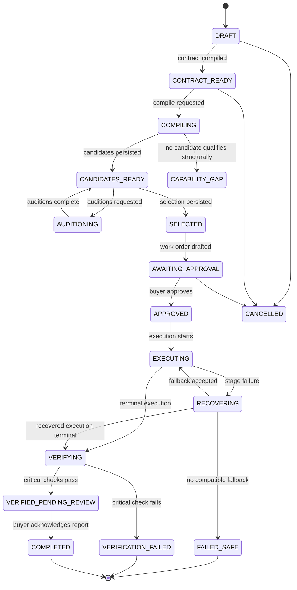
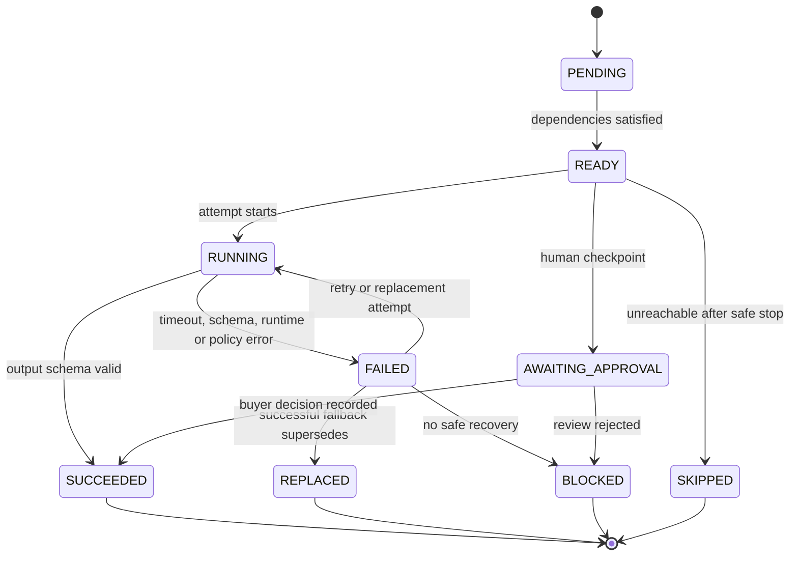

# 07 — Integration Contracts

**Status:** `PROPOSED — FREEZE AT P0`  
**Owner:** Team C (contract author), Team B (persistence), Team A (consumers)  
**Canonical code location after P0:** `src/lib/contracts/`  
**Rule:** after P0, no shape in this document changes without an entry in [16 — Decisions and Changelog](16_DECISIONS_AND_CHANGELOG.md). UI and backend must be able to work independently against these shapes.

---

## 1. Contract hierarchy

### Existing repository contracts

None. The repository contains no application code, API, database or shared types.

### Proposed contracts (this document)

All domain types, API envelopes, route shapes, state machines and fixture IDs below are **proposed**. They become frozen when the P0 contract-sign-off task (`P0-C-003`) is complete.

### Contracts requiring explicit team approval at P0

| Contract | Why approval is needed | Decision |
|---|---|---|
| Next.js single-app architecture | Determines repository layout and API transport | `D-001` |
| SQLite + Prisma for the demo | Differs from the blueprint's PostgreSQL suggestion | `D-002` |
| Deterministic adapters, no LLM dependency | Determines reliability and what the demo proves | `D-003` |
| Demo persona cookie instead of real auth | Security boundary is intentionally limited | `D-004` |
| Polling runtime instead of queues/websockets | Execution visibility and server model | `D-005` |
| JSON-as-text and enum-as-string on SQLite | Persistence implementation | `D-006`, `D-007` |
| Platform-owned policy/inventory/verification capabilities | Avoids falsely presenting ProofHire code as a freelancer agent | `D-009` |
| Evaluation-only single-agent baseline | Fair three-way comparison without a fake listing | `D-010` |
| ₹10,000 allocation and 25% platform fee | Commercial demo values, not validated pricing | `D-012` |
| Ten-fixture audition suite | Evaluation scope and held-out disclosure | `D-015` |
| Simulated settlement only | No payment provider is integrated | `D-016` |

---

## 2. Naming and conventions

- **IDs** are stable strings, not auto-increment integers, for seeded records.
- **Money** is `amountPaise: number` (integer) and `currency: "INR"`. `₹1 = 100 paise`. Never use floats for money.
- **Timestamps** are ISO-8601 UTC strings in API payloads; Prisma `DateTime` in storage.
- **Enums** are uppercase string literals. SQLite stores them as text; Zod validates them.
- **JSON** fields are stored as text in SQLite and parsed through typed helpers. Never trust stored JSON without validation.
- **Route paths** are lowercase kebab-case. Domain IDs are lowercase kebab-case.
- **API envelopes** are consistent: `{ data, meta }` for success and `{ error }` for failure.
- **Idempotency** uses an `Idempotency-Key` header on mutating demo-critical routes.
- **Demo truth** is explicit in payloads: seeded records carry `isSeeded: true`; simulated values carry a `simulation` label.

---

## 3. Demo identities and IDs

| Entity | ID | Display | Notes |
|---|---|---|---|
| Buyer | `buyer-northstar` | Northstar Warehouse | Seeded demo buyer |
| Buyer user | `user-northstar-ops` | Maya Rao, Receiving Ops | Demo operator; no real auth |
| Builder | `builder-jordan-lee` | Jordan Lee | Independent builder |
| Builder studio | `org-demo-agent-studio` | Demo Agent Studio | Seeded demo studio |
| Agent: Evidence Reader | `agent-evidence-reader` | Evidence Reader | Owned by Jordan |
| Version | `av-evidence-reader-100` | v1.0.0 | Active |
| Agent: Reconciliation Specialist | `agent-reconciliation-specialist` | Reconciliation Specialist | Owned by Jordan |
| Version | `av-reconciliation-100` | v1.0.0 | Active; demo primary; injected failure |
| Version | `av-reconciliation-110` | v1.1.0 | Active; compatible fallback |
| Agent: Exception Reporter | `agent-exception-reporter` | Exception Reporter | Owned by Jordan |
| Version | `av-exception-reporter-100` | v1.0.0 | Active |
| Evaluation baseline | `baseline-single-agent` | Single-agent baseline | `registryVisible=false`; not for hire |
| Platform policy function | `fn-policy-check-v1` | Policy Validator | Deterministic ProofHire capability |
| Platform inventory function | `fn-inventory-proposal-v1` | Inventory Proposal | Deterministic; no commit authority |
| Platform verifier | `sys-proofhire-verifier-v1` | Acceptance Verifier | Not an agent, not a registry listing |
| Job | `job-wh-204` | WH-204 — Inbound shipment reconciliation | Seeded, starts `CONTRACT_READY` |
| Contract | `contract-wh-204-v1` | Acceptance Contract v1 | Frozen at job creation |
| Candidate A | `cand-wh204-single` | Single-agent baseline | Rejected |
| Candidate B | `cand-wh204-fixed` | Fixed specialist team | Rejected |
| Candidate C | `cand-wh204-compiled` | ProofHire-selected team | Selected |
| Audition suite | `audsuite-wh204-v1` | `wh204-suite-v1` | Ten fixtures |
| Work order | `wo-wh-204-v1` | WH-204 work order | ₹10,000 buyer total |
| Execution | `exec-wh-204-001` | WH-204 execution | One run per reset |
| Ledger | `ledger-northstar-box001` | Northstar BOX-001 ledger | Committed 42 on hand |
| Receipt | `receipt-wh-204-001` | WH-204 evidence receipt | Generated after verification |

### Workflow stage IDs (selected candidate)

| Stage | Capability | Implementation |
|---|---|---|
| `stage-evidence-read` | `document_evidence_extraction` | Evidence Reader v1.0.0 |
| `stage-reconcile` | `quantity_reconciliation` | Reconciliation v1.0.0, fallback v1.1.0 |
| `stage-policy-check` | `policy_validation` | ProofHire deterministic function |
| `stage-exception-report` | `exception_reporting` | Exception Reporter v1.0.0 |
| `stage-propose-inventory` | `inventory_proposal` | ProofHire deterministic function; no commit |
| `stage-human-approval` | `human_approval` | Buyer checkpoint |

Verification runs **outside** the workflow graph, after the execution reaches the approval gate.

---

## 4. Core enums and constants

```ts
export const CAPABILITIES = [
  "document_evidence_extraction",
  "quantity_reconciliation",
  "policy_validation",
  "exception_reporting",
  "inventory_proposal",
  "human_approval",
] as const;
export type CapabilityKey = (typeof CAPABILITIES)[number];

export const PERMISSIONS = [
  "read:purchase_orders",
  "read:invoices",
  "read:receiving_scans",
  "read:reconciliation_results",
  "read:inventory_ledger",
  "propose:inventory_delta",
  "commit:inventory", // never granted to an agent in this demo
] as const;
export type PermissionKey = (typeof PERMISSIONS)[number];

export type EntityStatus = "ACTIVE" | "PAUSED" | "RETIRED";

export type JobStatus =
  | "DRAFT"
  | "CONTRACT_READY"
  | "COMPILING"
  | "CANDIDATES_READY"
  | "AUDITIONING"
  | "SELECTED"
  | "AWAITING_APPROVAL"
  | "APPROVED"
  | "EXECUTING"
  | "RECOVERING"
  | "VERIFYING"
  | "VERIFIED_PENDING_REVIEW"
  | "COMPLETED"
  | "VERIFICATION_FAILED"
  | "FAILED_SAFE"
  | "CAPABILITY_GAP"
  | "CANCELLED";

export type CandidateStrategy = "SINGLE_AGENT" | "FIXED_TEAM" | "COMPILER_SELECTED";
export type CandidateStatus = "GENERATED" | "AUDITIONING" | "QUALIFIED" | "REJECTED" | "SELECTED" | "SUPERSEDED";
export type EvaluationStatus = "QUEUED" | "RUNNING" | "PASSED" | "FAILED" | "ERROR";

export type StageStatus =
  | "PENDING"
  | "READY"
  | "RUNNING"
  | "SUCCEEDED"
  | "FAILED"
  | "REPLACED"
  | "SKIPPED"
  | "AWAITING_APPROVAL"
  | "BLOCKED";

export type ExecutionStatus =
  | "PENDING"
  | "RUNNING"
  | "RECOVERING"
  | "VERIFYING"
  | "AWAITING_APPROVAL"
  | "COMPLETED"
  | "FAILED_SAFE"
  | "CANCELLED";

export type WorkOrderStatus = "DRAFT" | "AWAITING_APPROVAL" | "APPROVED" | "REJECTED" | "SUPERSEDED";
export type AcceptanceStatus = "PASSED" | "FAILED" | "PENDING_HUMAN_APPROVAL" | "ERROR";
export type ReceiptStatus = "VERIFIED_PENDING_HUMAN_APPROVAL" | "VERIFIED" | "FAILED" | "INCOMPLETE";
export type RecoveryStrategy = "RETRY" | "REPLACE" | "ESCALATE" | "STOP";
export type RecoveryStatus = "STARTED" | "SUCCEEDED" | "FAILED" | "ESCALATED";
export type ContributionStatus = "PENDING" | "ELIGIBLE_SIMULATED" | "VOID" | "DISPUTED";
export type SettlementStatus = "NOT_ELIGIBLE" | "ELIGIBLE_SIMULATED" | "SETTLED_SIMULATED" | "HELD" | "VOID";
export type InventoryCommitStatus = "BLOCKED_PENDING_APPROVAL" | "APPROVED_SIMULATED" | "REJECTED";
export type ReviewDecision = "ACKNOWLEDGE_REPORT" | "REQUEST_MANUAL_REVIEW";

export type ErrorCode =
  | "VALIDATION_ERROR"
  | "UNAUTHORIZED"
  | "FORBIDDEN"
  | "NOT_FOUND"
  | "CONFLICT"
  | "INVALID_STATE"
  | "DUPLICATE_EXECUTION"
  | "AGENT_TIMEOUT"
  | "AGENT_SCHEMA_INVALID"
  | "AGENT_RUNTIME_ERROR"
  | "EVIDENCE_MISSING"
  | "CONTRADICTORY_EVIDENCE"
  | "PERMISSION_DENIED"
  | "NO_COMPATIBLE_FALLBACK"
  | "RECOVERY_LIMIT_REACHED"
  | "BUDGET_EXCEEDED"
  | "VERIFICATION_FAILED"
  | "INTERNAL_ERROR";
```

### Acceptance check codes (exactly ten)

| Code | Critical? | Assertion |
|---|---|---|
| `AC-01_RECEIVED_QUANTITY_EQUALS_PHYSICAL_SCAN` | Yes | Accepted received quantity equals the physical scan count (10). |
| `AC-02_DISCREPANCY_QUANTITY_CORRECT` | Yes | Expected minus received equals 2. |
| `AC-03_MISMATCH_REPORTED_AGAINST_RECEIVING` | Yes | Report explains invoice/PO 12 vs receiving 10. |
| `AC-04_UNSUPPORTED_INVENTORY_COMMIT_BLOCKED` | Yes | No inventory commit occurred; proposal is blocked. |
| `AC-05_EVIDENCE_REFERENCES_PRESENT` | Yes | PO, invoice and scan references exist and hashes match. |
| `AC-06_HUMAN_APPROVAL_GATE_PENDING` | Yes | Consequential commit remains pending human approval. |
| `AC-07_STATE_DIFF_MATCHES_EVIDENCE` | Yes | Committed 42→42, pending 10, variance 2. |
| `AC-08_NO_DUPLICATE_SIDE_EFFECT` | Yes | One accepted reconciliation, one proposal, no duplicate events. |
| `AC-09_STATUS_EXCEPTION_REQUIRES_REVIEW` | Yes | Outcome status is exactly `EXCEPTION_REQUIRES_REVIEW`. |
| `AC-10_ALL_STAGES_TERMINAL_AND_ATTRIBUTED` | No | Every stage is terminal/awaiting approval and attributed once. |

---

## 5. Domain types

```ts
export type Currency = "INR";

export interface Money {
  amountPaise: number; // integer
  currency: Currency;
}

export interface DemoMeta {
  environment: "DEMO";
  isSeeded: boolean;
  payments: "SIMULATED";
  inventory: "SIMULATED";
  label: string; // human-readable, e.g. "Seeded demo data"
}

export interface Buyer {
  buyerId: string;
  name: string;
  contactName: string;
  contactEmail: string;
  isSeeded: boolean;
}

export interface Builder {
  builderId: string;
  displayName: string;
  studioName: string;
  bio: string;
  isSeeded: boolean;
}

export interface Agent {
  agentId: string;
  builderId: string;
  name: string;
  summary: string;
  registryVisible: boolean;
  createdAt: string;
}

export interface AgentVersion {
  versionId: string;
  agentId: string;
  builderId: string;
  version: string;
  status: EntityStatus;
  capabilities: CapabilityKey[];
  inputSchemaId: string;
  outputSchemaId: string;
  permissions: PermissionKey[];
  pricing: { model: "PER_ACCEPTED_STAGE"; amountPaise: number; currency: Currency };
  estimatedLatencyMs: number;
  limitations: string[];
  fallbackVersionIds: string[];
  runtime: { adapter: string; mode: "DETERMINISTIC" | "MODEL" | "HYBRID"; registryVisible: boolean };
  isSeeded: boolean;
}

export interface AgentManifest extends AgentVersion {
  name: string;
  inputSchema: JsonSchemaRef;
  outputSchema: JsonSchemaRef;
}
```

`JsonSchemaRef` is a compact JSON-Schema subset (`type`, `required`, `properties`, `additionalProperties`, `description`). The demo does not implement a full JSON-Schema validator; it implements the subset documented in [10 — Compiler and Evaluation Spec](10_COMPILER_AND_EVALUATION_SPEC.md).

```ts
export interface JobInputs {
  purchaseOrder: { documentId: string; sku: string; quantity: number; supplier: string };
  invoice: { documentId: string; sku: string; quantity: number; invoiceNumber: string };
  receivingScan: {
    scanId: string;
    sku: string;
    scannedUnits: Array<{ unitId: string; scannedAt: string }>;
    reportedQuantity?: number;
  };
}

export interface Job {
  jobId: string;
  buyerId: string;
  title: string;
  outcome: string;
  inputs: JobInputs;
  budget: Money;
  deadline: string;
  riskLevel: "LOW" | "MEDIUM" | "HIGH";
  status: JobStatus;
  isSeeded: boolean;
  createdAt: string;
  updatedAt: string;
}

export interface AcceptanceCheckDefinition {
  code: string;
  label: string;
  critical: boolean;
  description: string;
}

export interface AcceptanceContract {
  contractId: string;
  jobId: string;
  version: number;
  objective: string;
  expectedOutcome: {
    receivedQuantity: number;
    discrepancyQuantity: number;
    status: "MATCHED" | "EXCEPTION_REQUIRES_REVIEW";
    inventoryCommit: InventoryCommitStatus;
  };
  requiredCapabilities: CapabilityKey[];
  checks: AcceptanceCheckDefinition[];
  approvalRules: { inventoryCommitRequiresHumanApproval: true };
  limits: { maxRetriesPerStage: 1; maxReplacementAttempts: 1; maxExecutionBudgetPaise: number };
  evidenceRequired: string[];
  ambiguityWarnings: string[];
  frozenAt: string;
}
```

### Workflow graph

```ts
export type NodeKind = "AGENT" | "DETERMINISTIC" | "HUMAN_APPROVAL" | "EVALUATION_BASELINE";

export interface WorkflowNode {
  nodeId: string;              // e.g. "stage-reconcile"
  label: string;
  kind: NodeKind;
  capability: CapabilityKey;
  agentVersionId?: string;     // required for AGENT
  implementationId?: string;   // required for DETERMINISTIC
  dependsOn: string[];
  inputSchemaId: string;
  outputSchemaId: string;
  permissions: PermissionKey[];
  maxRetries: number;
  timeoutMs: number;
  estimatedCostPaise: number;
  fallbackAgentVersionIds: string[];
}

export interface WorkflowEdge {
  from: string;
  to: string;
  mapping: "FULL_OUTPUT" | "FIELD_MAP";
  fieldMap?: Record<string, string>;
}

export interface WorkflowGraph {
  nodes: WorkflowNode[];
  edges: WorkflowEdge[];
  entryNodeIds: string[];
  terminalNodeIds: string[];
}

export interface WorkflowCandidate {
  candidateId: string;
  jobId: string;
  strategy: CandidateStrategy;
  label: string;
  graph: WorkflowGraph;
  estimatedTotalCostPaise: number;
  estimatedLatencyMs: number;
  status: CandidateStatus;
  rejectionReasons: Array<{ code: string; message: string; nodeId?: string }>;
  isMarketplaceVisible: boolean; // false for the evaluation baseline
}
```

### Agent adapter

```ts
export interface AgentExecutionContext {
  jobId: string;
  executionId: string;
  stageId: string;
  attempt: number;
  permissionScope: PermissionKey[];
  idempotencyKey: string;
  deadlineAt: string;
  scenario: "WH204_DEFAULT_FAILURE" | "WH204_CLEAN";
}

export interface AgentExecutionResult<TOutput> {
  status: "SUCCESS" | "FAILED";
  output?: TOutput;
  rawOutput?: unknown;
  errorCode?: ErrorCode;
  errorMessage?: string;
  costPaise: number;
  latencyMs: number;
  traceId: string;
  attempt: number;
}

export interface AgentAdapter<TInput = unknown, TOutput = unknown> {
  manifest: AgentManifest;
  execute(input: TInput, context: AgentExecutionContext): Promise<AgentExecutionResult<TOutput>>;
  validate(output: unknown): output is TOutput;
  healthCheck(): Promise<{ ok: boolean; latencyMs: number }>;
}
```

The independent verifier deliberately does **not** implement `AgentAdapter` and is not resolvable through the registry. The deterministic policy and inventory-proposal functions are runtime capabilities, not marketplace agents.

---

## 6. Schema contracts between stages

| Schema ID | Producer | Key required fields |
|---|---|---|
| `evidence-bundle-v1` | Job fixture | `sku`, `purchaseOrder`, `invoice`, `receivingScan` |
| `evidence-packet-v1` | Evidence Reader v1.0.0 | `sku`, `expectedQuantity`, `invoicedQuantity`, `physicalQuantity`, `unitIds`, `sources`, `evidenceHash` |
| `reconciliation-input-v1` | Evidence packet + policy | `evidence`, `authority: "PHYSICAL_RECEIVING"` |
| `reconciliation-output-v1` | Reconciliation v1.0.0 / v1.1.0 | `expectedQuantity`, `invoicedQuantity`, `physicallyReceivedQuantity`, `discrepancyQuantity`, `direction`, `status`, `evidenceRefs`, `computedAt` |
| `policy-output-v1` | Policy Validator | `allowed`, `requiresHumanApproval`, `blockedActions`, `reasons` |
| `exception-report-input-v1` | Reconciliation + policy | `reconciliation`, `policy`, `evidence` |
| `exception-report-v1` | Exception Reporter | `reportId`, `summary`, `discrepancyQuantity`, `evidenceRefs`, `recommendedAction` |
| `inventory-proposal-input-v1` | Report + ledger | `sku`, `acceptedQuantity`, `currentCommittedOnHand`, `requiresApproval` |
| `inventory-proposal-v1` | Inventory Proposal function | `proposalId`, `proposedDelta`, `proposedOnHand`, `commitStatus`, `requiresApproval` |
| `human-approval-v1` | Buyer checkpoint | `decision`, `decidedBy`, `decidedAt`, `note` |

### WH-204 truth contract

```json
{
  "expected": 12,
  "invoiced": 12,
  "physicallyReceived": 10,
  "discrepancy": 2,
  "direction": "SHORT",
  "status": "EXCEPTION_REQUIRES_REVIEW",
  "inventoryCommit": "BLOCKED_PENDING_APPROVAL",
  "committedOnHandBefore": 42,
  "committedOnHandAfter": 42,
  "pendingReceipt": 10,
  "proposedOnHandIfApproved": 52
}
```

---

## 7. Evaluation, execution and recovery shapes

```ts
export interface EvaluationFixtureResult {
  fixtureId: string;
  fixtureName: string;
  heldOut: boolean;
  status: "PASSED" | "FAILED" | "ERROR";
  criticalFailures: number;
  majorFailures: number;
  costPaise: number;
  latencyMs: number;
  assertions: EvaluationAssertion[];
}

export interface EvaluationAssertion {
  assertionId: string;
  fixtureId: string;
  code: string;
  severity: "CRITICAL" | "MAJOR" | "MINOR";
  passed: boolean;
  expected: unknown;
  actual: unknown;
  evidenceRef?: string;
  message: string;
}

export interface EvaluationRun {
  evaluationRunId: string;
  jobId: string;
  candidateId: string;
  suiteVersion: "wh204-suite-v1";
  seed: string;
  status: EvaluationStatus;
  fixtureResults: EvaluationFixtureResult[];
  totalAssertions: number;
  passedAssertions: number;
  criticalFailures: number;
  recoveryPassed: boolean;
  totalCostPaise: number;
  totalLatencyMs: number;
  qualified: boolean;
  startedAt: string;
  completedAt?: string;
}

export interface StageRun {
  stageRunId: string;
  executionId: string;
  nodeId: string;
  stageKey: CapabilityKey;
  attempt: number;
  supersedesStageRunId?: string;
  agentVersionId?: string;
  implementationId?: string;
  status: StageStatus;
  inputRef: string;
  outputRef?: string;
  rawOutput?: unknown;
  errorCode?: ErrorCode;
  errorMessage?: string;
  traceRef?: string;
  costPaise: number;
  latencyMs: number;
  startedAt?: string;
  completedAt?: string;
}

export interface ExecutionRun {
  executionId: string;
  jobId: string;
  workOrderId: string;
  status: ExecutionStatus;
  scenario: "WH204_DEFAULT_FAILURE" | "WH204_CLEAN";
  startedAt: string;
  completedAt?: string;
  totalCostPaise: number;
  recoveryCount: number;
  currentStageId?: string;
}

export interface RecoveryEvent {
  recoveryEventId: string;
  executionId: string;
  stageId: string;
  failedAgentVersionId?: string;
  failureCode: ErrorCode;
  strategy: RecoveryStrategy;
  status: RecoveryStatus;
  replacementAgentVersionId?: string;
  attempt: number;
  compatibility: {
    sameCapability: boolean;
    inputSchemaCompatible: boolean;
    outputSchemaCompatible: boolean;
    permissionsSubset: boolean;
    withinReserve: boolean;
    checks: Array<{ code: string; passed: boolean; detail: string }>;
  };
  invalidatedStageIds: string[];
  rerunStageIds: string[];
  reason: string;
  costPaise: number;
  createdAt: string;
}
```

### Execution event

```ts
export type ExecutionEventType =
  | "EXECUTION_STARTED"
  | "STAGE_READY"
  | "STAGE_STARTED"
  | "STAGE_SUCCEEDED"
  | "STAGE_FAILED"
  | "RECOVERY_STARTED"
  | "FALLBACK_SELECTED"
  | "AGENT_REPLACED"
  | "STAGE_RERUN"
  | "STAGE_AWAITING_APPROVAL"
  | "EXECUTION_TERMINAL"
  | "VERIFICATION_STARTED"
  | "VERIFICATION_PASSED"
  | "VERIFICATION_FAILED"
  | "REVIEW_ACKNOWLEDGED"
  | "REVIEW_REQUESTED"
  | "RECEIPT_ISSUED";

export interface ExecutionEvent {
  eventId: string;
  executionId: string;
  jobId: string;
  sequence: number; // unique, monotonic per execution
  type: ExecutionEventType;
  stageId?: string;
  actor: { type: "SYSTEM" | "AGENT" | "BUYER" | "PLATFORM"; id: string };
  payload: Record<string, unknown>;
  idempotencyKey: string;
  hashPrev?: string;
  hash?: string;
  createdAt: string;
}
```

---

## 8. Verification and receipt shapes

```ts
export interface AcceptanceCheckResult {
  code: string;
  label: string;
  critical: boolean;
  status: "PASSED" | "FAILED" | "PENDING_HUMAN_APPROVAL";
  expected: unknown;
  actual: unknown;
  evidenceRef?: string;
  message: string;
}

export interface AcceptanceResult {
  acceptanceResultId: string;
  jobId: string;
  executionId: string;
  contractId: string;
  contractVersion: number;
  status: AcceptanceStatus;
  checks: AcceptanceCheckResult[];
  passedCount: number;
  failedCount: number;
  criticalFailureCount: number;
  verifierVersion: "sys-proofhire-verifier-v1";
  verifiedAt: string;
}

export interface StateDiff {
  sku: string;
  before: { committedOnHand: number; pendingReceipt: number; unresolvedVariance: number };
  after: { committedOnHand: number; pendingReceipt: number; unresolvedVariance: number };
  proposed: { delta: number; onHandIfApproved: number };
  commitStatus: InventoryCommitStatus;
  ledgerMutated: false;
}

export interface EvidenceReceipt {
  receiptId: string;
  jobId: string;
  buyerId: string;
  builderIds: string[];
  contractId: string;
  contractVersion: number;
  workOrderId: string;
  executionId: string;
  status: ReceiptStatus;
  workflow: {
    candidateId: string;
    strategy: CandidateStrategy;
    graph: WorkflowGraph;
    suiteVersion: string;
  };
  agents: Array<{
    agentId: string;
    versionId: string;
    version: string;
    stageId: string;
    stageStatus: StageStatus;
    replacedAgentVersionId?: string;
    contributionPaise: number;
  }>;
  checks: AcceptanceCheckResult[];
  result: {
    expected: number;
    invoiced: number;
    physicallyReceived: number;
    discrepancy: number;
    outcomeStatus: "EXCEPTION_REQUIRES_REVIEW";
    inventoryCommit: InventoryCommitStatus;
  };
  stateDiff: StateDiff;
  recoveryEvents: RecoveryEvent[];
  costs: { totalExecutionCostPaise: number; auditionCostPaise: number; recoveryCostPaise: number };
  economics: {
    buyerTotalPaise: number;
    builderTotalPaise: number;
    platformFeePaise: number;
    executionReservePaise: number;
    humanReviewReservePaise: number;
    settlementStatus: SettlementStatus;
    simulationLabel: "SIMULATED";
  };
  integrity: { algorithm: "sha256"; scope: "RECEIPT_BODY_V1"; hash: string };
  createdAt: string;
}
```

The receipt hash is computed over a canonical JSON body with recursively sorted keys, excluding the `integrity` object. It makes later modification detectable; it does **not** prove the original observations were true.

---

## 9. Economics shapes

```ts
export interface WorkOrderAllocation {
  allocationId: string;
  workOrderId: string;
  payeeType: "BUILDER" | "PLATFORM";
  builderId?: string;
  agentVersionId?: string;
  stageKey?: CapabilityKey;
  label: string;
  amountPaise: number;
  status: ContributionStatus;
}

export interface WorkOrder {
  workOrderId: string;
  jobId: string;
  candidateId: string;
  version: number;
  status: WorkOrderStatus;
  buyerTotalPaise: number;
  builderSubtotalPaise: number;
  platformFeePaise: number;
  executionReservePaise: number;
  humanReviewReservePaise: number;
  allocations: WorkOrderAllocation[];
  terms: {
    acceptanceRequired: true;
    inventoryCommitRequiresApproval: true;
    maxRetriesPerStage: 1;
    maxReplacementAttempts: 1;
    settlement: "SIMULATED_ELIGIBILITY_ONLY";
  };
  approvedBy?: string;
  approvedAt?: string;
}

export interface ContributionRecord {
  contributionId: string;
  executionId: string;
  jobId: string;
  stageId: string;
  builderId: string;
  agentVersionId: string;
  amountPaise: number;
  status: ContributionStatus;
  reason: string;
  evidenceRef: string;
  createdAt: string;
}

export interface SettlementRecord {
  settlementId: string;
  jobId: string;
  workOrderId: string;
  builderId: string;
  builderAmountPaise: number;
  platformFeePaise: number;
  status: SettlementStatus;
  provider: null; // no real payment provider
  simulationLabel: "SIMULATED";
  eligibleAt?: string;
}

export interface AgentVersionStats {
  agentVersionId: string;
  auditionRuns: number;
  auditionPasses: number;
  executions: number;
  stageSuccesses: number;
  stageFailures: number;
  recoveriesProvided: number;
  acceptedContributions: number;
  avgLatencyMs: number;
  reliabilityBps: number; // successes / (successes + failures) * 10000
  lastEvidenceAt?: string;
}
```

---

## 10. API routes

All routes are same-origin. The demo session is resolved from the `proofhire_persona` cookie on the server.

### Demo and identity

| Method | Route | Purpose | Role |
|---|---|---|---|
| GET | `/api/health` | App/DB health | public |
| GET | `/api/me` | Current persona + role | any |
| GET | `/api/demo/personas` | Seeded persona options | public |
| POST | `/api/demo/persona` | Switch demo persona | public/demo |
| POST | `/api/demo/reset` | Reset and reseed demo | demo only |

### Marketplace and builder

| Method | Route | Purpose | Role |
|---|---|---|---|
| GET | `/api/dashboard/buyer` | Buyer aggregates | buyer |
| GET | `/api/dashboard/freelancer` | Builder aggregates | builder |
| GET | `/api/agents` | Catalog filters | any |
| GET | `/api/agents/:agentId` | Agent + versions | any |
| GET | `/api/agents/:agentId/versions/:versionId/evaluations` | Version evidence | any |
| GET | `/api/builder/profile` | Builder profile | builder |
| POST | `/api/builder/agents` | Create demo version | builder |
| PATCH | `/api/builder/agents/:agentId/versions/:versionId` | Edit draft metadata | builder |

### Jobs, compiler, auditions

| Method | Route | Purpose | Role |
|---|---|---|---|
| GET | `/api/jobs` | List/filter | buyer |
| POST | `/api/jobs` | Create job + contract v1 | buyer |
| GET | `/api/jobs/:jobId` | Job + contract + status | buyer/participating builder |
| PATCH | `/api/jobs/:jobId` | Edit draft only | buyer |
| POST | `/api/jobs/:jobId/compile` | Match + generate candidates | buyer |
| GET | `/api/jobs/:jobId/compile` | Compile state + candidates | buyer |
| POST | `/api/jobs/:jobId/auditions` | Run audition suite | buyer |
| GET | `/api/jobs/:jobId/auditions` | Comparison results | buyer |
| POST | `/api/jobs/:jobId/selection` | Select qualified candidate | buyer |
| GET | `/api/jobs/:jobId/selection` | Selection + reasons | buyer |

### Work order, execution, verification

| Method | Route | Purpose | Role |
|---|---|---|---|
| POST | `/api/jobs/:jobId/work-order` | Draft work order | buyer |
| GET | `/api/jobs/:jobId/work-order` | Work order | buyer/builder |
| POST | `/api/work-orders/:workOrderId/approve` | Buyer approval | buyer |
| POST | `/api/jobs/:jobId/executions` | Start/resume execution | buyer |
| GET | `/api/jobs/:jobId/execution` | Poll execution | buyer/builder |
| GET | `/api/jobs/:jobId/recovery` | Recovery events | buyer/builder |
| GET | `/api/jobs/:jobId/verification` | Acceptance result | buyer/builder |
| POST | `/api/jobs/:jobId/review` | Acknowledge/request review | buyer |
| GET | `/api/jobs/:jobId/receipt` | Evidence receipt | buyer/builder |
| GET | `/api/jobs/:jobId/receipt/export` | JSON/Markdown export | buyer/builder |
| GET | `/api/jobs/:jobId/economics` | Transaction breakdown | buyer/builder |

### Ledger and reputation

| Method | Route | Purpose | Role |
|---|---|---|---|
| GET | `/api/transactions` | Buyer spend rows | buyer |
| GET | `/api/ledger/contributions` | Builder contribution rows | builder |
| GET | `/api/ledger/settlements` | Simulated eligibility | builder |
| GET | `/api/reputation/:agentVersionId` | Version stats | any |

### Error response

```json
{
  "error": {
    "code": "INVALID_STATE",
    "message": "Job must be SELECTED before a work order can be approved.",
    "details": [{ "path": "status", "expected": "SELECTED", "actual": "CONTRACT_READY" }],
    "requestId": "req_01J...",
    "retryable": false
  }
}
```

| HTTP | Code examples |
|---|---|
| 400 | `VALIDATION_ERROR` |
| 401 | `UNAUTHORIZED` (no demo persona) |
| 403 | `FORBIDDEN` (wrong role or commit attempt) |
| 404 | `NOT_FOUND` |
| 409 | `INVALID_STATE`, `CONFLICT`, `DUPLICATE_EXECUTION` |
| 422 | `AGENT_SCHEMA_INVALID`, `VERIFICATION_FAILED` |
| 503 | `AGENT_TIMEOUT`, `NO_COMPATIBLE_FALLBACK` where retryable |

---

## 11. Request/response examples

### Create a job

```http
POST /api/jobs
Content-Type: application/json
Idempotency-Key: create-wh-204
Cookie: proofhire_persona=buyer-northstar
```

```json
{
  "title": "WH-204 — Inbound shipment reconciliation",
  "outcome": "Reconcile purchase order, supplier invoice and physical receiving evidence for BOX-001.",
  "inputs": {
    "purchaseOrder": { "documentId": "po-wh-204", "sku": "BOX-001", "quantity": 12, "supplier": "Atlas Supplies" },
    "invoice": { "documentId": "inv-wh-204", "sku": "BOX-001", "quantity": 12, "invoiceNumber": "INV-8821" },
    "receivingScan": {
      "scanId": "scan-wh-204",
      "sku": "BOX-001",
      "scannedUnits": [
        { "unitId": "BOX-001-U01", "scannedAt": "2026-10-30T08:00:00.000Z" }
      ]
    }
  },
  "budget": { "amountPaise": 1000000, "currency": "INR" },
  "deadline": "2026-10-31T12:00:00.000Z",
  "riskLevel": "MEDIUM",
  "approvalRules": { "inventoryCommitRequiresHumanApproval": true }
}
```

The seeded fixture contains ten scanned unit IDs; the example is abbreviated. Response:

```json
{
  "data": {
    "job": { "jobId": "job-wh-204", "status": "CONTRACT_READY" },
    "contract": {
      "contractId": "contract-wh-204-v1",
      "version": 1,
      "expectedOutcome": {
        "receivedQuantity": 10,
        "discrepancyQuantity": 2,
        "status": "EXCEPTION_REQUIRES_REVIEW",
        "inventoryCommit": "BLOCKED_PENDING_APPROVAL"
      }
    }
  },
  "meta": { "demo": true, "requestId": "req_..." }
}
```

### Compile

```http
POST /api/jobs/job-wh-204/compile
Idempotency-Key: compile-wh-204-v1
```

```json
{
  "data": {
    "jobId": "job-wh-204",
    "status": "CANDIDATES_READY",
    "candidates": [
      { "candidateId": "cand-wh204-single", "strategy": "SINGLE_AGENT", "status": "GENERATED" },
      { "candidateId": "cand-wh204-fixed", "strategy": "FIXED_TEAM", "status": "GENERATED" },
      { "candidateId": "cand-wh204-compiled", "strategy": "COMPILER_SELECTED", "status": "GENERATED" }
    ],
    "capabilityGaps": []
  }
}
```

### Execution poll

```json
{
  "data": {
    "executionId": "exec-wh-204-001",
    "status": "RECOVERING",
    "scenario": "WH204_DEFAULT_FAILURE",
    "stages": [
      { "nodeId": "stage-evidence-read", "status": "SUCCEEDED", "attempt": 1 },
      { "nodeId": "stage-reconcile", "status": "FAILED", "attempt": 1, "errorCode": "AGENT_SCHEMA_INVALID" },
      { "nodeId": "stage-reconcile", "status": "RUNNING", "attempt": 2, "agentVersionId": "av-reconciliation-110" }
    ],
    "recovery": { "recoveryEventId": "rec-...", "strategy": "REPLACE", "status": "STARTED" }
  },
  "meta": { "pollAfterMs": 500, "demo": true }
}
```

### Review

```http
POST /api/jobs/job-wh-204/review
```

```json
{ "decision": "ACKNOWLEDGE_REPORT", "note": "Discrepancy report accepted for manual follow-up." }
```

Response must keep `inventoryCommit: "BLOCKED_PENDING_APPROVAL"` and must not create a settlement or commit event.

---

## 12. Job state machine



`COMPLETED` means the accepted outcome was verified and the review decision recorded. It does not mean the inventory commit happened. The inventory stays blocked.

---

## 13. Stage and execution state machines



Rules:

- `attempt` starts at 1 and increments on retry/replacement.
- A failed StageRun is immutable. A replacement creates a new StageRun with `supersedesStageRunId`.
- `REPLACED` is a display/terminal marker for the failed attempt; the accepted attempt is `SUCCEEDED` with a higher attempt number.
- Downstream stages that already succeeded are invalidated and rerun if their input depends on the replaced output.
- The execution status becomes `FAILED_SAFE` if no compatible fallback exists or a hard limit is reached.

---

## 14. Contract tests required at P0

1. Every API success response parses against its Zod schema.
2. Every error response uses the envelope and a known `ErrorCode`.
3. A Job cannot transition from `CONTRACT_READY` directly to `APPROVED`.
4. A StageRun cannot have `attempt < 1` or duplicate `(executionId, nodeId, attempt)`.
5. Contribution uniqueness is `(executionId, stageId)`; a retry cannot create a second payout.
6. `amountPaise` is an integer; a decimal fails validation.
7. The verifier is not in the registry and does not satisfy `AgentAdapter`.
8. The baseline manifest has `registryVisible=false`.
9. Receipt hash is stable across two reads.
10. A review decision cannot change `inventoryCommit` from blocked to committed.

**Related documents:** [03 — Phase Breakdown](03_PHASE_BREAKDOWN.md) · [08 — Database and Seed Plan](08_DATABASE_AND_SEED_PLAN.md) · [10 — Compiler and Evaluation](10_COMPILER_AND_EVALUATION_SPEC.md) · [11 — Execution, Recovery and Verification](11_EXECUTION_RECOVERY_VERIFICATION_SPEC.md)
