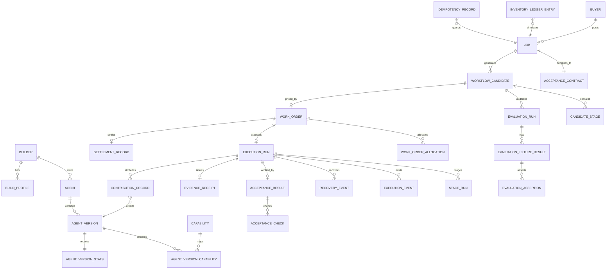

# 08 — Database and Seed Plan

**Status:** `PROPOSED — FREEZE AT P0`  
**Owner:** Team B  
**Engine:** Neon PostgreSQL + Prisma 7 (using `@prisma/adapter-neon` and `@neondatabase/serverless`) for serverless runtime  
**Datasource:** Neon pooled connection via `DATABASE_URL` (with `?sslmode=require`) and direct connection via `DIRECT_URL` for migrations

---

## 1. Design principles

1. **Deterministic seed IDs.** Every seeded record has a stable string ID so the UI, tests and demo script can deep-link without lookup tables.
2. **Money in paise.** All amounts are integers. No floating-point money anywhere.
3. **Enums as strings.** Store enum fields as `String` / `VARCHAR` validated by shared Zod schemas at the application boundary for zero-downtime evolution.
4. **Native JSON via Json / jsonb.** Store structured payloads using Prisma `Json` native PostgreSQL `jsonb` fields and parse through typed Zod helpers at runtime.
5. **Evidence is append-only.** Execution events, failed stage attempts, contributions, acceptance results and receipts are never overwritten.
6. **One execution per reset.** The demo has one job and one run; idempotency prevents duplicate effects.
7. **Demo reset is explicit.** No silent deletion of unknown rows; the reset performs clean FK-safe deletion of records owned by seeded demo entities in Neon PostgreSQL.

---

## 1.1 Conceptual Entity Model vs. Hackathon MVP Persistence

To maintain architectural purity without bloating the 24-hour hackathon scope, ProofHire explicitly maps its conceptual domain entities across three layers:

```text
┌────────────────────────────────────────────────────────────────────────────────────────┐
│                        CONCEPTUAL ENTITY ARCHITECTURE MAPPING                          │
├─────────────────────────┬───────────────────────────────┬──────────────────────────────┤
│ Conceptual Entity       │ Hackathon MVP Persistence     │ Structural Role & Rationale  │
├─────────────────────────┼───────────────────────────────┼──────────────────────────────┤
│ AgentPackage            │ Table: `Agent`                │ Package identity & author.   │
│ AgentVersion            │ Table: `AgentVersion`         │ Immutable release & adapter. │
│ Capability              │ Table: `Capability`           │ Neutral functional skills.   │
│ AgentCapability         │ Table: `AgentVersionCap...`   │ Declared skill mapping.      │
│ AgentInstance           │ Table: `CandidateStage`       │ Configured instance for job. │
│ AgentConfiguration      │ Embedded JSON on `StageRun`   │ Runtime business context.    │
│ EvaluationSuite         │ Table: `EvaluationRun` (suite)│ 10-fixture suite metadata.   │
│ EvaluationRun           │ Table: `EvaluationRun`        │ Persisted audition runs.     │
│ CompiledWorkflow        │ Table: `WorkflowCandidate`    │ Acyclic workflow graph.      │
│ WorkflowNode / Edge     │ Embedded in `graphJson`       │ Visual & execution topology. │
│ Execution               │ Table: `ExecutionRun`         │ Commercial execution run.    │
│ ExecutionStage          │ Table: `StageRun`             │ Stage attempt trace & cost.  │
│ ToolPermission          │ Runtime Tool Gateway policy   │ Mediated least-privilege.    │
│ BusinessIntegration     │ Local test fixtures           │ Simulated ERP/scan fixtures. │
│ EvidenceReceipt         │ Table: `EvidenceReceipt`      │ SHA-256 tamper-evident hash. │
│ ContributionRecord      │ Table: `ContributionRecord`   │ Stage-level builder earning. │
│ SettlementRecord        │ Table: `SettlementRecord`     │ Simulated payout eligibility.│
├─────────────────────────┴───────────────────────────────┴──────────────────────────────┤
│ FUTURE ARCHITECTURE (DEFERRED): BuilderHostedEndpoint, CustomerHostedRunner,            │
│ CodeRepositoryConnection, PullRequestArtifact, CredentialVaultRecord.                  │
└────────────────────────────────────────────────────────────────────────────────────────┘
```

- **Required Hackathon Persistence:** The 20 Prisma tables defined below provide all state needed for the complete buyer-to-freelancer demo loop.
- **Logical / Runtime Abstractions:** Abstractions like `AgentInstance`, `ToolPermission`, and `WorkflowEdge` are enforced in TypeScript runtime code and serialized into parent rows rather than requiring redundant relational tables.
- **Future Infrastructure:** Enterprise connectors, external repository sandboxes, and customer-hosted runner tables are deferred.

---

## 2. Entity relationship diagram



`BuildProfile` may be folded into `Builder` for the demo; keep the diagram’s profile concept represented by `Builder.bio`, `Builder.studioName` and links, rather than a separate table unless the UI needs it.

---

## 3. Tables and important fields

### Identity and marketplace

| Table | Important fields | Notes |
|---|---|---|
| `Buyer` | `buyerId @id`, `name`, `contactName`, `contactEmail`, `isSeeded`, timestamps | Northstar only. |
| `Builder` | `builderId @id`, `displayName`, `studioName`, `bio`, `isSeeded`, timestamps | Jordan Lee / Demo Agent Studio only. |
| `Agent` | `agentId @id`, `builderId`, `name`, `summary`, `registryVisible`, timestamps | Stable identity. |
| `AgentVersion` | `versionId @id`, `agentId`, `version`, `status`, `inputSchemaId`, `outputSchemaId`, `permissionsJson`, `pricingModel`, `pricePaise`, `estimatedLatencyMs`, `limitationsJson`, `fallbackVersionIdsJson`, `runtimeAdapter`, `runtimeMode`, `registryVisible`, `isSeeded`, timestamps | Unique `(agentId, version)`. Published versions immutable. |
| `Capability` | `key @id`, `label`, `description`, `isPlatformOwned` | Six capability keys. |
| `AgentVersionCapability` | `versionId`, `capabilityKey`, composite primary key | Explicit many-to-many. |
| `AgentManifestSnapshot` | `snapshotId`, `versionId`, `manifestJson`, `createdAt` | Frozen manifest used by auditions/receipts. |

### Job and compiler

| Table | Important fields | Notes |
|---|---|---|
| `Job` | `jobId @id`, `buyerId`, `title`, `outcome`, `inputsJson`, `budgetPaise`, `deadline`, `riskLevel`, `status`, `isSeeded`, timestamps | Start `CONTRACT_READY`. |
| `AcceptanceContract` | `contractId @id`, `jobId`, `version`, `objective`, `expectedOutcomeJson`, `requiredCapabilitiesJson`, `checksJson`, `approvalRulesJson`, `limitsJson`, `evidenceRequiredJson`, `ambiguityWarningsJson`, `frozenAt` | Unique `(jobId, version)`. |
| `WorkflowCandidate` | `candidateId @id`, `jobId`, `strategy`, `label`, `graphJson`, `estimatedTotalCostPaise`, `estimatedLatencyMs`, `status`, `rejectionReasonsJson`, `isMarketplaceVisible`, timestamps | Unique `(jobId, strategy)`. |
| `CandidateStage` | `candidateStageId`, `candidateId`, `nodeId`, `order`, `capability`, `kind`, `agentVersionId`, `implementationId`, `dependsOnJson`, `inputSchemaId`, `outputSchemaId`, `permissionsJson`, `fallbackVersionIdsJson`, `estimatedCostPaise` | Unique `(candidateId, nodeId)`. |
| `EvaluationRun` | `evaluationRunId @id`, `jobId`, `candidateId`, `suiteVersion`, `seed`, `status`, `totalAssertions`, `passedAssertions`, `criticalFailures`, `recoveryPassed`, `totalCostPaise`, `totalLatencyMs`, `qualified`, `runNumber`, `startedAt`, `completedAt` | Unique `(jobId, candidateId, suiteVersion, runNumber)`. |
| `EvaluationFixtureResult` | `fixtureResultId`, `evaluationRunId`, `fixtureId`, `fixtureName`, `heldOut`, `status`, `criticalFailures`, `majorFailures`, `costPaise`, `latencyMs`, `outputJson` | Unique `(evaluationRunId, fixtureId)`. |
| `EvaluationAssertion` | `assertionId`, `evaluationRunId`, `fixtureId`, `code`, `severity`, `passed`, `expectedJson`, `actualJson`, `evidenceRef`, `message` | Append-only. |

### Commercial

| Table | Important fields | Notes |
|---|---|---|
| `WorkOrder` | `workOrderId @id`, `jobId`, `candidateId`, `version`, `status`, `buyerTotalPaise`, `builderSubtotalPaise`, `platformFeePaise`, `executionReservePaise`, `humanReviewReservePaise`, `termsJson`, `approvedBy`, `approvedAt`, timestamps | Unique `(jobId, version)`. |
| `WorkOrderAllocation` | `allocationId`, `workOrderId`, `payeeType`, `builderId`, `agentVersionId`, `stageKey`, `label`, `amountPaise`, `status` | Sum must equal buyer total. |

### Execution and trust

| Table | Important fields | Notes |
|---|---|---|
| `ExecutionRun` | `executionId @id`, `jobId`, `workOrderId`, `status`, `scenario`, `startedAt`, `completedAt`, `totalCostPaise`, `recoveryCount`, `currentStageId` | One demo execution per reset. |
| `StageRun` | `stageRunId @id`, `executionId`, `nodeId`, `stageKey`, `attempt`, `supersedesStageRunId`, `agentVersionId`, `implementationId`, `status`, `inputRef`, `outputRef`, `outputJson`, `rawOutputJson`, `errorCode`, `errorMessage`, `traceRef`, `costPaise`, `latencyMs`, `startedAt`, `completedAt` | Unique `(executionId, nodeId, attempt)`; failed attempts immutable. |
| `ExecutionEvent` | `eventId @id`, `executionId`, `jobId`, `sequence`, `type`, `stageId`, `actorType`, `actorId`, `payloadJson`, `idempotencyKey`, `hashPrev`, `hash`, `createdAt` | Unique `(executionId, sequence)` and `(executionId, idempotencyKey)`. |
| `RecoveryEvent` | `recoveryEventId @id`, `executionId`, `stageId`, `failedAgentVersionId`, `failureCode`, `strategy`, `status`, `replacementAgentVersionId`, `attempt`, `compatibilityJson`, `invalidatedStageIdsJson`, `rerunStageIdsJson`, `reason`, `costPaise`, `createdAt` | Append-only. |
| `AcceptanceResult` | `acceptanceResultId @id`, `jobId`, `executionId`, `contractId`, `contractVersion`, `status`, `passedCount`, `failedCount`, `criticalFailureCount`, `verifierVersion`, `verifiedAt` | Unique `(executionId)`. |
| `AcceptanceCheck` | `checkId`, `acceptanceResultId`, `code`, `label`, `critical`, `status`, `expectedJson`, `actualJson`, `evidenceRef`, `message` | Unique `(acceptanceResultId, code)`. |
| `EvidenceReceipt` | `receiptId @id`, `jobId`, `executionId`, `workOrderId`, `status`, `bodyJson`, `integrityHash`, `hashScope`, `createdAt` | Unique `(executionId)`. |
| `ContributionRecord` | `contributionId @id`, `executionId`, `jobId`, `stageId`, `builderId`, `agentVersionId`, `amountPaise`, `status`, `reason`, `evidenceRef`, `createdAt` | Unique `(executionId, stageId)`. |
| `SettlementRecord` | `settlementId @id`, `jobId`, `workOrderId`, `builderId`, `builderAmountPaise`, `platformFeePaise`, `status`, `provider`, `simulationLabel`, `eligibleAt` | Unique `(jobId, workOrderId)`. |
| `AgentVersionStats` | `agentVersionId @id`, `auditionRuns`, `auditionPasses`, `executions`, `stageSuccesses`, `stageFailures`, `recoveriesProvided`, `acceptedContributions`, `avgLatencyMs`, `reliabilityBps`, `lastEvidenceAt` | One row per version. |
| `InventoryLedgerEntry` | `entryId @id`, `ledgerId`, `sku`, `committedOnHand`, `pendingReceipt`, `unresolvedVariance`, `commitStatus`, `proposalId`, `jobId`, `idempotencyKey`, `updatedAt` | Seeded row; no agent write permission. |
| `IdempotencyRecord` | `idempotencyId @id`, `scope`, `key`, `requestHash`, `status`, `responseJson`, `createdAt`, `expiresAt` | Unique `(scope, key)`. |

---

## 4. Indexes and constraints

| Constraint / index | Reason |
|---|---|
| `AgentVersion @@unique([agentId, version])` | No duplicate version identity. |
| `WorkflowCandidate @@unique([jobId, strategy])` | One A/B/C candidate per job. |
| `StageRun @@unique([executionId, nodeId, attempt])` | Idempotent attempts. |
| `ExecutionEvent @@unique([executionId, sequence])` | Ordered audit log. |
| `ExecutionEvent @@unique([executionId, idempotencyKey])` | Replayed events are rejected. |
| `ContributionRecord @@unique([executionId, stageId])` | No duplicate payout on retry. |
| `AcceptanceResult @@unique([executionId])` | One final verification. |
| `EvidenceReceipt @@unique([executionId])` | One receipt per run. |
| `WorkOrder @@unique([jobId, version])` | Versioned commercial terms. |
| `AcceptanceContract @@unique([jobId, version])` | Versioned checks. |
| `SettlementRecord @@unique([jobId, workOrderId])` | One settlement eligibility row. |
| `IdempotencyRecord @@unique([scope, key])` | Duplicate mutation protection. |
| `Job @@index([buyerId, status])` | Job list. |
| `AgentVersion @@index([agentId, status])` | Version timeline. |
| `ExecutionRun @@index([jobId, status])` | Execution lookup. |
| `StageRun @@index([executionId, nodeId])` | Timeline. |
| `ContributionRecord @@index([builderId, status])` | Earnings view. |
| `ExecutionEvent @@index([executionId, createdAt])` | Event log. |

---

## 5. Seed specification

The seed is created by `prisma/seed.ts` using `upsert` with fixed IDs. It must be safe to run twice.

### 5.1 Buyer

```json
{
  "buyerId": "buyer-northstar",
  "name": "Northstar Warehouse",
  "contactName": "Maya Rao",
  "contactEmail": "maya.rao@northstar.demo",
  "isSeeded": true
}
```

### 5.2 Builder

```json
{
  "builderId": "builder-jordan-lee",
  "displayName": "Jordan Lee",
  "studioName": "Demo Agent Studio",
  "bio": "Independent builder of warehouse evidence and reconciliation agents. Seeded demo participant.",
  "isSeeded": true
}
```

### 5.3 Capabilities

| Key | Label | Platform-owned? |
|---|---|---|
| `document_evidence_extraction` | Document evidence extraction | No |
| `quantity_reconciliation` | Quantity reconciliation | No |
| `policy_validation` | Policy validation | Yes |
| `exception_reporting` | Exception reporting | No |
| `inventory_proposal` | Inventory proposal | Yes |
| `human_approval` | Human approval checkpoint | Yes |

### 5.4 Agent versions

| Version ID | Agent | Capabilities | Price | Status | Visible | Fallback |
|---|---|---|---:|---|---|---|
| `av-evidence-reader-100` | Evidence Reader v1.0.0 | extraction | ₹2,000 (`200000` paise) | ACTIVE | yes | — (Hybrid: model-backed + deterministic fallback) |
| `av-reconciliation-100` | Reconciliation Specialist v1.0.0 | reconciliation | ₹2,500 (`250000` paise) | ACTIVE | yes | `av-reconciliation-110` (Deterministic rules) |
| `av-reconciliation-110` | Reconciliation Specialist v1.1.0 | reconciliation | ₹2,500 (`250000` paise) | ACTIVE | yes | — (Deterministic fallback) |
| `av-exception-reporter-100` | Exception Reporter v1.0.0 | reporting | ₹1,000 (`100000` paise) | ACTIVE | yes | — (Deterministic rules) |
| `baseline-single-agent` | Evaluation baseline | all worker capabilities | hidden | ACTIVE | **no** | — (Evaluation baseline — not for hire) |

The baseline has `runtime.registryVisible=false`, `registryVisible=false` and `isSeeded=true`. It is not a Jordan Lee listing and must never appear in the marketplace. Its builder reference is `platform-baseline`, clearly labelled “Evaluation baseline — not for hire.”

The verifier (`sys-proofhire-verifier-v1`) is **not** an AgentVersion row.

### 5.5 WH-204 job and contract

| Field | Value |
|---|---|
| Job ID | `job-wh-204` |
| Title | WH-204 — Inbound shipment reconciliation |
| Status at reset | `CONTRACT_READY` |
| PO | `po-wh-204`, SKU `BOX-001`, quantity `12`, supplier Atlas Supplies |
| Invoice | `inv-wh-204`, SKU `BOX-001`, quantity `12`, invoice `INV-8821` |
| Scan | `scan-wh-204`, SKU `BOX-001`, 10 unit IDs (`BOX-001-U01` … `BOX-001-U10`) |
| Budget | `1000000` paise (₹10,000) |
| Deadline | seeded demo deadline, not a real contractual date |
| Risk | MEDIUM |
| Contract | `contract-wh-204-v1`, version 1 |
| Expected separate fields | `expectedQuantity: 12`, `invoicedQuantity: 12`, `scannedQuantity: 10`, `discrepancyQuantity: 2` |
| Expected status | `status: EXCEPTION_REQUIRES_REVIEW`, `inventoryCommit: BLOCKED_PENDING_APPROVAL` |
| Inventory invariant | Initial simulated on-hand 42 → preserved 42 → 42 pending approval |

The scan fixture must produce exactly ten units. Explicit separate fields are enforced. The physical evidence is authoritative.

### 5.6 Inventory ledger

| Field | Value |
|---|---|
| Ledger ID | `ledger-northstar-box001` |
| SKU | `BOX-001` |
| Committed on hand | `42` |
| Pending receipt | `0` |
| Unresolved variance | `0` |
| Commit status | `BLOCKED_PENDING_APPROVAL` |
| Proposal | none until execution reaches the inventory stage |

After the demo execution, the ledger must still be 42 committed, 10 pending, variance 2, commit blocked. There is no real inventory mutation.

### 5.7 What is deliberately **not** seeded

- No workflow candidates: they are generated by the compiler during the demo.
- No audition results or scores: they are measured during the demo. No fake evaluation history.
- No work order: created after selection.
- No execution, failure, recovery or receipt: created during the demo.
- No buyer spend or builder earnings: zero before the run; populated by verified records.
- No historical jobs: the dashboards show the current seeded job and zero-value states, not invented volume.
- No real payment, provider reference or settled payout.

This is intentional. The demo must show measurement, not replay a fabricated scoring history.

---

## 6. Reset behavior

`POST /api/demo/reset` (and `npm run db:reset`) must:

1. Refuse unless `NEXT_PUBLIC_DEMO_MODE=true` and `DEMO_MODE=true` server-side.
2. Delete demo-owned rows in FK-safe order:
   `EvaluationAssertion` → `EvaluationFixtureResult` → `EvaluationRun` → `CandidateStage` → `WorkflowCandidate` → `WorkOrderAllocation` → `SettlementRecord` → `ContributionRecord` → `AcceptanceCheck` → `AcceptanceResult` → `EvidenceReceipt` → `RecoveryEvent` → `ExecutionEvent` → `StageRun` → `ExecutionRun` → `WorkOrder` → `AcceptanceContract` → `Job` → `IdempotencyRecord` (demo scopes) → `InventoryLedgerEntry`.
3. Preserve the seeded `Buyer`, `Builder`, `Agent`, `AgentVersion`, `Capability` and `AgentVersionStats` rows, resetting stats to zero.
4. Recreate `job-wh-204`, `contract-wh-204-v1` and `ledger-northstar-box001` at the initial state.
5. Return `{ resetId, seededAt, jobId, jobStatus: "CONTRACT_READY", counts }`.
6. Be idempotent: a second reset produces the same IDs and counts.
7. Never delete rows belonging to unknown buyers/builders; in the demo database there should be none, but the guard prevents accidental data loss.

Reset is a demo convenience, not a production admin API. It must not be exposed publicly outside demo mode.

---

## 7. Idempotency requirements

| Operation | Scope key | Expected duplicate behavior |
|---|---|---|
| Create job | `job:create:{idempotencyKey}` | Return the same job and contract. |
| Compile | `job:{jobId}:compile` | Return the same candidate set; no duplicate rows. |
| Auditions | `job:{jobId}:auditions:{runNumber}` | A new run only when explicitly requested; same key returns same run. |
| Selection | `job:{jobId}:selection` | Return the same selected candidate. |
| Create work order | `job:{jobId}:work-order` | Return the same draft. |
| Approve work order | `work-order:{id}:approve` | Return the same approved record; one approval event. |
| Start execution | `job:{jobId}:execution:{scenario}` | Return the same execution; no duplicate run. |
| Review | `job:{jobId}:review` | Return the same decision; no duplicate event. |
| Reset | `demo:reset:{key}` | Return the same reset result or a fresh equivalent seeded state. |

Mandatory uniqueness in the database, not only in application code:

- `(executionId, nodeId, attempt)` on `StageRun`
- `(executionId, stageId)` on `ContributionRecord`
- `(executionId)` on `AcceptanceResult` and `EvidenceReceipt`
- `(executionId, sequence)` and `(executionId, idempotencyKey)` on `ExecutionEvent`
- `(jobId, strategy)` on `WorkflowCandidate`

---

## 8. Database client, migration and seed commands (to create at P0)

```ts
// src/server/db.ts - Prisma 7 Neon Serverless Adapter Singleton
import { Pool, neonConfig } from "@neondatabase/serverless";
import { PrismaNeon } from "@prisma/adapter-neon";
import { PrismaClient } from "@prisma/client";
import ws from "ws";

neonConfig.webSocketConstructor = ws;
const connectionString = process.env.DATABASE_URL!;
const pool = new Pool({ connectionString });
const adapter = new PrismaNeon(pool);

export const db = new PrismaClient({ adapter });
```

```powershell
npm run db:generate     # prisma generate
npm run db:push         # prisma db push against DIRECT_URL
npm run db:seed         # deterministic seed via Neon connection pool
npm run db:reset        # clean FK-safe truncate and reseed in Neon PostgreSQL
npm run db:studio       # inspect rows via Neon connection
```

For serverless deployment on Vercel, `db:push` applies the schema against `DIRECT_URL` during CI/build, and `db:seed` populates initial records via `DATABASE_URL`. The reset script (`POST /api/demo/reset`) is the operational source, not manual SQL.

---

## 9. Seed verification queries

The seed task is not complete until these assertions pass:

```text
Buyer count = 1
Builder count = 1
Agent count = 4 marketplace agents + 1 hidden baseline
AgentVersion count = 4 visible + 1 hidden baseline
Capability count = 6
Job count = 1 (WH-204)
AcceptanceContract count = 1
InventoryLedgerEntry count = 1, committedOnHand = 42
Candidate count = 0
EvaluationRun count = 0
WorkOrder count = 0
ExecutionRun count = 0
ContributionRecord count = 0
SettlementRecord count = 0
AgentVersionStats rows = 5, all counters zero
```

After a reset following a demo run, the same assertions must hold. Any extra row is a reset defect.

**Related documents:** [07 — Integration Contracts](07_INTEGRATION_CONTRACTS.md) · [10 — Compiler and Evaluation](10_COMPILER_AND_EVALUATION_SPEC.md) · [12 — Marketplace and Economics](12_MARKETPLACE_AND_ECONOMICS_SPEC.md) · [14 — Testing and Acceptance](14_TESTING_AND_ACCEPTANCE_PLAN.md)
