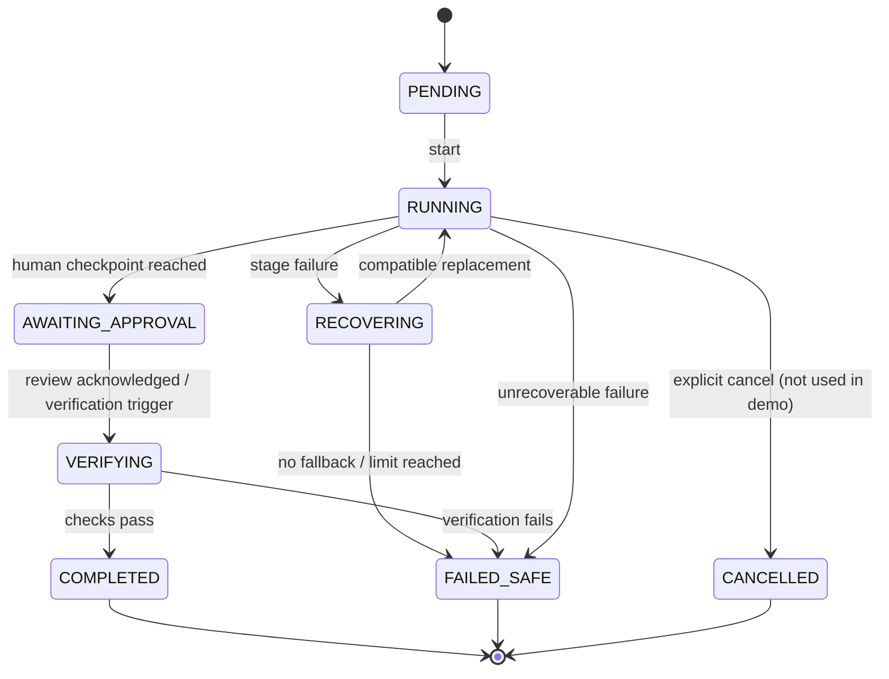
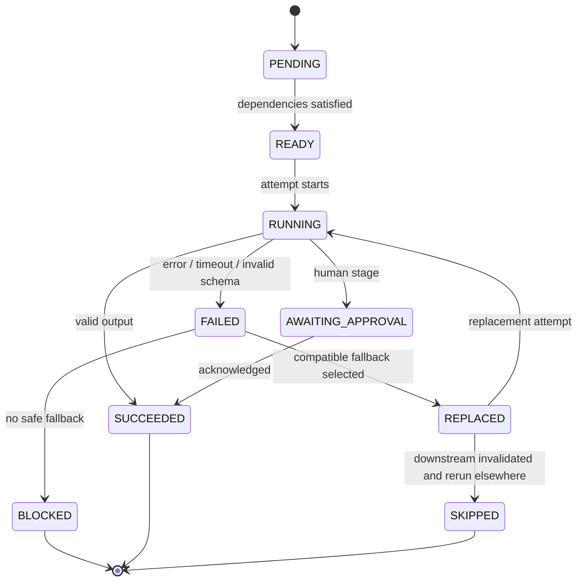

# 11 — Execution, Recovery and Verification Specification

**Status:** `PROPOSED — FREEZE AT P0`  
**Owner:** Team C (runtime, recovery, verifier, receipt semantics); Team B (persistence, APIs, role guards)  
**Consumers:** Team A (approval, monitor, verification, receipt, review)  
**Canonical code:** `src/server/runtime/**`, `src/server/verification/**`, `src/server/evidence/**`

---

## 1. Purpose

This specification defines how an approved ProofHire workflow runs, fails, recovers, stops safely, and is independently verified. It is the trust engine.

The core rule:

> An agent's `SUCCESS` is a claim, not a result. The verifier recomputes the result from evidence. A failed or replaced version is preserved, attributed at zero, and never silently overwritten.

---

## 2. Commercial precondition: work order

Execution cannot start until the buyer approves a versioned work order.

### 2.1 Work order content

| Field | WH-204 value |
|---|---:|
| Buyer total | ₹10,000 (`1,000,000` paise) |
| Evidence Reader | ₹2,000 (`200,000` paise) |
| Reconciliation | ₹2,500 (`250,000`) |
| Exception reporting | ₹1,000 (`100,000`) |
| Builder subtotal | ₹5,500 (`550,000`) |
| Platform fee | ₹2,500 (`250,000`) |
| Execution/recovery reserve | ₹1,200 (`120,000`) |
| Human-review reserve | ₹800 (`80,000`) |

### 2.2 Approval rules

- Buyer role only.
- Job must be `SELECTED`.
- Work order must be `DRAFT` or `AWAITING_APPROVAL`.
- Allocations must sum exactly to the buyer total, in integer paise.
- Terms: acceptance required; inventory commit requires human approval; max 1 retry; max 1 replacement; `SIMULATED_ELIGIBILITY_ONLY`.
- Duplicate approval with the same idempotency key returns the same approved record.
- Approval transitions the job to `APPROVED`; it does not start execution.
- Approval does not imply payment; settlement is simulated eligibility after verification.

### 2.3 Allocation semantics

- The reconciliation allocation is bound to the **stage**, not to v1.0.0.
- If v1.1.0 produces the accepted output, it receives the ₹2,500.
- v1.0.0 receives ₹0 with reason `REPLACED_BEFORE_ACCEPTED_OUTPUT`.
- Platform-owned functions are paid from the platform side, not as builder contributions.
- Reserves are not builder earnings.

---

## 3. Execution model

### 3.1 Runtime shape

- In-process orchestrator behind a Next.js route handler.
- Topological stage execution in dependency order.
- Each stage is persisted before and after execution.
- One execution per reset; idempotent start.
- Browser polls every 500 ms; stop at a terminal state.
- A restart resumes from persisted stage state.
- No arbitrary code execution; adapters are allow-listed functions.
- No network or LLM dependency on the critical path.

### 3.2 Stage sequence

```text
1. stage-evidence-read       Evidence Reader v1.0.0          AGENT
2. stage-reconcile           Reconciliation v1.0.0           AGENT
                             └─ fallback v1.1.0
3. stage-policy-check        Policy Validator                DETERMINISTIC
4. stage-exception-report    Exception Reporter v1.0.0       AGENT
5. stage-propose-inventory   Inventory Proposal              DETERMINISTIC
6. stage-human-approval      Buyer checkpoint                HUMAN_APPROVAL
```

Verification runs after the execution reaches the approval gate, outside the workflow graph.

### 3.3 Stage contract validation

Before a stage runs:

1. The input exists and parses against the stage input schema.
2. The selected implementation is active and compatible.
3. Permissions are a subset of the stage scope.
4. The stage budget is within the remaining execution budget.
5. The stage is not already running.

After a stage runs:

1. The output parses against the stage output schema.
2. Required fields are present with correct types.
3. The raw output is persisted even on failure.
4. Cost and latency are recorded.
5. A monotonic event is emitted.

### 3.4 Execution state machine



**Important:** `COMPLETED` means the workflow reached a terminal, verified outcome. It does **not** mean inventory was committed or money moved. For WH-204 the receipt status remains `VERIFIED_PENDING_HUMAN_APPROVAL`.

### 3.5 Stage state machine



A failed `StageRun` is immutable. A replacement is a new attempt with `supersedesStageRunId` pointing to the failed attempt.

---

## 4. Events and persistence

### 4.1 Execution event

Every material change emits an event with:

- `sequence`: unique and monotonic per execution.
- `type`: from the frozen event enum.
- `stageId`, `actor`, `payload`.
- `idempotencyKey`: unique per execution.
- Optional hash chain (`hashPrev`, `hash`) for tamper evidence.

Demo event order (successful recovery path):

```text
1  EXECUTION_STARTED
2  STAGE_READY          evidence-read
3  STAGE_STARTED        evidence-read
4  STAGE_SUCCEEDED      evidence-read
5  STAGE_READY          reconcile
6  STAGE_STARTED        reconcile v1.0.0 attempt 1
7  STAGE_FAILED         reconcile v1.0.0 AGENT_SCHEMA_INVALID
8  RECOVERY_STARTED     reconcile
9  FALLBACK_SELECTED    v1.1.0
10 AGENT_REPLACED       v1.0.0 → v1.1.0
11 STAGE_STARTED        reconcile v1.1.0 attempt 2
12 STAGE_SUCCEEDED      reconcile v1.1.0
13 STAGE_RERUN          downstream invalidation
14 STAGE_STARTED        policy-check
15 STAGE_SUCCEEDED      policy-check
16 STAGE_STARTED        exception-report
17 STAGE_SUCCEEDED      exception-report
18 STAGE_STARTED        propose-inventory
19 STAGE_SUCCEEDED      propose-inventory (commit blocked)
20 STAGE_AWAITING_APPROVAL human-approval
21 VERIFICATION_STARTED
22 VERIFICATION_PASSED
23 REVIEW_ACKNOWLEDGED  (after buyer review)
24 RECEIPT_ISSUED
```

Exact event count is not the contract; ordering, uniqueness and idempotency are.

### 4.2 Polling payload

The execution read returns:

- Execution status, scenario, cost, recovery count, current stage.
- Ordered stages with attempt, implementation, status, cost, latency, error code.
- Recent events (paginated in P7).
- Recovery summary.
- Terminal flag.

The UI must stop polling at `AWAITING_APPROVAL`, `COMPLETED`, `FAILED_SAFE`, `VERIFICATION_FAILED` or `CANCELLED`.

---

## 5. Failure injection

### 5.1 Scenario flag

```text
DEMO_FAILURE_SCENARIO = WH204_DEFAULT_FAILURE | WH204_CLEAN
```

| Scenario | Behaviour |
|---|---|
| `WH204_DEFAULT_FAILURE` | Reconciliation v1.0.0 returns a malformed quantity payload on attempt 1. |
| `WH204_CLEAN` | No injected failure; the clean path is used for tests and fallback demos. |

### 5.2 Injected failure

| Field | Value |
|---|---|
| Stage | `stage-reconcile` |
| Attempt | 1 |
| Version | `av-reconciliation-100` |
| Error code | `AGENT_SCHEMA_INVALID` |
| Raw output | Malformed quantity object preserved |
| Agent status | May claim `SUCCESS`; the runtime rejects the schema |
| UI | Red failed node; raw output viewable; failure labelled as controlled injection |

The failure is explicit in the execution payload. Do not disguise it as a random production incident.

### 5.3 Why schema-invalid, not a crash

- It proves the runtime validates outputs rather than trusting `SUCCESS`.
- It preserves a real artifact for the recovery story.
- It is deterministic and fast.
- It creates a clean distinction: v1.0.0 failed; v1.1.0 is compatible.

---

## 6. Recovery

### 6.1 Recovery policy

When a stage fails:

1. Record the failure and preserve the raw output.
2. If a retry is allowed and meaningful, retry once (max 1).
3. If retry fails or is not appropriate, search for a compatible replacement.
4. If a replacement exists, verify compatibility and budget.
5. Replace, rerun the stage, invalidate completed downstream stages, rerun dependents.
6. If no replacement or limit is reached, stop safely with `FAILED_SAFE`.

### 6.2 Compatibility checks

A replacement must pass **all**:

| Check | Meaning |
|---|---|
| Same capability | Declares the failed stage's capability. |
| Input schema compatible | Accepts the stage input. |
| Output schema compatible | Produces the shape downstream expects. |
| Permissions subset | Does not exceed the stage scope; never `commit:inventory`. |
| Within reserve | Cost fits the execution/recovery reserve. |
| Active and visible | `ACTIVE`; marketplace-visible for a hire. |
| Not the failed version | A version cannot replace itself. |

Each check is stored with `code`, `passed` and `detail` in the `RecoveryEvent.compatibility` object.

### 6.3 WH-204 recovery

| Field | Value |
|---|---|
| Failed version | `av-reconciliation-100` |
| Failure code | `AGENT_SCHEMA_INVALID` |
| Strategy | `REPLACE` |
| Replacement | `av-reconciliation-110` |
| Attempt | 2 |
| Compatibility | all six checks pass |
| Downstream invalidated | policy, exception report, inventory proposal, human approval |
| Rerun | downstream stages run once against v1.1.0 output |
| Result | 10 received, 2 discrepancy, exception requires review |
| v1.0.0 contribution | ₹0, `REPLACED_BEFORE_ACCEPTED_OUTPUT` |
| v1.1.0 contribution | ₹2,500 |

### 6.4 Limits

| Limit | Value | Behaviour on breach |
|---|---|---|
| Retries per stage | 1 | `RECOVERY_LIMIT_REACHED` |
| Replacements per stage | 1 | `RECOVERY_LIMIT_REACHED` |
| Execution/recovery reserve | ₹1,200 (120,000 paise) | Stop before exceeding; `BUDGET_EXCEEDED` |
| Total execution budget | Bounded by the work order | `BUDGET_EXCEEDED` |
| Wall-clock stage timeout | Per manifest / stage policy | `AGENT_TIMEOUT` |

### 6.5 Safe stop

When recovery is impossible:

- Execution status: `FAILED_SAFE`.
- Stage status: `BLOCKED`.
- Error: `NO_COMPATIBLE_FALLBACK`, `RECOVERY_LIMIT_REACHED` or `BUDGET_EXCEEDED`.
- Preserve all evidence and raw outputs.
- No receipt as verified; no contributions; no settlement.
- UI shows a safe-failure panel with a human-review CTA.
- Never present the job as completed, verified or paid.

### 6.6 Downstream invalidation

If a completed downstream stage depended on the failed output:

1. Mark it `SKIPPED`/invalidated.
2. Preserve its previous attempt for audit.
3. Rerun it after the replacement succeeds.
4. Ensure exactly one accepted output per stage.
5. Do not create a second accepted contribution.

---

## 7. Independent verification

### 7.1 Independence rules

- The verifier is **not** an `AgentAdapter`.
- It is **not** in the agent registry or marketplace.
- It cannot be selected, hired or replaced.
- It does not trust agent self-reported success, status or narrative.
- It recomputes quantities from the seeded evidence and the execution artifacts.
- It is deterministic and versioned `sys-proofhire-verifier-v1`.

### 7.2 The ten checks

| Code | Critical | Assertion |
|---|---|---|
| `AC-01_RECEIVED_QUANTITY_EQUALS_PHYSICAL_SCAN` | Yes | Received = physical scan count = 10. |
| `AC-02_DISCREPANCY_QUANTITY_CORRECT` | Yes | Expected − received = 2. |
| `AC-03_MISMATCH_REPORTED_AGAINST_RECEIVING` | Yes | Report explains PO/invoice 12 vs receiving 10. |
| `AC-04_UNSUPPORTED_INVENTORY_COMMIT_BLOCKED` | Yes | No commit occurred; proposal blocked. |
| `AC-05_EVIDENCE_REFERENCES_PRESENT` | Yes | PO, invoice, scan references and hashes exist. |
| `AC-06_HUMAN_APPROVAL_GATE_PENDING` | Yes | Consequential commit pending human approval. |
| `AC-07_STATE_DIFF_MATCHES_EVIDENCE` | Yes | 42→42 committed invariant, pending 10, variance 2. Separate fields: expectedQuantity (12), invoicedQuantity (12), scannedQuantity (10), discrepancyQuantity (2). |
| `AC-08_NO_DUPLICATE_SIDE_EFFECT` | Yes | One accepted reconciliation, one proposal, no duplicate events. |
| `AC-09_STATUS_EXCEPTION_REQUIRES_REVIEW` | Yes | Outcome exactly `EXCEPTION_REQUIRES_REVIEW`. |
| `AC-10_ALL_STAGES_TERMINAL_AND_ATTRIBUTED` | No | Every stage terminal/awaiting approval and attributed once. |

### 7.3 Result shape

```ts
interface AcceptanceResult {
  acceptanceResultId: string;
  jobId: string;
  executionId: string;
  contractId: string;
  contractVersion: number;
  status: "PASSED" | "FAILED" | "PENDING_HUMAN_APPROVAL" | "ERROR";
  checks: AcceptanceCheckResult[];
  passedCount: number;
  failedCount: number;
  criticalFailureCount: number;
  verifierVersion: "sys-proofhire-verifier-v1";
  verifiedAt: string;
}
```

WH-204 result:

- 10 checks `PASSED`; 0 failed; 0 critical failures.
- Overall status: `PASSED`.
- Job status: `VERIFIED_PENDING_REVIEW`.
- Receipt status: `VERIFIED_PENDING_HUMAN_APPROVAL`.
- Inventory commit: `BLOCKED_PENDING_APPROVAL`.

**Implementation rule:** checks that describe a blocked-but-correct state must distinguish “the control worked” from “the action succeeded.” `AC-04` and `AC-06` pass because the commit is correctly blocked and approval is correctly pending; they do not imply inventory was committed. The separate receipt status carries the pending-human-approval meaning.

### 7.4 Negative verification

The verifier must fail when:

- Received quantity is wrong.
- Discrepancy is wrong.
- Evidence references are missing or hashes mismatch.
- The report contradicts the scan.
- An agent claims success while the final state is wrong.
- Inventory was committed without approval.
- A duplicate side effect occurred.
- A stage is non-terminal or attributed twice.

A passing score elsewhere cannot rescue a critical failure.

---

## 8. State diff and inventory gate

### 8.1 Truth and separate quantity fields

```json
{
  "quantities": {
    "expectedQuantity": 12,
    "invoicedQuantity": 12,
    "scannedQuantity": 10,
    "discrepancyQuantity": 2
  },
  "before": { "committedOnHand": 42, "pendingReceipt": 0, "unresolvedVariance": 0 },
  "after": { "committedOnHand": 42, "pendingReceipt": 10, "unresolvedVariance": 2 },
  "proposed": { "delta": 10, "onHandIfApproved": 52 },
  "commitStatus": "BLOCKED_PENDING_APPROVAL",
  "ledgerMutated": false
}
```

### 8.2 Rules

- The calculator never mutates the ledger.
- `committedOnHand` stays 42.
- `pendingReceipt` and `unresolvedVariance` describe the proposed outcome.
- `onHandIfApproved` is prospective only.
- `commit:inventory` is never granted to an agent.
- A direct commit attempt returns `403 FORBIDDEN` / `BLOCKED`, is audited, and does not change the ledger.
- Acknowledging the exception report does **not** approve the inventory correction.
- The demo ends with the commit still blocked.

### 8.3 Human review

Allowed decisions:

| Decision | Effect |
|---|---|
| `ACKNOWLEDGE_REPORT` | Records buyer acknowledgement; job moves to review-complete; inventory remains blocked. |
| `REQUEST_MANUAL_REVIEW` | Records escalation; inventory remains blocked; no payout change in the demo. |

Builder cannot review. Buyer cannot commit inventory through review.

---

## 9. Evidence receipt

### 9.1 Content

The receipt snapshots:

- Job, buyer, builder(s), contract and version.
- Work order and execution.
- Selected workflow graph and suite version.
- Every participating agent version, including the replaced v1.0.0.
- Ten acceptance checks with expected/actual/evidence.
- Result 10/2/`EXCEPTION_REQUIRES_REVIEW`.
- State diff.
- Recovery events and compatibility checks.
- Measured costs.
- Economics: buyer total, builder total, platform fee, reserves, settlement status.
- Integrity hash.

### 9.2 Canonical hash and tamper-evident verification

- Algorithm: SHA-256.
- Scope: `RECEIPT_BODY_V1`.
- Canonical JSON: recursively sorted keys, stable arrays, no whitespace variance.
- Exclude the `integrity` object from the hash input.
- The hash is stored and recomputed on read/export.
- A mismatch is an integrity violation, not a warning.
- The receipt is **tamper-evident and hash-verified**, rather than claiming absolute distributed immutability.

#### Explicit limitations of SHA-256 receipt hashing:
1. **Payload integrity only:** SHA-256 guarantees that the serialized receipt payload has not been modified after generation.
2. **Observation vs physical ground truth:** The hash confirms that the recorded observations (e.g. 10 scanned units, PO 12 units) match what the pipeline processed; it cannot verify whether upstream physical real-world data was mis-scanned or falsified before ingestion.
3. **Storage anchor boundary:** In a hackathon Neon PostgreSQL setup, hashes are verified server-side via SHA-256; true cryptographic non-repudiation requires external anchoring or distributed consensus (deferred post-hackathon).

### 9.3 Receipt status

- `VERIFIED_PENDING_HUMAN_APPROVAL` for WH-204.
- Never `VERIFIED` while inventory approval is pending.
- Never `FAILED` for a correctly blocked action.

### 9.4 Export

- JSON: full persisted receipt, recomputed hash, no secrets.
- Markdown: all critical sections, deterministic.
- Repeated exports are byte-identical for the same receipt.
- No PDF control in the demo.

---

## 10. Idempotency and concurrency

| Operation | Key | Expected |
|---|---|---|
| Approve work order | `work-order:{id}:approve` | Same approved record; no duplicate allocation |
| Start execution | `job:{id}:execution` | Same execution; no duplicate events |
| Stage attempt | `execution:{id}:stage:{node}:attempt:{n}` | Unique; no overwrite |
| Recovery | `execution:{id}:stage:{node}:recovery` | One event per failure path |
| Verification | `execution:{id}:verification` | Same acceptance result |
| Receipt | `execution:{id}:receipt` | Same receipt/hash |
| Contribution | `(executionId, stageId)` unique | One row per accepted stage |
| Settlement | `(jobId, workOrderId)` unique | One eligibility row |
| Review | `job:{id}:review:{decision}` | Idempotent acknowledgement |

Concurrency posture: one demo user, one execution, short serverless transactions managed via Neon PostgreSQL connection pooling. Asynchronous stage orchestration is driven dually by QStash durable step webhooks and polling API routes; retry idempotency is enforced by unique database constraints.

---

## 11. Failure matrix

| Failure | Code | Preserve | Terminal state | Payout |
|---|---|---|---|---|
| Invalid agent output | `AGENT_SCHEMA_INVALID` | Raw output | `RECOVERING` → replacement | Failed version ₹0 |
| Timeout | `AGENT_TIMEOUT` | Partial trace | Retry/replace or `FAILED_SAFE` | Failed version ₹0 |
| Runtime exception | `AGENT_RUNTIME_ERROR` | Stack-safe message | Retry/replace or `FAILED_SAFE` | Failed version ₹0 |
| Missing evidence | `EVIDENCE_MISSING` | Input refs | `FAILED_SAFE` | No contribution |
| Contradiction | `CONTRADICTORY_EVIDENCE` | Both sources | `FAILED_SAFE` | No contribution |
| No fallback | `NO_COMPATIBLE_FALLBACK` | Failed output | `FAILED_SAFE` | No contribution |
| Limit reached | `RECOVERY_LIMIT_REACHED` | Attempt history | `FAILED_SAFE` | No contribution |
| Budget exceeded | `BUDGET_EXCEEDED` | Cost records | `FAILED_SAFE` | No contribution |
| Verification failure | `VERIFICATION_FAILED` | Check results | `VERIFICATION_FAILED` | No eligibility |
| Unauthorized action | `FORBIDDEN` | Audit event | State unchanged | None |

No failure path may produce a verified receipt, an accepted contribution or a simulated payout.

---

## 12. Tests

### Runtime

- Happy path: six stages in order; terminal at approval gate.
- Injected failure: v1.0.0 fails with `AGENT_SCHEMA_INVALID`; raw output persisted.
- Recovery: v1.1.0 selected; all compatibility checks pass; downstream reruns once.
- No fallback: `FAILED_SAFE`; no receipt.
- Two replacements: refused with `RECOVERY_LIMIT_REACHED`.
- Reserve exhaustion: `BUDGET_EXCEEDED`.
- Duplicate start: one execution, no duplicate events.
- Restart mid-run: resumes from persisted state.
- Event sequence: unique and monotonic.

### Verifier

- WH-204 truth passes ten checks.
- Wrong received quantity fails `AC-01`.
- Wrong discrepancy fails `AC-02`.
- Missing evidence fails `AC-05`.
- Unsupported commit fails `AC-04`.
- Contradictory report fails `AC-03`.
- False agent success fails.
- Duplicate side effect fails `AC-08`.
- Wrong status fails `AC-09`.
- Verifier is absent from registry/marketplace.

### Receipt and review

- Receipt includes v1.0.0 and v1.1.0.
- Hash stable across reads and exports.
- Canonicalisation independent recomputation matches.
- Review acknowledge keeps commit blocked.
- Builder cannot review; buyer cannot commit.
- Direct commit returns 403 and writes an audit event.

---

## 13. Acceptance criteria

- [ ] Buyer approves exactly ₹10,000 in allocations.
- [ ] Execution runs six stages in dependency order.
- [ ] v1.0.0 fails with `AGENT_SCHEMA_INVALID`; raw output preserved.
- [ ] v1.1.0 is compatible, replaces it, and yields 10/2.
- [ ] Downstream stages rerun exactly once.
- [ ] The verifier independently passes ten checks for WH-204.
- [ ] State diff is 42/10/2; ledger is not mutated.
- [ ] Inventory commit remains `BLOCKED_PENDING_APPROVAL`.
- [ ] Receipt hash is stable and includes both reconciliation versions.
- [ ] No-fallback path ends `FAILED_SAFE` with no payout.
- [ ] Review acknowledgement does not commit inventory.
- [ ] All money remains simulated and labelled.

---

## Related documents

- [07 — Integration Contracts](07_INTEGRATION_CONTRACTS.md)
- [10 — Compiler and Evaluation](10_COMPILER_AND_EVALUATION_SPEC.md)
- [12 — Marketplace and Economics](12_MARKETPLACE_AND_ECONOMICS_SPEC.md)
- [13 — Demo Runbook](13_DEMO_RUNBOOK.md)
- [14 — Testing and Acceptance Plan](14_TESTING_AND_ACCEPTANCE_PLAN.md)
