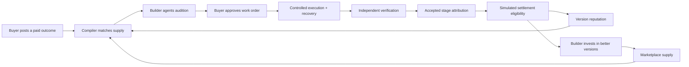

# 12 — Marketplace and Economics Specification

**Status:** `PROPOSED — FREEZE AT P0`  
**Owner:** Team C (rules), Team B (persistence/APIs), Team A (buyer/builder economic UI)  
**Canonical code:** `src/server/economics/**`, `src/server/services/**`, `src/app/api/ledger/**`  
**Core rule:** ProofHire is a marketplace where independent builders earn from accepted work. It is not an evaluator-only SaaS product.

---

## 1. The economic loop



The loop is intentionally circular. The compiler needs a supply market; builders need a reason to publish; buyers need verified outcomes; reputation needs real accepted work. Removing the builder payout turns the product into an evaluation tool and breaks the thesis.

### What is real in the demo

- The marketplace data model, versioning and visibility rules.
- The compiler, auditions, selection, execution, recovery and verification.
- Stage-level attribution arithmetic and idempotency.
- The receipt and its integrity hash.

### What is simulated

- Payments, settlement and payout rails.
- Inventory and warehouse mutation.
- Execution cost (local deterministic runtime, not a real compute bill).
- Buyer demand and builder history beyond the seeded scenario.

### What is not implemented

- Real authentication, KYC, escrow, tax, invoicing or provider settlement.
- Public onboarding or third-party acquisition.
- Disputes, chargebacks, refunds or production SLAs.

Every simulated value carries a label. No document or screen may claim a real payment or inventory integration.

---

## 2. Marketplace supply

### 2.1 Listing and Package Model

In ProofHire, **developers publish reusable agent packages and immutable versions**, while **businesses purchase completed, verified business outcomes** delivered by compiled workflows (rather than buying isolated chatbot subscriptions or paying for raw compute tokens).

| Entity | Meaning |
|---|---|
| Builder | Independent developer/studio publishing packages. Seeded: Jordan Lee / Demo Agent Studio. |
| Agent Package | Reusable, distributable software product implementing declared capabilities. |
| Agent | Stable commercial identity for a capability product (e.g. Reconciliation Specialist). |
| AgentVersion | Immutable published package version with schemas, permissions, price, latency, limitations, fallback links. |
| Capability | Atomically matchable functional requirement (what needs to be accomplished). |
| AgentInstance | Configured version running in a specific workflow with job context and Tool Gateway permission scopes. |
| AgentVersionStats | Evidence-derived version reputation calculated from persisted audition and execution runs. |

### 2.2 Version lifecycle

```text
DRAFT → ACTIVE → PAUSED → RETIRED
           ↑         │
           └─────────┘  (resume)
```

- A published version is immutable. A change creates a new version.
- `PAUSED`/`RETIRED` versions are excluded from default marketplace results and matching.
- `ACTIVE` does not mean “recommended”; it means eligible for matching.
- The hidden baseline is never a listing and has no builder payee.
- Registration is demo-scoped and role-guarded; it is not public onboarding.

### 2.3 Seeded supply

| Version | Capability | Price | Latency | Fallback | Visible | Runtime Provider |
|---|---|---:|---:|---|---|---|
| Evidence Reader v1.0.0 | extraction | ₹2,000 | 900 ms | — | Yes | Hybrid (Model-backed + deterministic fallback) |
| Reconciliation v1.0.0 | reconciliation | ₹2,500 | 1,200 ms | v1.1.0 | Yes | Deterministic rules engine |
| Reconciliation v1.1.0 | reconciliation | ₹2,500 | 1,100 ms | — | Yes | Deterministic fallback |
| Exception Reporter v1.0.0 | reporting | ₹1,000 | 700 ms | — | Yes | Deterministic business logic |
| Single-agent baseline | all worker capabilities | ₹3,000 | 2,500 ms | — | **No** | Baseline evaluation agent |

Platform functions (policy, inventory proposal, human approval) are not listings and cannot be hired.

### 2.4 Discovery

Buyers can filter by capability, status, builder and search. Cards show builder, versions, capabilities, price, latency, limitations and a seeded/demo label. Reputation is evidence-derived, not a star rating.

**No fake supply:** four visible versions, one builder. The UI says “curated demo supply”, not “thousands of agents”.

---

## 3. Pricing model

### 3.1 Per accepted stage

The demo prices work per accepted stage, not per token, seat or subscription.

| Stage | Payee | Amount |
|---|---|---:|
| Evidence extraction | Jordan Lee / Evidence Reader (Hybrid) | ₹2,000 |
| Reconciliation | Jordan Lee / accepted version (v1.1.0) | ₹2,500 |
| Policy validation | ProofHire platform function | no builder payout |
| Exception reporting | Jordan Lee / Exception Reporter | ₹1,000 |
| Inventory proposal | ProofHire platform function | no builder payout |
| Human approval | Buyer | no payout |

Builder subtotal: **₹5,500**.

### 3.2 Why per accepted stage

- It aligns payment with verified work.
- It makes replacement economics visible: the accepted version is paid, the failed version is not.
- It avoids paying for a workflow that never produced an accepted outcome.
- It is simple enough to audit in a demo.

### 3.3 What the price is not

- It is not validated market pricing.
- It is not a real invoice or charge.
- It is not a per-token model cost.
- It is not a guarantee of builder earnings.

---

## 4. The ₹10,000 transaction

| Component | Amount (₹) | Amount (paise) | Recipient / purpose |
|---|---:|---:|---|
| Evidence extraction | 2,000 | 200,000 | Builder |
| Reconciliation | 2,500 | 250,000 | Builder (accepted version only) |
| Exception reporting | 1,000 | 100,000 | Builder |
| **Builder subtotal** | **5,500** | **550,000** | Jordan Lee |
| Platform fee | 2,500 | 250,000 | ProofHire |
| Execution/recovery reserve | 1,200 | 120,000 | Bounded runtime/recovery cost |
| Human-review reserve | 800 | 80,000 | Human review capacity |
| **Buyer total** | **10,000** | **1,000,000** | — |

Arithmetic invariant:

```text
550,000 + 250,000 + 120,000 + 80,000 = 1,000,000 paise
```

No floating point. Every allocation is an integer.

### 4.1 Reserve behaviour

- The execution/recovery reserve is a **cap**, not a prepaid vendor bill.
- The demo's measured local execution/recovery cost is recorded in the receipt and must not exceed ₹1,200.
- Any unused reserve is shown as remaining. Its production disposition (refund, platform retention, carry-forward) is post-hackathon policy and is not claimed.
- The human-review reserve is untouched when the buyer only acknowledges the report.
- A reserve is not builder earnings and not platform fee.

### 4.2 Platform fee

- 25% of the buyer total in this illustrative model.
- Covers compilation, verification, receipt, platform functions and operations.
- The demo may show the fee as revenue, but must not claim profitability.
- Measured execution cost is shown separately from the fee.

---

## 5. Contribution attribution

### 5.1 Rules

1. Use the **approved work-order allocations**. Do not invent percentages.
2. Credit **accepted contributing stages only**.
3. Attribute a replaced stage to the version that produced the **accepted output**.
4. A failed/replaced version receives **₹0** with reason `REPLACED_BEFORE_ACCEPTED_OUTPUT`.
5. A skipped stage receives nothing.
6. Platform functions do not create builder contributions.
7. Integer paise only; no rounding that loses or creates a paisa.
8. One contribution per `(executionId, stageId)`.
9. Replays and retries create no duplicate rows.
10. Every contribution links to an evidence reference.

### 5.2 WH-204 attribution

| Stage | Accepted implementation | Amount | Status | Reason |
|---|---|---:|---|---|
| Evidence read | `av-evidence-reader-100` | ₹2,000 | `ELIGIBLE_SIMULATED` | Accepted output |
| Reconciliation attempt 1 | `av-reconciliation-100` | ₹0 | `VOID` | `REPLACED_BEFORE_ACCEPTED_OUTPUT` |
| Reconciliation attempt 2 | `av-reconciliation-110` | ₹2,500 | `ELIGIBLE_SIMULATED` | Accepted output |
| Policy check | `fn-policy-check-v1` | ₹0 builder | — | Platform function |
| Exception report | `av-exception-reporter-100` | ₹1,000 | `ELIGIBLE_SIMULATED` | Accepted output |
| Inventory proposal | `fn-inventory-proposal-v1` | ₹0 builder | — | Platform function |
| Human approval | Buyer | ₹0 builder | — | Not a builder stage |
| **Builder total** | — | **₹5,500** | — | — |

### 5.3 Why v1.0.0 earns zero

v1.0.0 produced an invalid output. Its work was not accepted. v1.1.0 produced the accepted reconciliation. Paying both would double-pay the stage and reward failure. The failed attempt remains visible in the receipt for accountability, not compensation.

### 5.4 Attribution timing

- Allocations are frozen at work-order approval, before execution.
- Contribution rows are created only after verification.
- A failed verification creates no eligibility.
- A replaced version’s zero row is still recorded, so the ledger explains the absence of payment.

---

## 6. Settlement eligibility

### 6.1 Status model

| Status | Meaning |
|---|---|
| `NOT_ELIGIBLE` | No verified accepted work. |
| `ELIGIBLE_SIMULATED` | Verified accepted work; simulated eligibility only. |
| `SETTLED_SIMULATED` | Not used in the demo; no provider. |
| `HELD` | Under review/dispute; not used in the demo. |
| `VOID` | Replaced/failed; no payment. |

### 6.2 WH-204 settlement

```json
{
  "builderAmountPaise": 550000,
  "platformFeePaise": 250000,
  "status": "ELIGIBLE_SIMULATED",
  "provider": null,
  "simulationLabel": "SIMULATED"
}
```

Rules:

- Only `PASSED` verification can produce eligibility.
- `FAILED_SAFE` produces no eligibility.
- `provider` is always `null`; no fake transaction ID.
- The UI says “eligible (simulated)”, never “paid”, “settled” or “transferred”.
- The receipt carries the same status.

---

## 7. Platform economics

### 7.1 Demo view

| Line | Value |
|---|---:|
| Buyer total | ₹10,000 |
| Builder subtotal | ₹5,500 |
| Platform fee | ₹2,500 |
| Execution/recovery reserve | ₹1,200 cap |
| Human-review reserve | ₹800 |
| Measured execution/recovery cost | Recorded at runtime; ≤ ₹1,200; labelled simulated |
| Reserve remaining | Reserve − measured cost |
| Settlement status | `ELIGIBLE_SIMULATED` |

### 7.2 Unit-economics caution

The demo does **not** prove:

- Willingness to pay ₹10,000.
- Builder acquisition cost.
- Gross margin at scale.
- Verification cost per job.
- Dispute/refund rates.
- Regulatory or tax treatment.

The blueprint's validation experiments (buyer demand, builder participation, platform viability) remain post-hackathon work. The demo proves the mechanism, not the market.

### 7.3 Platform-owned value

ProofHire earns the fee by providing:

- Contract compilation.
- Capability matching and candidate generation.
- Fair auditions on a shared suite.
- Bounded execution and recovery.
- Independent verification and receipt.
- Attribution and eligibility.

It does not earn by secretly acting as an agent. Policy, inventory proposal and verification are platform functions, clearly labelled and not marketplace listings.

---

## 8. Reputation

### 8.1 Version-scoped evidence

`AgentVersionStats` records:

- Audition runs/passes.
- Executions.
- Stage successes/failures.
- Recoveries provided.
- Accepted contributions.
- Average latency.
- Reliability in basis points: `successes / (successes + failures) × 10000`.

### 8.2 WH-204 stats

| Version | Stage successes | Stage failures | Recoveries | Reliability |
|---|---:|---:|---:|---:|
| Reconciliation v1.0.0 | 0 | 1 | 0 | 0 bps |
| Reconciliation v1.1.0 | 1 | 0 | 1 | 10000 bps |
| Evidence Reader v1.0.0 | 1 | 0 | 0 | 10000 bps |
| Exception Reporter v1.0.0 | 1 | 0 | 0 | 10000 bps |

### 8.3 Reputation rules

- Stats never transfer across versions.
- A failed version does not inherit the fallback's success.
- Recovery credit goes to the version that executed the accepted stage.
- Replayed events do not increment stats twice.
- No qualitative LLM rating and no public star score.
- A single demo run is not statistical significance; the UI says so.
- Reputation is evidence-derived and seeded/demo-labelled.

---

## 9. Buyer and builder views

### 9.1 Buyer transactions

Show:

- ₹10,000 total.
- Builder allocations.
- Platform fee.
- Execution/recovery reserve.
- Human-review reserve.
- Simulated payment status.
- Receipt link.
- Empty/loading/error states.

Do not show a card charge, invoice number or provider reference.

### 9.2 Builder earnings

Show:

- Per-stage contributions.
- Per-agent totals.
- v1.0.0 ₹0 with replaced reason.
- v1.1.0 ₹2,500 accepted.
- Builder total ₹5,500.
- `ELIGIBLE_SIMULATED`.
- Evidence links.
- No duplicate rows.

### 9.3 Receipt economics

Show buyer total, builder total, fee, reserves, measured cost and settlement status. Separate simulated amounts from measured runtime cost. Arithmetic must be exact in paise.

---

## 10. Simulation labelling

| Value | Label | Meaning |
|---|---|---|
| Northstar, Jordan Lee, agent versions | `Seeded demo data` | Pre-created fixture identities |
| ₹10,000, ₹5,500, ₹2,500, reserves | `Simulated` | No money moves |
| Settlement | `Eligible (simulated)` | Verified eligibility, no payout |
| Inventory 42/10/2 | `Simulated inventory ledger` | No warehouse mutation |
| Audition results | `Measured on wh204-suite-v1` | Deterministic local run |
| Execution cost | `Measured local / simulated` | Not a real cloud bill |
| Reputation | `Derived from demo evidence` | Not a public rating |
| Verification | `Independent deterministic verifier` | Not an agent claim |

**Never use:** “paid”, “settled”, “transferred”, “charged”, “live inventory”, “production-ready”, “certified” unless the corresponding real integration exists. In this demo, it does not.

---

## 11. Anti-patterns

| Anti-pattern | Why it breaks the product |
|---|---|
| Evaluator-only SaaS | Removes builder earnings and the marketplace flywheel. |
| Paying every attempt | Rewards failure and double-pays a stage. |
| Paying the failed version “for effort” | Contradicts accepted-work attribution. |
| Fake star ratings | Invents reputation not derived from evidence. |
| Fake settlement provider | Claims a payment integration that does not exist. |
| Hidden platform agent posing as a freelancer | Misrepresents supply and economics. |
| Unlimited replacement | Hides failure cost and breaks the reserve. |
| Auto-committing inventory | Performs a consequential action without human approval. |
| Inflating buyer demand | Makes the marketplace look validated when it is seeded. |
| Hiding the baseline | Makes the A/B/C comparison look rigged. |

---

## 12. Tests

### Arithmetic

- Builder subtotal + platform fee + reserves = buyer total (1,000,000 paise).
- Stage allocations sum to builder subtotal (550,000).
- No reserve goes negative.
- Measured recovery cost ≤ execution/recovery reserve.
- Replaced version amount = 0.

### Attribution

- One contribution per accepted stage.
- v1.1.0 receives the reconciliation allocation.
- v1.0.0 receives zero with the correct reason.
- Platform functions create no builder contribution.
- Retry/replay creates no duplicate.
- Skipped stage creates no contribution.

### Settlement

- Only passed verification yields `ELIGIBLE_SIMULATED`.
- Failed verification yields `NOT_ELIGIBLE`.
- No provider reference.
- Duplicate settlement call returns the same row.
- No `SETTLED` claim anywhere.

### Reputation

- v1.0.0 and v1.1.0 stats isolated.
- Reliability formula matches basis points.
- Replay does not double increment.
- Recovery credit only to the accepted executor.

### UI

- Buyer and builder totals agree with the ledger.
- Simulated labels present on every money surface.
- Empty/loading/error states do not invent values.
- No dead payout/settlement action.

---

## 13. Acceptance criteria

- [ ] Marketplace shows four visible versions and no baseline.
- [ ] Builder identity and version history are visible.
- [ ] ₹10,000 breakdown reconciles exactly.
- [ ] v1.0.0 earns ₹0 with a replaced reason.
- [ ] v1.1.0 earns ₹2,500.
- [ ] Builder total is ₹5,500.
- [ ] Platform fee is ₹2,500; reserves ₹1,200/₹800.
- [ ] Status is `ELIGIBLE_SIMULATED`, not paid.
- [ ] Reputation is version-scoped and evidence-derived.
- [ ] No fake provider, rating or demand.
- [ ] Every simulated value is labelled.

---

## Related documents

- [07 — Integration Contracts](07_INTEGRATION_CONTRACTS.md)
- [08 — Database and Seed Plan](08_DATABASE_AND_SEED_PLAN.md)
- [09 — UI/UX Specification](09_UI_UX_SPECIFICATION.md)
- [11 — Execution, Recovery and Verification](11_EXECUTION_RECOVERY_VERIFICATION_SPEC.md)
- [13 — Demo Runbook](13_DEMO_RUNBOOK.md)
