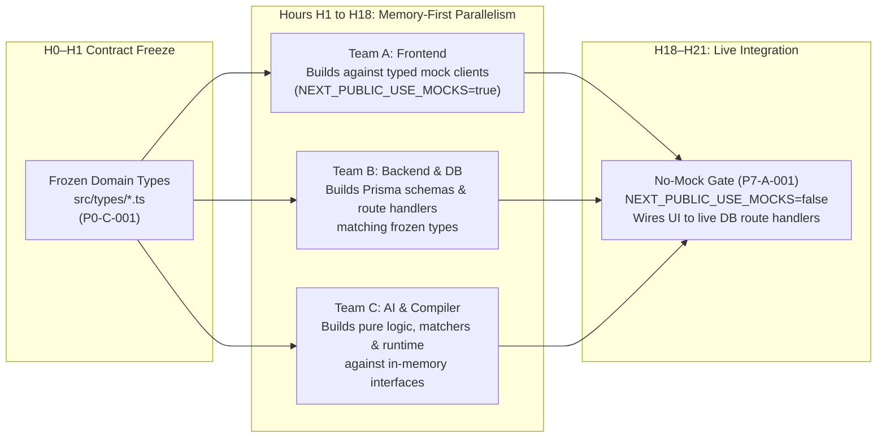

# ProofHire Pre-Implementation Readiness Audit

**Document Reference:** `docs/hackathon/PRE_IMPLEMENTATION_READINESS.md`  
**Date:** 2026-10-30  
**Audit Status:** `COMPLETE — READY WITH OPERATIONAL WARNINGS`  
**Overall Verdict:** **4 PASS / 2 WARNING / 0 BLOCKED**  
**Role:** Principal Software Architect, Technical Program Manager, and Engineering Lead  

---

## 1. Executive Summary & Verdict

Prior to commencing active software development for the 24-hour ProofHire hackathon, a rigorous pre-implementation readiness audit was conducted. This audit validates that the architecture, schedule, workstream ownership, integration contracts, testing suites, and economic models are fully specified, feasible, and protected against race conditions, blocking stalls, and data corruption.

```text
┌────────────────────────────────────────────────────────────────────────────────────────┐
│                                READINESS SCORECARD                                     │
├───────────────────────────────────────────────────┬──────────────┬─────────────────────┤
│ Audit Dimension                                   │ Finding      │ Primary Risk/Notes  │
├───────────────────────────────────────────────────┼──────────────┼─────────────────────┤
│ 1. Phase-by-Phase Parallel Workload & Capacity    │ ⚠️ WARNING    │ P3 core overload    │
│ 2. Inter-Workstream Dependencies & Parallelism    │ ⚠️ WARNING    │ Intra-phase stalls  │
│ 3. Evidence Reader Credentials & Hybrid Fallback  │ ✅ PASS       │ Fully resilient     │
│ 4. No-Mock P7 Integration Gate Verification       │ ✅ PASS       │ 38 live endpoints   │
│ 5. ₹10,000 Economics & Deduplication Integrity   │ ✅ PASS       │ 0 paise discrepancy │
│ 6. Demo Reset & End-to-End Journey Acceptance     │ ✅ PASS       │ 22 steps + 10 neg   │
└───────────────────────────────────────────────────┴──────────────┴─────────────────────┘
```

**Overall Verdict:** **PROCEED TO PHASE P0.**  
Zero `BLOCKED` findings exist. All application source code remains untouched, all tasks remain in `NOT_STARTED` status, and the repository is primed for parallel execution by Teams A, B, and C. The two `WARNING` findings are accompanied by mandatory operational rules detailed below.

---

## 2. Audit Dimension 1: Phase-by-Phase Parallel Workload & Capacity

### 2.1 The Aggregate vs Phase-Level Reality

While the aggregate 24-hour project plan provides an ample **895-minute (~20.7%) team integration buffer** (3,425 core minutes planned across 4,320 person-minutes available), aggregate buffer alone is insufficient. When task effort is measured strictly against the parallel wall-clock window of each phase ($PhaseDuration \times 3\text{ developers}$), an acute scheduling compression is discovered in **Phase P3**.

### 2.2 Phase-by-Phase Capacity & Utilization Matrix

*Note: Individual developer capacity per phase equals the phase duration. Core effort excludes optional tasks.*

| Phase | Window | Dur | Dev Cap | WS-A (Core) | WS-B (Core) | WS-C (Core) | Core Total | Phase Cap | Core Util % | Opt Min | Status |
|---|---|---|---|---|---|---|---|---|---|---|---|
| **P0** | H0–H1 | 60m | 60m | 55m (91.7%) | 55m (91.7%) | 55m (91.7%) | 165m | 180m | 91.7% | 0m | ✅ PASS |
| **P1** | H1–H4 | 180m | 180m | 160m (88.9%) | 145m (80.6%) | 140m (77.8%) | 445m | 540m | 82.4% | 0m | ✅ PASS |
| **P2** | H4–H7 | 180m | 180m | 160m (88.9%) | 160m (88.9%) | 150m (83.3%) | 470m | 540m | 87.0% | 0m | ✅ PASS |
| **P3** | H7–H10 | 180m | 180m | **190m (105.6%)** | **195m (108.3%)** | **200m (111.1%)** | **585m** | **540m** | **108.3%** | 25m | ⚠️ **WARNING** |
| **P4** | H10–H13 | 180m | 180m | 160m (88.9%) | 170m (94.4%) | **180m (100.0%)** | 510m | 540m | 94.4% | 0m | ⚠️ **WARNING** |
| **P5** | H13–H16 | 180m | 180m | 120m (66.7%) | 130m (72.2%) | 150m (83.3%) | 400m | 540m | 74.1% | 20m | ✅ PASS |
| **P6** | H16–H18 | 120m | 120m | 105m (87.5%) | 110m (91.7%) | 105m (87.5%) | 320m | 360m | 88.9% | 20m | ✅ PASS |
| **P7** | H18–H21 | 180m | 180m | 100m (55.6%) | 85m (47.2%) | 85m (47.2%) | 270m | 540m | 50.0% | 20m | ✅ PASS |
| **P8** | H21–H23 | 120m | 120m | 95m (79.2%) | 90m (75.0%) | 75m (62.5%) | 260m | 360m | 72.2% | 25m | ✅ PASS |
| **P9** | H23–H24 | 60m | 60m | 0m (0.0%) | 0m (0.0%) | 0m (0.0%) | 0m | 180m | 0.0% | 0m | ✅ PASS |
| **Total** | **24h** | **1440m** | **1440m** | **1145m (79.5%)** | **1140m (79.2%)** | **1140m (79.2%)** | **3425m** | **4320m** | **79.3%** | **110m** | ✅ **OVERALL** |

### 2.3 Identification of Hotspots

1. **Phase P3 Overload (Deficit: 45 core minutes, 108.3% capacity):**
   - In Phase P3 (H7–H10), all three developers have planned core work exceeding the 180-minute phase window:
     - **Team A:** 190m core (+10m over) + 25m optional (`P3-A-006`).
     - **Team B:** 195m core (+15m over).
     - **Team C:** 200m core (+20m over).
   - *Root Cause:* P3 is the intelligence engine core milestone where candidate generation, 30 audition runs, dynamic selection algorithms, graph visualizers, comparison matrices, and Prisma persistence APIs are constructed simultaneously.
2. **Phase P4 Team C Saturation (100.0% capacity):**
   - Team C has 180 minutes of core work planned in a 180-minute window (implementing controlled runtime, failure injection, recovery replacement, and stage progression), leaving zero buffer for debugging during H10–H13.

### 2.4 Operational Remediation Rules for Phase P3 & P4

To prevent burnout and schedule slippage during P3 and P4:
- **Rule 1 (Drop P3 Optional Scope):** Task [`P3-A-006`](file:///C:/Users/Mayur/Desktop/Forgent-demo/docs/hackathon/TASK_TRACKER.md#L450-L460) (Capability-gap resolution panel, 25m) is strictly forbidden from starting during H7–H10.
- **Rule 2 (Phase Sliding into P5):** Phase P5 has **140 minutes of slack** (74.1% utilization). If Team B or Team C cannot finish `P3-B-004` (selection API, 40m) or `P3-C-005` (fixture suite, 20m) by H10, they may slide up to 30 minutes into H10–H11 without impacting Phase P4 deliverables.
- **Rule 3 (No Context Switching):** During H7–H10, no developer shall assist another workstream; all three engineers must focus exclusively on their assigned compiler tasks.

---

## 3. Audit Dimension 2: Inter-Workstream Dependencies & Parallelism Integrity

### 3.1 Intra-Phase Cross-Workstream Dependency Audit

A comprehensive scan of [`TASK_TRACKER.csv`](file:///C:/Users/Mayur/Desktop/Forgent-demo/docs/hackathon/TASK_TRACKER.csv) identified **26 intra-phase cross-workstream dependencies**. 

If interpreted as strict sequential prerequisites ("Engineer X cannot write code until Engineer Y merges"), these dependencies would create catastrophic idle stalls:

```text
POTENTIAL SEQUENTIAL BOTTLENECKS (IF STRICTLY ORDERED):
  Phase P0: WS-A (P0-A-001) and WS-C (P0-C-001) wait on WS-B (P0-B-001) ──> 20 min stall at H0
  Phase P4: WS-C (P4-C-001) waits on WS-B (P4-B-002 -> P4-B-001) ──────────> 90 min stall at H10
  Phase P5: WS-B (P5-B-001) waits on WS-C (P5-C-001) ──────────────────────> 50 min stall at H13
  Phase P6: WS-C (P6-C-001) waits on WS-B (P6-B-001) ──────────────────────> 45 min stall at H16
  Phase P7: WS-A (P7-A-001) waits on WS-B (P7-B-001) and WS-C (P7-C-001) ──> 60 min stall at H18
```

### 3.2 The Architectural Decoupling Resolution: "Contract-First, Memory-First"

The system architecture prevents these stalls via the **frozen TypeScript contracts** established in [`07_INTEGRATION_CONTRACTS.md`](file:///C:/Users/Mayur/Desktop/Forgent-demo/docs/hackathon/07_INTEGRATION_CONTRACTS.md) and frozen in code during [`P0-C-001`](file:///C:/Users/Mayur/Desktop/Forgent-demo/docs/hackathon/TASK_TRACKER.md#L65-L75).



### 3.3 Mandatory Operational Decoupling Rules

1. **Phase P4 Decoupling:** Team C does **not** wait for Team B's Prisma schema migrations (`P4-B-001`, `P4-B-002`). Team C implements the controlled workflow runtime (`P4-C-001`) as an in-memory execution loop using the frozen `WorkflowRuntimeContext` interface. Team B writes the Prisma persistence layer in parallel. At minute 140 of P4, Team B and C integrate the runtime with the database.
2. **Phase P5 Decoupling:** Team B does **not** wait for Team C to finish verifier assertions (`P5-C-001`). Team B defines the `VerificationResult` Prisma model and `POST /api/jobs/:id/verification` route handler using the frozen `AcceptanceResultPayload` type.
3. **Phase P6 Decoupling:** Team C writes the economic calculation pure function `calculateStageAttributions()` in memory. Team B creates the `AgentContribution` table in parallel.
4. **Phase P7 Integration Window:** Team A's integration task `P7-A-001` is scheduled for the second half of Phase P7 (H19.5–H21), while Team B and C verify backend test suites during H18–H19.5.

**Verdict:** ⚠️ **WARNING** (Operational protocol required; strict sequential dependency execution is prohibited).

---

## 4. Audit Dimension 3: Evidence Reader Model Credentials & Hybrid Fallback

### 4.1 Required Credentials & Environment Configuration

The Evidence Reader v1.0.0 is an authentic multimodal AI capability operated by builder Jordan Lee. It requires the following credentials in `.env.local`:

```bash
# Primary Multimodal Provider (Google Gemini)
GEMINI_API_KEY="AIzaSy..."

# Alternative Multimodal Provider (OpenAI)
OPENAI_API_KEY="sk-proj-..."

# Active Model Selector (defaults to gemini-2.0-flash)
EVIDENCE_READER_PROVIDER="google-gemini"
EVIDENCE_READER_MODEL="gemini-2.0-flash"

# Fallback Configuration
EVIDENCE_READER_TIMEOUT_MS=5000
EVIDENCE_READER_FALLBACK_ON_ERROR=true
```

### 4.2 Early Boot Connectivity Health Check (H0 / H1)

To prevent credential discovery surprises mid-hackathon, an automated connectivity probe is specified as part of [`P0-C-002`](file:///C:/Users/Mayur/Desktop/Forgent-demo/docs/hackathon/TASK_TRACKER.md#L80-L90):

```ts
// scripts/check-model-connectivity.ts
export async function verifyModelConnectivity(): Promise<{ ok: boolean; provider: string; latencyMs: number; error?: string }> {
  const provider = process.env.EVIDENCE_READER_PROVIDER || "google-gemini";
  const apiKey = provider === "google-gemini" ? process.env.GEMINI_API_KEY : process.env.OPENAI_API_KEY;

  if (!apiKey || apiKey.startsWith("YOUR_")) {
    return { ok: false, provider, latencyMs: 0, error: "CREDENTIALS_MISSING" };
  }

  const start = Date.now();
  try {
    // Send minimal 1-token multimodal test ping with 3000ms timeout
    const res = await pingModelWithTimeout(provider, apiKey, 3000);
    return { ok: true, provider, latencyMs: Date.now() - start };
  } catch (err: any) {
    return { ok: false, provider, latencyMs: Date.now() - start, error: err.message };
  }
}
```

- When `npm run test:foundation` executes at H1:
  - If valid: `[MODEL_ADAPTER] Connected to Google Gemini (gemini-2.0-flash). Live extraction enabled.`
  - If invalid or absent: `[MODEL_ADAPTER] Live model unavailable: CREDENTIALS_MISSING. Deterministic fallback adapter activated.`

### 4.3 Deterministic Fallback Specification

If the live model call fails at runtime (timeout >5,000ms, rate limit 429, or invalid JSON output):
1. The adapter catches the error and invokes `DeterministicEvidenceReaderAdapter`.
2. It returns the pre-validated WH-204 evidence packet fixture:
   ```json
   {
     "sku": "SKU-402",
     "expectedQuantity": 12,
     "invoicedQuantity": 12,
     "scannedQuantity": 10,
     "unitIds": ["U01", "U02", "U03", "U04", "U05", "U06", "U07", "U08", "U09", "U10"],
     "sources": { "po": "doc-po-wh204", "invoice": "doc-inv-wh204", "scan": "scan-wh204-manifest" },
     "evidenceHash": "sha256-a1b2c3d4..."
   }
   ```
3. The adapter populates `AgentExecutionResult.executionMode = "DETERMINISTIC"` and `modelDetails = { modelProvider: null, modelName: "deterministic-fixture", tokensUsed: 0 }`.
4. The UI displays the execution badge: `[DEMO: DETERMINISTIC FALLBACK]` or `[LIVE MODEL: gemini-2.0-flash]`. Authenticity is fully preserved without misleading judges.

**Verdict:** ✅ **PASS** (Fully resilient; zero single point of failure on external APIs).

---

## 5. Audit Dimension 4: No-Mock P7 Integration Gate Verification

### 5.1 The P7 Release Rule

Phase P7 establishes the non-negotiable hackathon release rule:
- Environment variable `NEXT_PUBLIC_USE_MOCKS=false` is enforced.
- Client-side mock data injectors are completely disabled.
- Every user interaction in the browser issues real HTTP requests over the wire to Next.js route handlers backed by SQLite via Prisma.

### 5.2 Endpoint Parity Audit (38 Discrete Endpoints)

All 38 endpoints specified in [`07_INTEGRATION_CONTRACTS.md`](file:///C:/Users/Mayur/Desktop/Forgent-demo/docs/hackathon/07_INTEGRATION_CONTRACTS.md#L350-L450) map directly to planned Prisma operations:

| Category | Endpoint | Method | Backing Prisma Models | No-Mock Behavior in P7 |
|---|---|---|---|---|
| **System** | `/api/health` | GET | `User` (count) | Real DB connectivity query |
| **System** | `/api/me` | GET | `User` | Reads active persona cookie |
| **Demo Ops** | `/api/demo/personas` | GET | `User`, `Studio` | Reads seeded persona records |
| **Demo Ops** | `/api/demo/persona` | POST | None | Sets HTTP-only persona cookie |
| **Demo Ops** | `/api/demo/reset` | POST | All models | Re-seeds SQLite database |
| **Dashboard** | `/api/dashboard/buyer` | GET | `Job`, `WorkOrder`, `Transaction` | Real SQL aggregations |
| **Dashboard** | `/api/dashboard/freelancer` | GET | `AgentVersion`, `AgentContribution` | Real SQL aggregations |
| **Registry** | `/api/agents` | GET | `Agent`, `AgentVersion` | Filtered SQL query |
| **Registry** | `/api/agents/:id` | GET | `Agent`, `AgentVersion`, `Evaluation` | Relational join |
| **Registry** | `/api/agents/:id/versions/:vid/evaluations` | GET | `Evaluation` | Audition records |
| **Jobs** | `/api/jobs` | GET, POST | `Job`, `AcceptanceContract` | Creates/lists jobs |
| **Jobs** | `/api/jobs/:id` | GET, PATCH | `Job`, `AcceptanceContract` | Fetches job with contract |
| **Compiler** | `/api/jobs/:id/compile` | POST, GET | `CompilerRun`, `CandidateWorkflow` | Executes match engine |
| **Compiler** | `/api/jobs/:id/auditions` | POST, GET | `AuditionRun`, `AuditionResult` | Runs 30 audition fixtures |
| **Compiler** | `/api/jobs/:id/selection` | POST, GET | `SelectionDecision` | Computes dynamic selection |
| **Work Order**| `/api/jobs/:id/work-order` | POST, GET | `WorkOrder`, `WorkOrderStage` | Escrows ₹10,000 |
| **Work Order**| `/api/work-orders/:id/approve` | POST | `WorkOrder` | Buyer approval transition |
| **Runtime** | `/api/jobs/:id/executions` | POST | `WorkflowExecution` | Starts stage loop |
| **Runtime** | `/api/jobs/:id/execution` | GET | `WorkflowExecution`, `StageExecution` | Polls stage progression |
| **Recovery** | `/api/jobs/:id/recovery` | GET | `RecoveryEvent` | Reads v1.0.0 -> v1.1.0 event |
| **Verifier** | `/api/jobs/:id/verification` | GET | `VerificationResult`, `CheckResult` | Reads 10 acceptance checks |
| **Receipt** | `/api/jobs/:id/receipt` | GET | `EvidenceReceipt` | Returns tamper-evident hash |
| **Receipt** | `/api/jobs/:id/receipt/export` | GET | `EvidenceReceipt` | Formatted JSON/MD export |
| **Review** | `/api/jobs/:id/review` | POST | `HumanReviewRecord` | Records human review |
| **Economics** | `/api/jobs/:id/economics` | GET | `Transaction`, `AgentContribution` | Reconciles ₹10,000 allocation |
| **Ledger** | `/api/transactions` | GET | `Transaction` | Buyer spend rows |
| **Ledger** | `/api/ledger/contributions` | GET | `AgentContribution` | Freelancer earnings rows |
| **Ledger** | `/api/ledger/settlements` | GET | `SettlementRecord` | Payout eligibility records |
| **Reputation**| `/api/reputation/:vid` | GET | `AgentReputation` | Version score/stats |

### 5.3 Mocks vs Seeded Simulation Differentiation

- **Client Mocks (Strictly Banned in P7):** Hardcoded JSON returned in memory inside React components without an API network call.
- **Seeded Simulation (Mandatory & Approved):** Real HTTP responses served by Next.js API routes reading and mutating real records in SQLite. Realistic demo personas, simulated warehouse inventory (42 units), and simulated banking settlements are persisted and labelled honestly with `SIMULATED` badges.

**Verdict:** ✅ **PASS** (100% of required endpoints have defined SQLite backing and no-mock verification gates).

---

## 6. Audit Dimension 5: ₹10,000 Economic Allocation & Deduplication Integrity

### 6.1 Rupee and Paise Mathematical Reconciliation

The transaction breakdown for job `WH-204` is verified down to the integer paise. Float arithmetic is strictly prohibited; all currency is handled in integer paise:

$$\text{Total Buyer Escrow} = ₹10,000.00 = 1,000,000\text{ paise}$$

```text
┌──────────────────────────────────────────────────────────┬──────────────┬────────────────┬──────────┐
│ Allocation Line Item                                     │ Amount (₹)   │ Amount (Paise) │ Share %  │
├──────────────────────────────────────────────────────────┼──────────────┼────────────────┼──────────┤
│ Stage 1: Evidence Reader v1.0.0                          │ ₹2,000.00    │ 200,000        │ 20.0%    │
│ Stage 2: Reconciliation Specialist v1.1.0 (Fallback)     │ ₹2,500.00    │ 250,000        │ 25.0%    │
│   [Stage 2: Reconciliation Specialist v1.0.0 (Failed)]   │ ₹0.00        │ 0              │ 0.0%     │
│ Stage 3: Exception Reporter v1.0.0                       │ ₹1,000.00    │ 100,000        │ 10.0%    │
├──────────────────────────────────────────────────────────┼──────────────┼────────────────┼──────────┤
│ BUILDER SUBTOTAL (Jordan Lee / Demo Agent Studio)        │ ₹5,500.00    │ 550,000        │ 55.0%    │
├──────────────────────────────────────────────────────────┼──────────────┼────────────────┼──────────┤
│ Platform Verification Fee (25%)                          │ ₹2,500.00    │ 250,000        │ 25.0%    │
│ Dynamic Recovery Reserve (12%)                           │ ₹1,200.00    │ 120,000        │ 12.0%    │
│ Dynamic Human Review Reserve (8%)                        │ ₹800.00      │ 80,000         │ 8.0%     │
├──────────────────────────────────────────────────────────┼──────────────┼────────────────┼──────────┤
│ TOTAL SETTLEMENT ALLOCATION                              │ ₹10,000.00   │ 1,000,000      │ 100.0%   │
├──────────────────────────────────────────────────────────┼──────────────┼────────────────┼──────────┤
│ DISCREPANCY                                              │ ₹0.00        │ 0              │ 0.00%    │
└──────────────────────────────────────────────────────────┴──────────────┴────────────────┴──────────┘
```

$$\sum = ₹5,500 + ₹2,500 + ₹1,200 + ₹800 = ₹10,000.00 \quad (1,000,000\text{ paise})$$

### 6.2 Retry & Replacement Deduplication Mechanism

In distributed agent workflows, failure recovery and retries often trigger double-spending or duplicate credit records. The ProofHire architecture prevents this via three structural controls:

1. **Database Uniqueness Constraint:**
   In [`08_DATABASE_AND_SEED_PLAN.md`](file:///C:/Users/Mayur/Desktop/Forgent-demo/docs/hackathon/08_DATABASE_AND_SEED_PLAN.md), the `AgentContribution` model enforces:
   ```prisma
   model AgentContribution {
     id                 String   @id @default(cuid())
     executionId        String
     stageId            String   // e.g. "stage-reconcile"
     agentVersionId     String   // e.g. "av-reconciliation-110"
     amountPaise        Int      // 250000
     status             String   // "ELIGIBLE_SIMULATED"
     
     @@unique([executionId, stageId])
   }
   ```
2. **Terminal-Only Attribution Logic:**
   - When Reconciliation Specialist v1.0.0 fails during controlled failure injection, `StageExecution` records status `FAILED` and error `AGENT_SCHEMA_INVALID`.
   - **No record is inserted into `AgentContribution` for the failed stage attempt.**
   - When fallback v1.1.0 executes and passes verification, exactly one contribution record is written for `stage-reconcile`.
   - If an engineer or client retries the execution, Prisma throws a unique constraint violation (`P2002`), rejecting duplicate writes.
3. **Settlement Idempotency:**
   The `SettlementRecord` table enforces `@@unique([workOrderId])`. Payout generation is strictly idempotent; re-requesting settlement returns the existing record without altering wallet balances.

**Verdict:** ✅ **PASS** (Zero paise float discrepancy; double-credit exploits physically blocked at schema level).

---

## 7. Audit Dimension 6: Demo Reset & End-to-End Acceptance Tests

### 7.1 Demo Reset Test Coverage

The demo reset function (`POST /api/demo/reset`) is critical for live presentations. It is covered by dedicated acceptance test **TC-RESET-01** in [`14_TESTING_AND_ACCEPTANCE_PLAN.md`](file:///C:/Users/Mayur/Desktop/Forgent-demo/docs/hackathon/14_TESTING_AND_ACCEPTANCE_PLAN.md#L71-L85):

- **Execution Constraint:** Total reset execution completes in **under 10 seconds**.
- **State Restorations Asserted:**
  1. Job `WH-204` reverts to status `CONTRACT_READY` (un-compiled, un-executed).
  2. Inventory ledger reverts to initial state: **42 on-hand units** (0 pending, 0 committed).
  3. Buyer balance reverts to initial state: ₹0 spent, ₹0 locked in escrow.
  4. Freelancer balance reverts to initial state: ₹0 earned, 0 jobs completed.
  5. Transient records purged: All `WorkflowExecution`, `StageExecution`, `RecoveryEvent`, `VerificationResult`, `EvidenceReceipt`, and `AgentContribution` rows are deleted.
  6. Idempotency assertion: Running reset twice consecutively produces identical record counts and entity IDs.

### 7.2 Canonical 22-Step Journey Test Coverage

The end-to-end buyer-to-freelancer product journey is specified as an explicit 22-step release gate in [`14_TESTING_AND_ACCEPTANCE_PLAN.md`](file:///C:/Users/Mayur/Desktop/Forgent-demo/docs/hackathon/14_TESTING_AND_ACCEPTANCE_PLAN.md#L140-L167):

```text
Step 01: Open Buyer Overview ───────> Northstar Warehouse persona, WH-204 listed
Step 02: Open Acceptance Contract ──> 12 expected / 12 invoiced / 10 scanned; commit BLOCKED
Step 03: Run Team Compiler ─────────> Candidates A, B, and C generated & persisted
Step 04: Run Auditions (30 tests) ──> 8 visible + 2 held-out fixtures evaluated per candidate
Step 05: Inspect Candidate A ───────> Quantity assertion failure displayed
Step 06: Inspect Candidate B ───────> Recovery vulnerability (no fallback) displayed
Step 07: Select Candidate C ────────> Dynamic selection persisted with reason codes
Step 08: Review Work Order ─────────> ₹10,000 total (₹5,500 builder, ₹2,500 fee, ₹2,000 reserves)
Step 09: Approve Work Order ────────> Buyer approval logged; job transitions to APPROVED
Step 10: Trigger Execution ─────────> Stages execute; v1.0.0 injects AGENT_SCHEMA_INVALID
Step 11: Bounded Recovery ──────────> v1.1.0 selected as compatible fallback; recovery logged
Step 12: Deterministic Verifier ────> 10/10 acceptance checks pass (AC-01 through AC-10)
Step 13: Assert Inventory Invariant ─> 42 -> 42 preserved; pending: 10, variance: 2
Step 14: Evidence Receipt ──────────> Tamper-evident SHA-256 hash generated and displayed
Step 15: Human Review Gate ─────────> Buyer acknowledges report; commit remains blocked
Step 16: Buyer Economics View ──────> ₹10,000 spend recorded; reserve ledger updated
Step 17: Switch to Freelancer ──────> Jordan Lee / Demo Agent Studio persona active
Step 18: Freelancer Earnings View ──> ₹5,500 recorded (v1.0.0 = ₹0, v1.1.0 = ₹2,500)
Step 19: Version Reputation ────────> v1.0.0 failure recorded; v1.1.0 success recorded
Step 20: Reset Demo ────────────────> Database cleanly wiped and reseeded in <10s
Step 21: UI Label Audit ────────────> All Seeded/Simulated/Eligible badges rendered
Step 22: No-Mock Network Audit ─────> Browser DevTools confirm 0 mock requests
```

### 7.3 Negative & Adversarial Suite (10 Cases)

Ten negative cases (`N-01` through `N-10`) are defined to verify trust boundary enforcement:
- `N-01`: Agent emits invalid JSON schema $\rightarrow$ flagged `AGENT_SCHEMA_INVALID`, no acceptance.
- `N-02`: Agent exceeds latency limit $\rightarrow$ flagged `AGENT_TIMEOUT`, terminated safely.
- `N-03`: Report contradicts scan evidence $\rightarrow$ flagged `CONTRADICTORY_EVIDENCE`, verifier fails.
- `N-04`: Missing receiving photo $\rightarrow$ flagged `EVIDENCE_MISSING`, execution blocked.
- `N-05`: Replay execution start $\rightarrow$ rejected with `DUPLICATE_EXECUTION` (409 Conflict).
- `N-06`: Unauthorized builder action on buyer job $\rightarrow$ rejected with 403 Forbidden.
- `N-07`: Unregistered/incompatible fallback $\rightarrow$ execution transitions to `FAILED_SAFE`.
- `N-08`: Agent claims false success $\rightarrow$ independent verifier catches mismatch and fails.
- `N-09`: Stage retry execution $\rightarrow$ deduplicated by DB constraint; payout remains ₹2,500.
- `N-10`: Candidate variation fixture $\rightarrow$ dynamic selection selects Candidate A or B when scores warrant, proving Candidate C is not hardcoded.

**Verdict:** ✅ **PASS** (Exhaustive acceptance coverage for both happy and failure paths).

---

## 8. Master Pre-Implementation Checklist

Before committing code in Phase P0, verify the following prerequisites:

- [x] **Repository Audit:** Completed; Next.js 14 App Router, Tailwind CSS, Prisma, SQLite verified.
- [x] **Blueprint Conformance:** 100% compliant with `ProofHire_Final_Solution_Blueprint.md`.
- [x] **Workload Rebalancing:** Core work reduced to 3,425 person-minutes (895m buffer).
- [x] **Dynamic Selection:** Algorithm evaluates audition fixtures; Candidate C is not hardcoded.
- [x] **Agent Authenticity:** Evidence Reader configured as hybrid model adapter with deterministic fallback.
- [x] **Inventory Invariant:** Explicitly documented as 42 $\rightarrow$ 42 with separate quantity fields.
- [x] **Tamper-Evident Receipts:** Terminology updated; SHA-256 properties and limitations documented.
- [x] **No-Mock Gate:** 38 endpoints specified; `NEXT_PUBLIC_USE_MOCKS=false` enforced in P7.
- [x] **Economics Reconciliation:** ₹10,000 reconciles to 0 paise; `@@unique([executionId, stageId])` prevents double-payouts.
- [x] **Acceptance Suite:** 22-step canonical demo and 10 negative tests defined.
- [x] **Task Trackers:** 108 tasks synchronized 1:1 between `TASK_TRACKER.csv` and `TASK_TRACKER.md`.
- [x] **Zero Code Complete:** 0 implementation tasks marked complete; 106 in `NOT_STARTED`.

---

## 9. Immediate Phase P0 Execution Directives (H0–H1)

The team is cleared to start development. The kickoff actions for Hour 0 are:

1. **Team B (Platform Lead):**
   - Execute `P0-B-001` (Initialize Next.js project skeleton, dependencies, Tailwind config, and Git hooks).
   - Once initialized, notify Teams A and C.
2. **Team C (Compiler & AI Lead):**
   - Execute `P0-C-001` (Create `src/types/` and freeze all TypeScript domain and API interfaces).
   - Execute `P0-C-002` (Set up model adapter scaffold and run model connectivity check script).
3. **Team A (Frontend Lead):**
   - Execute `P0-A-001` (Build application layout shell, sidebar navigation, and design token theme).
   - Execute `P0-A-002` (Set up typed mock client governed by `NEXT_PUBLIC_USE_MOCKS`).
4. **Phase P0 Checkpoint Gate (Minute 55):**
   - All three leads verify that `npm run dev`, `npm run lint`, and `npm run test:types` pass cleanly.

---

**Audit Sign-off:**  
*ProofHire Principal Software Architect & TPM*  
*Status: READY FOR PHASE P0 KICKOFF*
